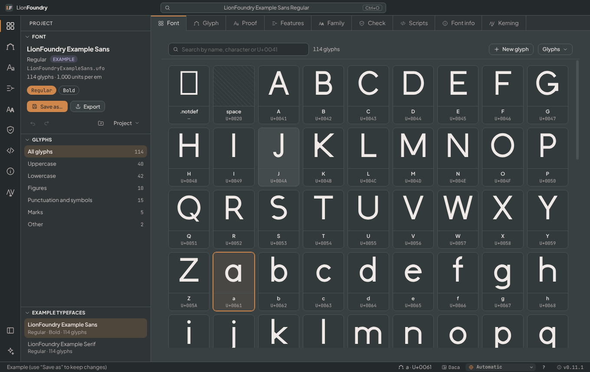
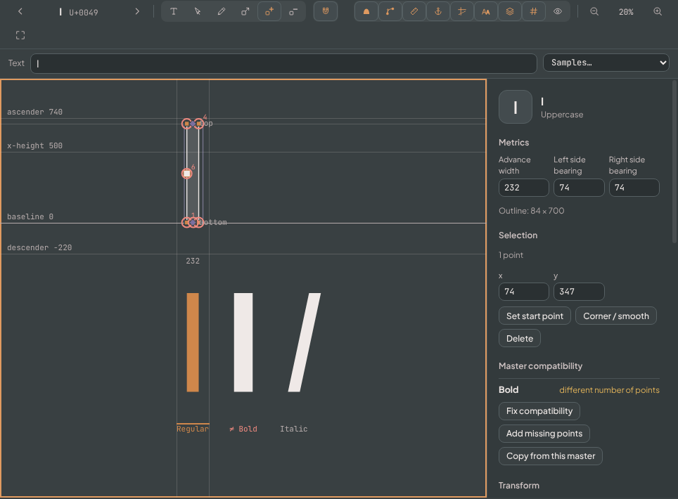
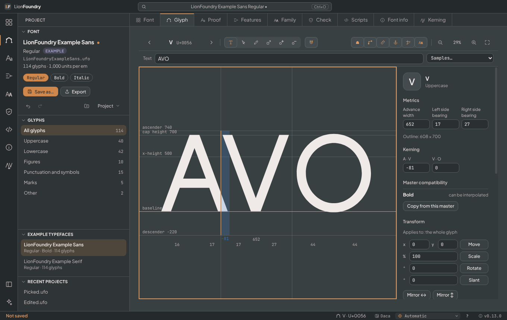
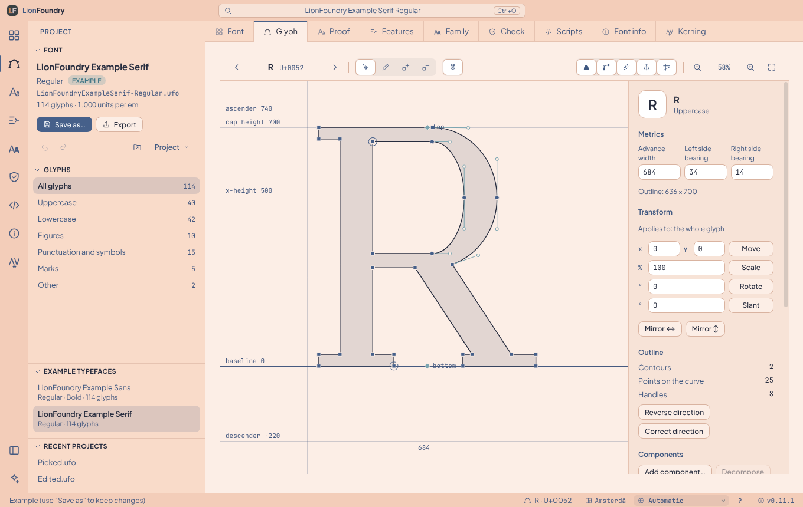
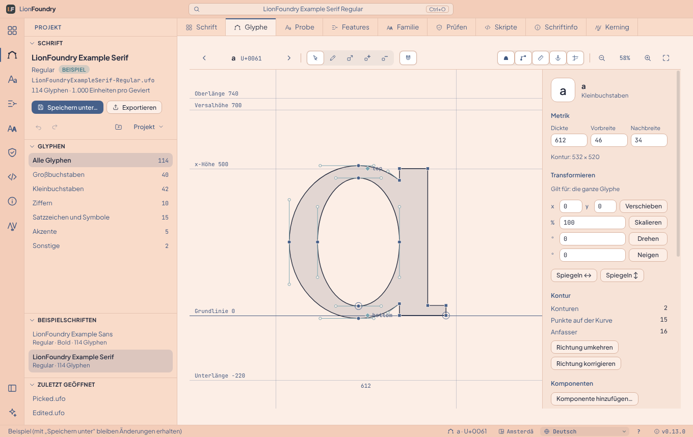

<div align="center">


# LionFoundry

### Zeichne eine ganze Schriftfamilie. Exportiere alle Schriften mit einem Klick.

Ein freier, quelloffener Schrifteditor mit aufgeräumter Oberfläche, gemacht für Menschen — und bereit für KI-Agenten.

[English](README.md) · [Português (Brasil)](README.pt-BR.md) · [Português (Portugal)](README.pt-PT.md) · [Español](README.es.md) · [Français](README.fr.md) · **Deutsch** · [Italiano](README.it.md)

<sub>vom <b>LionFoundry Team</b> · erdacht und entwickelt von <b>Daniel Michelon De Carli</b></sub>


</div>

> Diese Übersetzung wurde noch nicht von Muttersprachlern geprüft. Maßgeblich ist der [englische Text](README.md); Korrekturen sind willkommen.

<a id="download"></a>

## Download

Lade das Installationsprogramm für dein System herunter. Die Links führen immer zur **neuesten Version**; jedes Installationsprogramm enthält die ganze App, während der Installation wird also nichts nachgeladen.

- **Windows 10/11** (x64): ein Installationsassistent, bei dem du den Ordner wählen kannst. → [`LionFoundry-Setup.exe`](https://github.com/danielcarli/lionfoundry/releases/latest/download/LionFoundry-Setup.exe) · oder die portable Version ohne Installation: [`LionFoundry-win-x64.zip`](https://github.com/danielcarli/lionfoundry/releases/latest/download/LionFoundry-win-x64.zip)
- **macOS** (Apple Silicon, Intel): öffne die `.dmg` und ziehe LionFoundry in den Ordner „Programme“. → [`LionFoundry-mac-universal.dmg`](https://github.com/danielcarli/lionfoundry/releases/latest/download/LionFoundry-mac-universal.dmg)
- **Linux** (x64): `.deb` für Ubuntu, Debian, Mint…, `.rpm` für Fedora, RHEL, openSUSE… oder das AppImage für jede Distribution, ohne Installation. → [`.deb`](https://github.com/danielcarli/lionfoundry/releases/latest/download/lionfoundry_amd64.deb) · [`.rpm`](https://github.com/danielcarli/lionfoundry/releases/latest/download/lionfoundry.x86_64.rpm) · [AppImage](https://github.com/danielcarli/lionfoundry/releases/latest/download/LionFoundry-x86_64.AppImage)

> Die Installationsprogramme sind noch nicht mit einem kostenpflichtigen Zertifikat signiert. Beim ersten Start zeigt Windows eventuell „Der Computer wurde durch Windows geschützt“ (**Weitere Informationen › Trotzdem ausführen**), und macOS verlangt, die App unter **Systemeinstellungen › Datenschutz & Sicherheit › Dennoch öffnen** zuzulassen. Die Prüfsummen aller Dateien stehen in [`SHA256SUMS.txt`](https://github.com/danielcarli/lionfoundry/releases/latest/download/SHA256SUMS.txt)

Die Installationsprogramme werden von GitHub Actions für jedes Versions-Tag gebaut (`.github/workflows/release.yml`), auf Windows-, macOS- und Linux-Maschinen, aus dem Code dieses Repositorys. Sie sind neu: Die Linux-Pakete wurden vor der Veröffentlichung ausprobiert, und das Windows-Installationsprogramm wurde bereits auf einem echten Rechner installiert und geöffnet; das für macOS wurde noch nicht ausprobiert — falls eines nicht startet, [sag uns bitte Bescheid](https://github.com/danielcarli/lionfoundry/issues). Du kannst die App jederzeit [aus dem Quellcode starten](#get-started).

## Vom ersten Buchstaben bis zu den fertigen Schriften

LionFoundry begleitet dich durch die ganze Arbeit in einem Fenster: Buchstaben **zeichnen**, **zurichten und unterschneiden**, **OpenType-Features** hinzufügen, die **Familie** aufbauen — Regular, Bold, Italic und alles dazwischen — und Schriften **exportieren**, die in jedem Programm und im Web funktionieren.

- **Frei und offen.** Kein Konto, kein Abo, kein Netzwerk. Die Schriften, die du machst, gehören dir, unter der Lizenz deiner Wahl.
- **Gut lesbar.** Ein aufgeräumtes Fenster, vier Themes, alle Tastaturkürzel auf einem Bildschirm.
- **Vertraut.** Die Begriffe und Tasten der Schrifteditoren, die du schon kennst: Master, Instanzen, Hilfslinien, `V`, `P`, `+`, `−`.

> **LionFoundry ist ein experimentelles Projekt.** Es deckt jeden Schritt der Schriftgestaltung in einer ersten, einfachen Form ab — unter [Wo das Projekt steht](#where-it-stands) siehst du, was noch fehlt. Es wurde vor allem unter Linux benutzt; unter Windows gab es nur einen ersten Versuch, unter macOS ist es ungetestet. Bewahre Kopien deiner Schriften auf.

## Was es anders macht

| | |
|---|---|
| **Eine ganze Familie in einem Projekt** | Regular, Bold, Italic und die Schnitte dazwischen liegen im selben Projekt. Zeichne zwei Strichstärken, und LionFoundry berechnet Medium und SemiBold für dich. |
| **Ein Export für alles** | Ein Dialog, ein Klick: jede Schrift der Familie, für Desktop und Web, in einem neuen Ordner — mit einem Stylesheet, das du direkt in eine Website einfügen kannst. |
| **Es sagt dir, was nicht stimmt, und hilft beim Beheben** | Ein Leitfaden zeigt, was erledigt ist und was fehlt. Eine Problemliste führt dich zu jeder Glyphe. Zwei Master, die nicht zusammenpassen, werden mit einer Schaltfläche korrigiert. |
| **Deine Originale sind sicher** | Nichts wird geschrieben, bevor du speicherst. Das erste Speichern bewahrt eine Kopie des Projekts im vorherigen Zustand auf. „Speichern unter“ und Exportieren überschreiben nie etwas. Alles lässt sich rückgängig machen. |
| **Offene Formate** | Projekte sind UFOs: ein Ordner mit kleinen Textdateien, den auch andere Schrifteditoren öffnen. Kein Lock-in. |
| **Von Anfang an für KI-Agenten gemacht** | Ein Agent kann deine Schriften über einen lokalen Server lesen, prüfen, testen und bauen — auf deinem Rechner, unter deiner Kontrolle. LionFoundry selbst spricht nie mit einem KI-Anbieter. |

## So sieht es aus

<sub>Die Bilder zeigen die englische Oberfläche; das Programm gibt es in sieben Sprachen, darunter Deutsch.</sub>

### Zeichnen

Auswählen, Zeichenstift, Skalieren, Punkt hinzufügen, Punkt entfernen, Messer, Rechteck und Ellipse. **Überlappung entfernen**, Vereinigen, Subtrahieren und Schnittmenge arbeiten direkt auf den Kurven, Kurven bleiben also Kurven; **Extrempunkte hinzufügen** und **Konturen bereinigen** setzen die Punkte dorthin, wo Schriftgestalter sie haben wollen. Drehen, ein **Lineal**, das die Stärke jedes durchquerten Strichs zeigt, ein Lasso und ein **Hintergrund** für jede Glyphe und jeden Master, zum Vergleichen oder Nachzeichnen. Wähle mehrere Punkte aus, und ein Rahmen erscheint um sie: Ziehe an einer Ecke, um die Form zu vergrößern oder zu verkleinern, mit Umschalt für feste Proportionen und Alt für das Skalieren von der Mitte aus — die Gesten von Illustrator. Anfasser, die horizontal, vertikal oder auf 45° bleiben, wenn du es willst. **Hilfslinien** pro Glyphe und **Einrasten**, damit deine Punkte auf der Linie bleiben. Gib Dickte, Vor- und Nachbreite ein; verschiebe, skaliere, drehe, neige und spiegle. Komponenten und Anker bauen die Akzentbuchstaben für dich.

<div align="center">

</div>

### Alle Glyphen sehen

Die ganze Schrift auf einem Bildschirm. Suchen, nach Art filtern, anlegen, duplizieren, umbenennen. **Glyphen einer Sprache hinzufügen** gibt der Schrift alle Buchstaben, die Portugiesisch, Spanisch oder Westeuropa brauchen: Die Akzentbuchstaben werden aus dem Buchstaben und dem Akzent gebaut, die du schon gezeichnet hast.

<div align="center">

</div>

### Die Familie aufbauen

**Master** sind die Schnitte, die du zeichnest. **Instanzen** sind die Schnitte, die LionFoundry dazwischen berechnet. Füge aus jedem Master eine Kursive hinzu und zeichne sie um. Sieh die ganze Familie im selben Text gesetzt, nebeneinander.

<div align="center">

</div>

Während du die Bold zeichnest, liegt die Regular direkt dahinter. Das Bedienfeld sagt, ob sich die beiden interpolieren lassen — und **Kompatibilität herstellen** bringt Konturen und Startpunkte in Übereinstimmung, ohne die Form zu ändern.

<div align="center">

</div>

Schalte **Alle Master** ein, um den Buchstaben in jedem Master unter der Zeile zu sehen, an der du zeichnest; ein Doppelklick auf einen wechselt zu ihm. **Kompatibilität** nummeriert die Punkte und verbindet jeden mit demselben Punkt im anderen Master — ein roter Ring markiert, was kein Gegenstück hat, und **Fehlende Punkte hinzufügen** ergänzt es, ohne die Form zu ändern. **Vorschau** zeigt die Zeile in jeder Stärke zwischen den Mastern. Halte `Alt` bei Punkt hinzufügen, Punkt entfernen, Umkehren oder Richtung korrigieren, um alle Master auf einmal zu ändern.

<div align="center">

</div>

### Zurichten und unterschneiden, wo du liest

Die Ansicht Glyphe ist eine Textzeile, wie in anderen Schrifteditoren: Tippe ein Wort, bearbeite jeden seiner Buchstaben zwischen den anderen und ändere Vor- und Nachbreite und Kerning des Buchstabens nach dem Cursor über die Tastatur (`Alt`, `Strg` und `Strg+Alt` mit den Pfeiltasten). In der Probe klickst du auf einen Buchstaben und stellst seine Zurichtung und sein Kerning gleich dort ein, im Text. Die Ansicht **Kerning** hält Gruppen und Paare in Ordnung: Ein Paar für eine Gruppe gilt für jeden Buchstaben darin.

<div align="center">

</div>

| | |
|---|---|
|  |  |

### OpenType-Features, so tief du willst

**Automatisch:** Nenne eine Glyphe `f_i`, und sie ist eine Ligatur; `a.sc` ist ein Kapitälchen; Kerning und Akzente funktionieren einfach. **Regeln:** „ersetze dies durch das“, Zeile für Zeile. **Code:** Schreibe die Feature-Datei selbst. Die Probe zeigt jeden Schritt, damit du siehst, warum sich ein Buchstabe geändert hat.

<div align="center">

</div>

### Wissen, wann sie fertig ist

Ein Leitfaden dessen, was erledigt ist. Wie viel von jeder Sprache die Schrift schon schreibt. Jedes Problem, mit einem Link zur Glyphe.

<div align="center">

</div>

### Einmal exportieren

Wähle den Master in Bearbeitung oder die ganze Familie, kreuze die Formate an, fertig. TrueType für den Desktop, WOFF2 für das Web und ein Stylesheet mit den `@font-face`-Regeln. Die Namen werden so geschrieben, dass die Fett- und Kursiv-Schaltflächen jedes Programms die richtige Schrift finden.

| | |
|---|---|
|  |  |

<sub>Rechts: sieben Schriften, die LionFoundry aus zwei gezeichneten Strichstärken und ihren Kursiven exportiert hat, außerhalb der App dargestellt.</sub>

### Mach es zu deinem

Vier Themes, sieben Sprachen — English, Português (Brasil und Portugal), Español, Français, Deutsch und Italiano — und alle Tastaturkürzel auf einem Bildschirm (drücke `?`).

| | | |
|---|---|---|
|  |  |  |
|  |  |  |

## Mit KI arbeiten

LionFoundry wurde so entworfen, dass ein KI-Agent **mit dir** an deinen Schriften arbeiten kann, nicht an deiner Stelle. In der App steckt keine KI, und nichts wird irgendwohin gesendet: Der Agent deiner Wahl verbindet sich auf deinem eigenen Rechner mit LionFoundry.

**Was ein Agent heute tun kann**

- **Prüfen** — die Schrift kontrollieren, die Glyphen mit Problemen lesen und erklären, was zu beheben ist.
- **Testen** — Wörter setzen und Schritt für Schritt sehen, welche Features und Kerningwerte greifen.
- **In Serie ändern** — ein Skript schreiben („füge der Vor- und Nachbreite jedes Kleinbuchstabens 10 Einheiten hinzu“) und das Ergebnis als neues Projekt speichern, das du dir ansehen kannst.
- **Bauen** — nach jeder Überarbeitung die ganze Familie exportieren.

**So verbindest du ihn**

*1. Der lokale Server (Model Context Protocol).* Starte ihn auf dem Ordner, in dem deine Schriften liegen. In den meisten Agenten-Apps sieht die Einrichtung so aus:

```json
{
  "mcpServers": {
    "lionfoundry": {
      "command": "node",
      "args": ["/path/to/lionfoundry/tools/mcp-server.js", "/path/to/your/fonts"]
    }
  }
}
```

Der Agent erhält neun Werkzeuge: `describe_font`, `list_glyphs`, `get_glyph`, `validate_font`, `list_features`, `shape_text`, `export_font`, `export_family` und `run_script`. Der Server hat keinen Netzwerkport und kein Konto und sieht nur den Ordner, mit dem er gestartet wurde.

*2. Die Kommandozeile.* Dieselbe Engine für Agenten, die im Terminal arbeiten. Jeder Befehl antwortet in JSON:

```sh
node tools/cli.js info      MyFont.ufo                      # names, metrics, masters, counts
node tools/cli.js glyphs    MyFont.ufo acute                # one line of data per glyph (filtered by name)
node tools/cli.js glyph     MyFont.ufo a                    # the full outline of one glyph
node tools/cli.js validate  MyFont.ufo                      # problems; exit code 1 when there are errors
node tools/cli.js features  MyFont.ufo                      # features of the font and their code
node tools/cli.js shape     MyFont.ufo "AVATAR" --off kern  # glyphs, positions and steps for a text
node tools/cli.js export    MyFont.ufo MyFont.woff2         # compile one font (.ttf or .woff2)
node tools/cli.js export-family MyFont.ufo fonts/           # every font of the family into a new folder
node tools/cli.js convert   Other.ttf  Other.ufo            # a TrueType font as a new project
node tools/cli.js run       MyFont.ufo fix.py --out Fixed.ufo   # run a script, save the result as a new project
```

Hänge `--weight Bold` an einen beliebigen Befehl, um an einem Master zu arbeiten.

*3. Skripte.* Bitte einen Agenten um ein Skript und führe es in der Ansicht Skripte aus. Dieselben Namen in Python und JavaScript, wo möglich nach [fontParts](https://fontparts.robotools.dev):

```python
for glyph in font:
    if glyph.leftMargin is not None:
        glyph.leftMargin += 10
font.kerning[("A", "V")] = -80
```

In der App kommt alles, was ein Skript tut, als **ein einziger Schritt zurück, den du rückgängig machen kannst**.

*4. Das Projekt selbst.* Ein UFO-Projekt ist ein Ordner mit kleinen Textdateien. Ein Agent kann es ganz ohne Werkzeug lesen und zwei Versionen vergleichen.

**Du behältst die Kontrolle**

- Über den Server und die Kommandozeile wird ein vorhandenes Projekt oder eine vorhandene Datei **nie verändert oder ersetzt**: Ergebnisse gehen immer an einen Pfad, den es noch nicht gibt.
- LionFoundry nutzt das Netzwerk nicht. Die einzige Ausnahme ist die Versionsprüfung, und nur, wenn du sie anklickst.
- Skripte sind Code: Sie laufen nicht in einer Sicherheits-Sandbox, führe also nur Skripte aus, die du gelesen hast oder denen du vertraust.

**Was noch nicht geht:** Der Agent kann nicht an dem Projekt arbeiten, das in der App geöffnet ist (er schreibt ein neues, und du öffnest es), es gibt keine Vorschläge mit Vorschau in der Oberfläche, und ein Agent liest die Zahlen einer Kontur — er sieht die Zeichnung nicht.

<a id="where-it-stands"></a>

## Wo das Projekt steht

LionFoundry ist jung. Das ist die ehrliche Liste.

| Das kann es | Das kann es noch nicht |
|---|---|
| Öffnet UFO 2 und 3, speichert UFO 3, importiert TrueType | OpenType CFF (`.otf`), FontForge SFD, Dateien der Industriestandard-Software |
| Exportiert TrueType und WOFF2, mit eigenem Code kompiliert | **Hinting** (die Schriften sind im Druck, im Web und auf hochauflösenden Bildschirmen in Ordnung; in kleinen Größen auf älteren Windows-Bildschirmen weich) |
| Master, Kursive und Instanzen auf der Gewichtsachse | **Variable Fonts** (für andere Werkzeuge wird eine `.designspace` exportiert), eine Breitenachse |
| Stellt Kompatibilität her (Konturen, Startpunkte) und ergänzt die Punkte, die einem Master fehlen | Master mit unterschiedlich vielen Konturen kompatibel machen |
| Entfernt Überlappungen, vereinigt, subtrahiert, bildet Schnittmengen und schneidet mit dem Messer, direkt auf den Kurven | Ecken- und Smart-Komponenten, Filter (versetzte Kontur, abgerundete Ecken) |
| Kerninggruppen und -paare, Zurichtung in der Probe | Ein Metrikfenster mit vielen Glyphen, automatische Zurichtung und automatisches Kerning |
| Ersetzungen, Ligaturen, Kerning und Akzentplatzierung | Kontextuelle Lookups; linksläufige und komplexe Schriftsysteme |
| Flächige Farbglyphen (COLR/CPAL) | Verläufe, SVG- und Bitmap-Farbe |
| Rückgängig für alles, eine Sicherungskopie beim ersten Speichern | Automatisches Speichern und Wiederherstellung nach einem Absturz |
| Installationsprogramme für Windows, macOS und Linux, für jede Version gebaut | Tests unter Windows und macOS; signierte Installationsprogramme; große Schriften (CJK) |

<a id="get-started"></a>

## Loslegen

Am schnellsten geht es mit einem Installationsprogramm aus dem Abschnitt [Download](#download). Um aus dem Quellcode zu starten, brauchst du [Node.js](https://nodejs.org) (LTS). In beiden Fällen wird Python 3 nur für Skripte gebraucht, die in Python geschrieben sind.

```sh
git clone https://github.com/danielcarli/lionfoundry.git
cd lionfoundry
npm install
npm start
```

Unter Windows kannst du auch auf `start.bat` doppelklicken.

**Neu in der Schriftgestaltung?** Folge dem Tutorial: [Von null zur ersten Schrift](docs/tutorial.de.md) — zwei Strichstärken und eine Kursive, Schritt für Schritt, jedes Werkzeug erklärt.

Zwei Beispielschriften lassen sich aus der Seitenleiste öffnen, damit es etwas Echtes zu erkunden gibt:

- **LionFoundry Example Sans** — zwei Master, Regular und Bold, und zwei Instanzen dazwischen, Medium und SemiBold;
- **LionFoundry Example Serif** — Kontrast zwischen dicken und dünnen Strichen, Haarserifen.

Jede hat 114 Glyphen mit den Akzentbuchstaben des Portugiesischen und Spanischen sowie Kerninggruppen und -paare. Sie sind eigenständig, bewusst einfach gehalten, von `tools/examples/build.py` erzeugt und unter der SIL Open Font License 1.1 veröffentlicht (`examples/OFL.txt`).

## Für Entwickler

Code, Kommentare und technische Dokumentation sind auf Englisch: Architektur, Befehle (`npm test`, `npm run test:e2e`, `npm run dist`…) und Sicherheitshinweise stehen im Abschnitt [For developers](README.md#for-developers) des englischen README. Die Übersetzungen der Oberfläche liegen in `src/nls/` — eine JSON-Datei pro Sprache —, und `npm run test:i18n` prüft, dass keine Meldung fehlt.

## Änderungsprotokoll

Siehe [CHANGELOG.md](CHANGELOG.md) (auf Englisch) — aktuelle Version: **0.17.0**.

## Mitwirkende

LionFoundry wurde von **Daniel Michelon De Carli**, Student der Architektur und Stadtplanung, **erdacht und entwickelt** und wird vom **LionFoundry Team** zusammen mit seinen Mitwirkenden und Übersetzern gepflegt.

Material Dritter ist in [THIRD-PARTY-NOTICES.md](THIRD-PARTY-NOTICES.md) aufgeführt.

## Lizenz

Copyright © 2026 LionFoundry Team.

LionFoundry ist freie Software: Du kannst sie unter den Bedingungen der **[GNU General Public License v3.0](LICENSE)**, wie von der Free Software Foundation veröffentlicht, weitergeben und/oder verändern, entweder gemäß Version 3 der Lizenz oder (nach deiner Wahl) jeder späteren Version. Sie wird in der Hoffnung verbreitet, dass sie nützlich ist, aber **ohne jede Gewährleistung**; Einzelheiten stehen in der Lizenz.

Kurz gesagt: Du darfst LionFoundry frei benutzen, studieren, weitergeben und verändern; wenn du eine veränderte Version verbreitest, muss auch sie unter der GPL mit ihrem Quellcode veröffentlicht werden.

**Die Lizenz des Programms erstreckt sich nicht auf die Schriften, die du damit machst.** In LionFoundry erstellte oder bearbeitete Schriften sind dein eigenes Werk, und du wählst ihre Lizenz.
