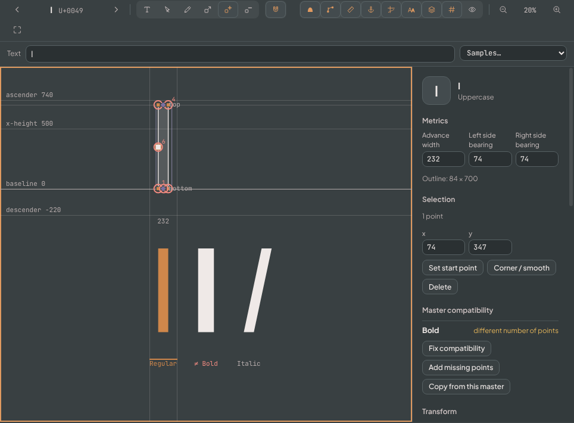
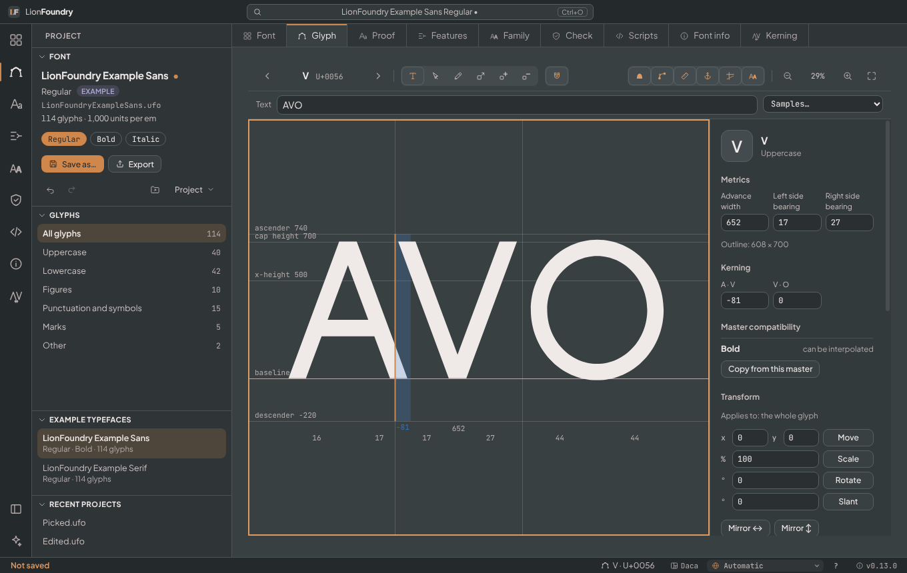
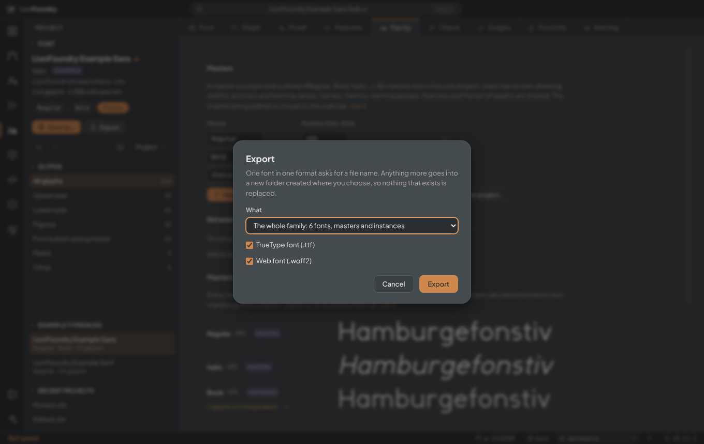
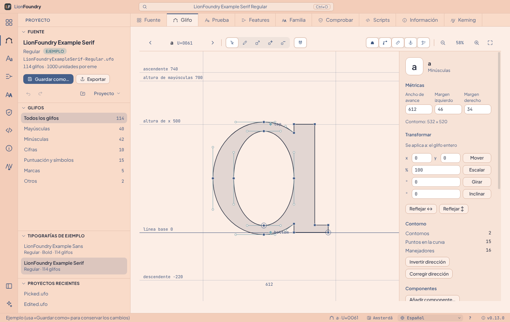
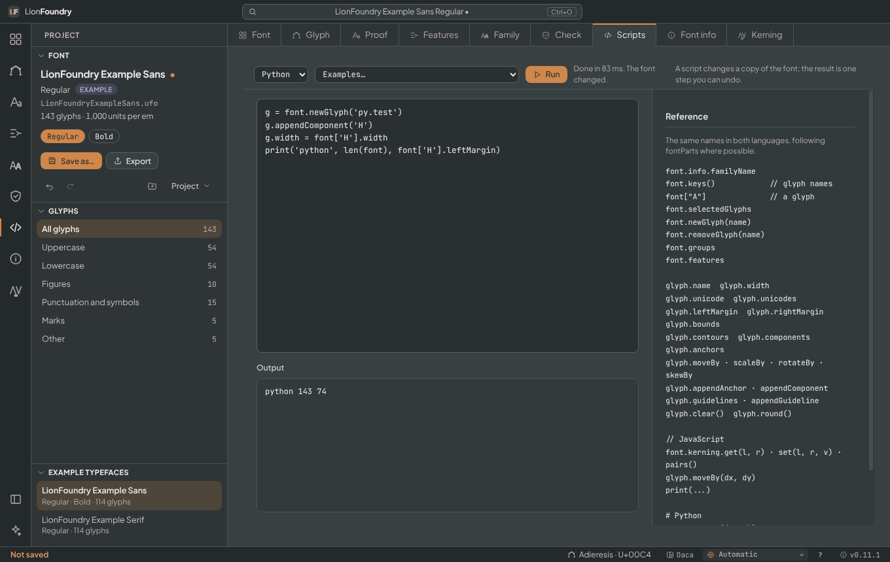

<div align="center">


# LionFoundry

### Dibuja una familia tipográfica entera. Exporta todas las fuentes con un clic.

Un editor de fuentes libre y de código abierto, con una interfaz limpia, hecho para personas — y preparado para agentes de IA.

[English](README.md) · [Português (Brasil)](README.pt-BR.md) · [Português (Portugal)](README.pt-PT.md) · **Español** · [Français](README.fr.md) · [Deutsch](README.de.md) · [Italiano](README.it.md)

<sub>por el <b>LionFoundry Team</b> · creado e ideado por <b>Daniel Michelon De Carli</b></sub>


</div>

> Esta traducción aún no ha sido revisada por una persona nativa. El texto de referencia es el [inglés](README.md); las correcciones son bienvenidas.

<a id="download"></a>

## Descargar

Descarga el instalador para tu sistema. Los enlaces llevan siempre a la **última versión**; cada instalador contiene la aplicación completa, así que no se descarga nada más durante la instalación.

- **Windows 10/11** (x64): un asistente de instalación que te deja elegir la carpeta. → [`LionFoundry-Setup.exe`](https://github.com/danielcarli/lionfoundry/releases/latest/download/LionFoundry-Setup.exe) · o la versión portátil, sin instalación: [`LionFoundry-win-x64.zip`](https://github.com/danielcarli/lionfoundry/releases/latest/download/LionFoundry-win-x64.zip)
- **macOS** (Apple Silicon, Intel): abre el `.dmg` y arrastra LionFoundry a Aplicaciones. → [`LionFoundry-mac-universal.dmg`](https://github.com/danielcarli/lionfoundry/releases/latest/download/LionFoundry-mac-universal.dmg)
- **Linux** (x64): `.deb` para Ubuntu, Debian, Mint…, `.rpm` para Fedora, RHEL, openSUSE…, o la AppImage para cualquier distribución, sin instalación. → [`.deb`](https://github.com/danielcarli/lionfoundry/releases/latest/download/lionfoundry_amd64.deb) · [`.rpm`](https://github.com/danielcarli/lionfoundry/releases/latest/download/lionfoundry.x86_64.rpm) · [AppImage](https://github.com/danielcarli/lionfoundry/releases/latest/download/LionFoundry-x86_64.AppImage)

> Los instaladores aún no están firmados con un certificado de pago. En el primer arranque, Windows puede mostrar «Windows protegió su PC» (**Más información › Ejecutar de todas formas**) y macOS pide permitir la aplicación en **Ajustes del Sistema › Privacidad y seguridad › Abrir igualmente**. Las sumas de verificación de todos los archivos están en [`SHA256SUMS.txt`](https://github.com/danielcarli/lionfoundry/releases/latest/download/SHA256SUMS.txt)

Los instaladores los genera GitHub Actions para cada etiqueta de versión (`.github/workflows/release.yml`), en máquinas Windows, macOS y Linux, a partir del código de este repositorio. Son nuevos: los paquetes de Linux se probaron antes de publicarlos y el instalador de Windows ya se ha instalado y abierto en un ordenador real; el de macOS aún no se ha probado — si alguno no abre, por favor [avísanos](https://github.com/danielcarli/lionfoundry/issues). Siempre puedes [ejecutarlo desde el código](#get-started).

## De la primera letra a las fuentes terminadas

LionFoundry te acompaña en todo el trabajo dentro de una sola ventana: **dibuja** las letras, **espácialas y ajusta el kerning**, añade **features OpenType**, construye la **familia** — Regular, Bold, Italic y todo lo que hay en medio — y **exporta** fuentes que funcionan en cualquier programa y en la web.

- **Libre y abierto.** Sin cuenta, sin suscripción, sin red. Las fuentes que haces son tuyas, con la licencia que elijas.
- **Fácil de leer.** Una ventana limpia, cuatro temas, todos los atajos en una pantalla.
- **Familiar.** Las palabras y las teclas de los editores de fuentes que ya conoces: masters, instancias, guías, `V`, `P`, `+`, `−`.

> **LionFoundry es un proyecto experimental.** Cubre todos los pasos para hacer una tipografía en una primera forma, básica — consulta [En qué punto está](#where-it-stands) para ver lo que falta. Se ha usado sobre todo en Linux; en Windows solo ha tenido una primera prueba y en macOS no se ha probado. Guarda copias de tus fuentes.

## Qué lo hace diferente

| | |
|---|---|
| **Una familia entera en un proyecto** | Regular, Bold, Italic y los estilos intermedios viven en el mismo proyecto. Dibuja dos pesos y LionFoundry calcula Medium y SemiBold por ti. |
| **Un solo Exportar para todo** | Un diálogo, un clic: todas las fuentes de la familia, para escritorio y para la web, en una carpeta nueva — con la hoja de estilos lista para pegar en un sitio. |
| **Te dice qué está mal y te ayuda a arreglarlo** | Una guía muestra lo que está hecho y lo que falta. Una lista de problemas te lleva a cada glifo. Dos masters que no coinciden se arreglan con un botón. |
| **Tus originales están a salvo** | No se escribe nada hasta que guardas. El primer guardado conserva una copia del proyecto tal como estaba. «Guardar como» y Exportar nunca sobrescriben nada. Todo se puede deshacer. |
| **Formatos abiertos** | Los proyectos son UFO: una carpeta de pequeños archivos de texto que otros editores de fuentes también abren. Sin ataduras. |
| **Hecho para agentes de IA desde el principio** | Un agente puede leer, comprobar, probar y compilar tus fuentes a través de un servidor local — en tu ordenador, contigo al mando. LionFoundry nunca habla con un proveedor de IA. |

## Míralo

<sub>Las imágenes muestran la interfaz en inglés; el programa está en siete idiomas, entre ellos el español.</sub>

### Dibujar

Seleccionar, pluma, escala, añadir punto, quitar punto, cuchillo, rectángulo y elipse. **Quitar superposición**, unir, restar e intersección trabajan sobre las propias curvas, así que las curvas siguen siendo curvas; **Añadir extremos** y **Ordenar contornos** dejan los puntos donde los quieren los tipógrafos. Girar, una **regla** que muestra el grosor de cada trazo que atraviesa, un lazo y un **fondo** para cada glifo y master, para comparar o calcar. Selecciona varios puntos y aparece un recuadro a su alrededor: arrastra una esquina para agrandar o reducir la forma, con Mayús para mantener las proporciones y Alt para escalar desde el centro — los gestos de Illustrator. Manejadores que se quedan en horizontal, en vertical o a 45° cuando tú quieres. **Guías** por glifo y **Ajustar** para mantener los puntos en la línea. Escribe el ancho y los márgenes laterales; mueve, escala, gira, inclina y refleja. Los componentes y las anclas construyen las letras acentuadas por ti.

<div align="center">

</div>

### Ver todos los glifos

Toda la fuente en una pantalla. Busca, filtra por tipo, crea, duplica, renombra. **Añadir glifos de un idioma** da a la fuente todas las letras que necesitan el portugués, el español o Europa occidental: las acentuadas se construyen con la letra y el acento que ya dibujaste.

<div align="center">

</div>

### Construir la familia

Los **masters** son los estilos que dibujas. Las **instancias** son los estilos que LionFoundry calcula entre ellos. Añade una cursiva a partir de cualquier master y redibújala. Mira toda la familia compuesta con el mismo texto, lado a lado.

<div align="center">

</div>

Mientras dibujas la Bold, la Regular está justo detrás. El panel dice si las dos se pueden interpolar — y **Corregir compatibilidad** pone de acuerdo los contornos y los puntos iniciales sin cambiar la forma.

<div align="center">

</div>

Activa **Todos los masters** para ver la letra en cada master bajo la línea que dibujas; un doble clic en uno te lleva a él. **Compatibilidad** numera los puntos y une cada uno con el mismo punto del otro master — un anillo rojo marca lo que no tiene pareja, y **Añadir los puntos que faltan** lo añade sin cambiar la forma. **Vista previa** muestra la línea en cualquier peso entre los masters. Mantén `Alt` con Añadir punto, Quitar punto, Invertir o Corregir dirección para cambiar todos los masters a la vez.

<div align="center">

</div>

### Espaciar y ajustar el kerning donde lees

La vista Glifo es una línea de texto, como en otros editores de fuentes: escribe una palabra, edita cualquiera de sus letras entre las demás y cambia desde el teclado los márgenes laterales y el kerning de la letra después del cursor (`Alt`, `Ctrl` y `Ctrl+Alt` con las flechas). En la prueba, haz clic en una letra y ajusta su espaciado y su kerning ahí mismo, en el texto. La vista **Kerning** mantiene ordenados los grupos y los pares: un par hecho para un grupo sirve para todas sus letras.

<div align="center">

</div>

| | |
|---|---|
|  |  |

### Features OpenType, tan a fondo como quieras

**Automático:** llama a un glifo `f_i` y es una ligadura; `a.sc` es una versalita; el kerning y los acentos simplemente funcionan. **Reglas:** «sustituir esto por aquello», una línea cada vez. **Código:** escribe tú mismo el archivo de features. La prueba muestra cada paso, para que veas por qué cambió una letra.

<div align="center">

</div>

### Saber cuándo está lista

Una guía de lo que está hecho. Cuánto de cada idioma escribe ya la fuente. Cada problema, con un enlace al glifo.

<div align="center">

</div>

### Exportar una sola vez

Elige el master que estás editando o la familia entera, marca los formatos, y listo. TrueType para escritorio, WOFF2 para la web y una hoja de estilos con las reglas `@font-face`. Los nombres se escriben de modo que los botones de negrita y cursiva de cualquier programa encuentren la fuente correcta.

| | |
|---|---|
|  |  |

<sub>A la derecha: siete fuentes exportadas por LionFoundry a partir de dos pesos dibujados y sus cursivas, renderizadas fuera de la aplicación.</sub>

### Hazlo tuyo

Cuatro temas, siete idiomas — English, Português (Brasil y Portugal), Español, Français, Deutsch y Italiano — y todos los atajos en una pantalla (pulsa `?`).

| | | |
|---|---|---|
|  |  |  |
|  |  |  |

## Trabajar con IA

LionFoundry se diseñó para que un agente de IA pueda trabajar en tus fuentes **contigo**, no en tu lugar. No hay IA dentro de la aplicación y no se envía nada a ninguna parte: el agente que elijas se conecta a LionFoundry en tu propio ordenador.

**Lo que un agente puede hacer hoy**

- **Revisar** — comprobar la fuente, leer los glifos con problemas y explicar qué hay que arreglar.
- **Probar** — componer palabras y ver qué features y qué valores de kerning se aplican, paso a paso.
- **Cambiar en bloque** — escribir un script («añade 10 unidades a los márgenes laterales de todas las minúsculas») y guardar el resultado como un proyecto nuevo para que lo mires.
- **Compilar** — exportar la familia entera después de cada revisión.

**Cómo conectarlo**

*1. El servidor local (Model Context Protocol).* Arráncalo sobre la carpeta donde están tus fuentes. En la mayoría de las aplicaciones de agentes la configuración es así:

```json
{
  "mcpServers": {
    "lionfoundry": {
      "command": "node",
      "args": ["/path/to/lionfoundry/tools/mcp-server.js", "/path/to/your/fonts"]
    }
  }
}
```

El agente recibe nueve herramientas: `describe_font`, `list_glyphs`, `get_glyph`, `validate_font`, `list_features`, `shape_text`, `export_font`, `export_family` y `run_script`. El servidor no tiene puerto de red ni cuenta, y solo ve la carpeta con la que se arrancó.

*2. La línea de comandos.* El mismo motor para agentes que trabajan en una terminal. Todos los comandos responden en JSON:

```sh
node tools/cli.js info      MyFont.ufo                      # names, metrics, masters, counts
node tools/cli.js glyphs    MyFont.ufo acute                # one line of data per glyph (filtered by name)
node tools/cli.js glyph     MyFont.ufo a                    # the full outline of one glyph
node tools/cli.js validate  MyFont.ufo                      # problems; exit code 1 when there are errors
node tools/cli.js features  MyFont.ufo                      # features of the font and their code
node tools/cli.js shape     MyFont.ufo "AVATAR" --off kern  # glyphs, positions and steps for a text
node tools/cli.js export    MyFont.ufo MyFont.woff2         # compile one font (.ttf or .woff2)
node tools/cli.js export-family MyFont.ufo fonts/           # every font of the family into a new folder
node tools/cli.js convert   Other.ttf  Other.ufo            # a TrueType font as a new project
node tools/cli.js run       MyFont.ufo fix.py --out Fixed.ufo   # run a script, save the result as a new project
```

Añade `--weight Bold` a cualquier comando para trabajar sobre un master.

*3. Scripts.* Pide un script a un agente y ejecútalo en la vista Scripts. Los mismos nombres en Python y en JavaScript, siguiendo [fontParts](https://fontparts.robotools.dev) donde es posible:

```python
for glyph in font:
    if glyph.leftMargin is not None:
        glyph.leftMargin += 10
font.kerning[("A", "V")] = -80
```

Dentro de la aplicación, todo lo que hace un script vuelve como **un solo paso que puedes deshacer**.

*4. El propio proyecto.* Un proyecto UFO es una carpeta de pequeños archivos de texto. Un agente puede leerlo y comparar dos versiones sin ninguna herramienta.

**Tú sigues al mando**

- A través del servidor y de la línea de comandos, un proyecto o un archivo existente **nunca se modifica ni se sustituye**: los resultados van siempre a una ruta que aún no existe.
- LionFoundry no usa la red. La única excepción es la comprobación de versión, y solo cuando tú la pulsas.
- Los scripts son código: no se ejecutan en un entorno aislado de seguridad, así que ejecuta solo scripts que hayas leído o en los que confíes.

**Lo que todavía no hace:** el agente no puede trabajar sobre el proyecto abierto en la aplicación (escribe uno nuevo, y tú lo abres), no hay sugerencias con vista previa dentro de la interfaz, y un agente lee los números de un contorno — no ve el dibujo.

<a id="where-it-stands"></a>

## En qué punto está

LionFoundry es joven. Esta es la lista sincera.

| Lo que hace | Lo que aún no hace |
|---|---|
| Abre UFO 2 y 3, guarda UFO 3, importa TrueType | OpenType CFF (`.otf`), FontForge SFD, archivos del software estándar de la industria |
| Exporta TrueType y WOFF2, compilados con su propio código | **Hinting** (las fuentes se ven bien impresas, en la web y en pantallas de alta densidad; algo blandas en tamaños pequeños en pantallas antiguas de Windows) |
| Masters, cursivas e instancias en el eje de peso | **Fuentes variables** (se exporta un `.designspace` para otras herramientas), un eje de ancho |
| Corrige la compatibilidad (contornos, puntos iniciales) y añade los puntos que le faltan a un master | Compatibilizar masters con un número distinto de contornos |
| Quita superposiciones, une, resta, interseca y corta con el cuchillo, sobre las propias curvas | Componentes de esquina e inteligentes, filtros (contorno desplazado, esquinas redondeadas) |
| Grupos y pares de kerning, espaciado en la prueba | Una ventana de métricas con muchos glifos, espaciado y kerning automáticos |
| Sustituciones, ligaduras, kerning y colocación de acentos | Búsquedas contextuales; escrituras de derecha a izquierda y complejas |
| Glifos de color planos (COLR/CPAL) | Degradados, color SVG y de mapa de bits |
| Deshacer para todo, una copia de seguridad en el primer guardado | Guardado automático y recuperación tras un fallo |
| Instaladores para Windows, macOS y Linux, generados para cada versión | Pruebas en Windows y macOS; instaladores firmados; fuentes grandes (CJK) |

<a id="get-started"></a>

## Empezar

Lo más rápido es un instalador de [Descargar](#download). Para ejecutarlo desde el código necesitas [Node.js](https://nodejs.org) (LTS). En ambos casos, Python 3 solo hace falta para los scripts escritos en Python.

```sh
git clone https://github.com/danielcarli/lionfoundry.git
cd lionfoundry
npm install
npm start
```

En Windows también puedes hacer doble clic en `start.bat`.

**¿Empiezas en el diseño de tipos?** Sigue el tutorial: [De cero a la primera tipografía](docs/tutorial.es.md) — dos pesos y una cursiva, paso a paso, con cada herramienta explicada.

Dos tipografías de ejemplo se abren desde la barra lateral, para que haya algo real que explorar:

- **LionFoundry Example Sans** — dos masters, Regular y Bold, y dos instancias entre ellos, Medium y SemiBold;
- **LionFoundry Example Serif** — contraste entre trazos gruesos y finos, remates filiformes.

Cada una tiene 114 glifos con las letras acentuadas del portugués y del español, grupos y pares de kerning. Son originales, deliberadamente básicas, generadas por `tools/examples/build.py` y publicadas bajo la SIL Open Font License 1.1 (`examples/OFL.txt`).

## Para desarrolladores

El código, los comentarios y la documentación técnica están en inglés: la arquitectura, los comandos (`npm test`, `npm run test:e2e`, `npm run dist`…) y las notas de seguridad están en la sección [For developers](README.md#for-developers) del README en inglés. Las traducciones de la interfaz están en `src/nls/` — un archivo JSON por idioma — y `npm run test:i18n` comprueba que no falte ningún mensaje.

## Historial de cambios

Consulta [CHANGELOG.md](CHANGELOG.md) (en inglés) — versión actual: **0.17.0**.

## Créditos

LionFoundry fue **creado e ideado por Daniel Michelon De Carli**, estudiante de arquitectura y urbanismo, y lo mantiene el **LionFoundry Team** junto con sus colaboradores y traductores.

El material de terceros figura en [THIRD-PARTY-NOTICES.md](THIRD-PARTY-NOTICES.md).

## Licencia

Copyright © 2026 LionFoundry Team.

LionFoundry es software libre: puedes redistribuirlo y/o modificarlo bajo los términos de la **[GNU General Public License v3.0](LICENSE)** publicada por la Free Software Foundation, ya sea la versión 3 de la Licencia o (a tu elección) cualquier versión posterior. Se distribuye con la esperanza de que sea útil, pero **sin ninguna garantía**; consulta la licencia para más detalles.

En resumen: puedes usar, estudiar, compartir y modificar LionFoundry libremente; si distribuyes una versión modificada, también debe publicarse bajo la GPL con su código fuente.

**La licencia del programa no se extiende a las fuentes que hagas con él.** Las fuentes creadas o editadas en LionFoundry son obra tuya, y tú eliges su licencia.
