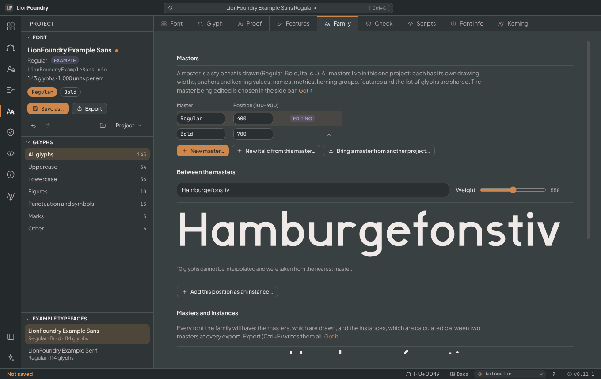
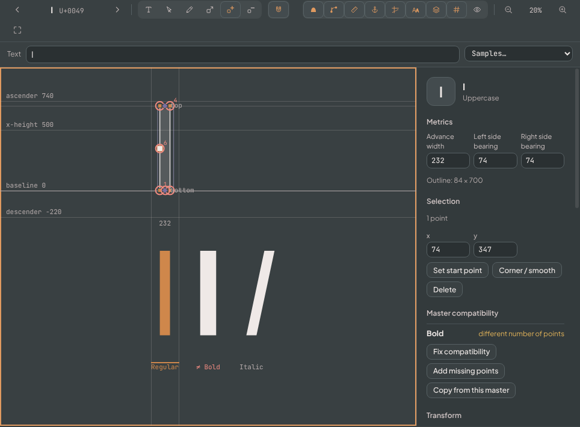
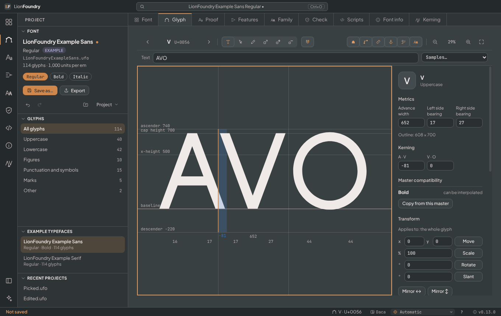
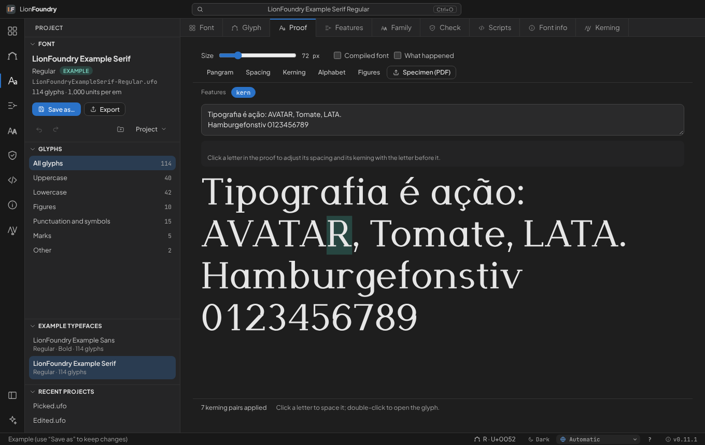
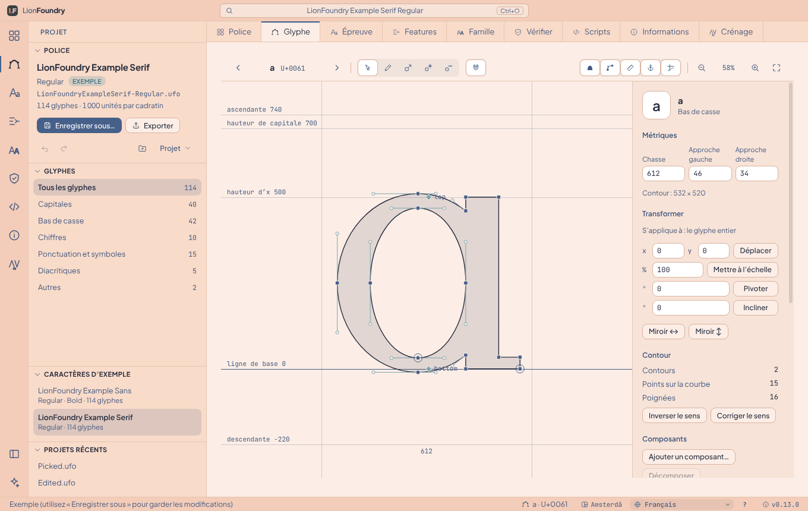
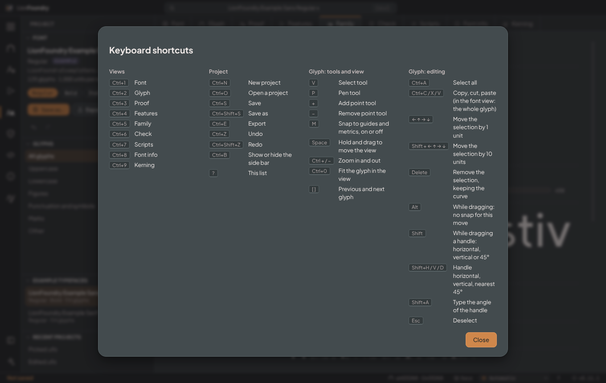

<div align="center">


# LionFoundry

### Dessinez une famille de caractères entière. Exportez toutes les polices en un clic.

Un éditeur de polices libre et open source, à l’interface épurée, fait pour les personnes — et prêt pour les agents d’IA.

[English](README.md) · [Português (Brasil)](README.pt-BR.md) · [Português (Portugal)](README.pt-PT.md) · [Español](README.es.md) · **Français** · [Deutsch](README.de.md) · [Italiano](README.it.md)

<sub>par la <b>LionFoundry Team</b> · créé et imaginé par <b>Daniel Michelon De Carli</b></sub>


</div>

> Cette traduction n’a pas encore été relue par une personne de langue maternelle française. Le texte de référence est l’[anglais](README.md) ; les corrections sont les bienvenues.

<a id="download"></a>

## Télécharger

Téléchargez l’installateur pour votre système. Les liens mènent toujours à la **dernière version** ; chaque installateur contient l’application complète, rien d’autre n’est donc téléchargé pendant l’installation.

- **Windows 10/11** (x64): un assistant d’installation qui vous laisse choisir le dossier. → [`LionFoundry-Setup.exe`](https://github.com/danielcarli/lionfoundry/releases/latest/download/LionFoundry-Setup.exe) · ou la version portable, sans installation : [`LionFoundry-win-x64.zip`](https://github.com/danielcarli/lionfoundry/releases/latest/download/LionFoundry-win-x64.zip)
- **macOS** (Apple Silicon, Intel): ouvrez le `.dmg` et faites glisser LionFoundry dans Applications. → [`LionFoundry-mac-universal.dmg`](https://github.com/danielcarli/lionfoundry/releases/latest/download/LionFoundry-mac-universal.dmg)
- **Linux** (x64): `.deb` pour Ubuntu, Debian, Mint…, `.rpm` pour Fedora, RHEL, openSUSE…, ou l’AppImage pour toute distribution, sans installation. → [`.deb`](https://github.com/danielcarli/lionfoundry/releases/latest/download/lionfoundry_amd64.deb) · [`.rpm`](https://github.com/danielcarli/lionfoundry/releases/latest/download/lionfoundry.x86_64.rpm) · [AppImage](https://github.com/danielcarli/lionfoundry/releases/latest/download/LionFoundry-x86_64.AppImage)

> Les installateurs ne sont pas encore signés avec un certificat payant. Au premier lancement, Windows peut afficher « Windows a protégé votre ordinateur » (**Informations complémentaires › Exécuter quand même**) et macOS demande d’autoriser l’application dans **Réglages Système › Confidentialité et sécurité › Ouvrir quand même**. Les sommes de contrôle de tous les fichiers se trouvent dans [`SHA256SUMS.txt`](https://github.com/danielcarli/lionfoundry/releases/latest/download/SHA256SUMS.txt)

Les installateurs sont produits par GitHub Actions pour chaque étiquette de version (`.github/workflows/release.yml`), sur des machines Windows, macOS et Linux, à partir du code de ce dépôt. Ils sont récents : les paquets Linux ont été essayés avant publication et l’installateur Windows a déjà été installé et ouvert sur un vrai ordinateur ; celui de macOS n’a pas encore été essayé — si l’un d’eux ne s’ouvre pas, merci de [nous le signaler](https://github.com/danielcarli/lionfoundry/issues). Vous pouvez toujours [lancer l’application depuis le code source](#get-started).

## De la première lettre aux polices terminées

LionFoundry vous accompagne dans tout le travail, dans une seule fenêtre : **dessinez** les lettres, **réglez leurs approches et leur crénage**, ajoutez des **features OpenType**, construisez la **famille** — Regular, Bold, Italic et tout ce qui se trouve entre eux — et **exportez** des polices qui fonctionnent dans tous les logiciels et sur le web.

- **Libre et ouvert.** Pas de compte, pas d’abonnement, pas de réseau. Les polices que vous créez sont à vous, sous la licence de votre choix.
- **Facile à lire.** Une fenêtre épurée, quatre thèmes, tous les raccourcis sur un seul écran.
- **Familier.** Les mots et les touches des éditeurs de polices que vous connaissez déjà : masters, instances, repères, `V`, `P`, `+`, `−`.

> **LionFoundry est un projet expérimental.** Il couvre toutes les étapes de la création d’un caractère sous une première forme, basique — voir [Où en est le projet](#where-it-stands) pour ce qui manque encore. Il a surtout été utilisé sous Linux ; sous Windows il n’a connu qu’un premier essai et sous macOS il n’a pas été testé. Gardez des copies de vos polices.

## Ce qui le rend différent

| | |
|---|---|
| **Une famille entière dans un seul projet** | Regular, Bold, Italic et les styles intermédiaires vivent dans le même projet. Dessinez deux graisses et LionFoundry calcule Medium et SemiBold pour vous. |
| **Un seul Exporter pour tout** | Une boîte de dialogue, un clic : toutes les polices de la famille, pour le bureau et pour le web, dans un nouveau dossier — avec la feuille de style prête à coller dans un site. |
| **Il vous dit ce qui ne va pas et vous aide à le corriger** | Un guide montre ce qui est fait et ce qui manque. Une liste de problèmes vous mène à chaque glyphe. Deux masters qui ne concordent pas se corrigent d’un bouton. |
| **Vos originaux sont en sécurité** | Rien n’est écrit tant que vous n’enregistrez pas. Le premier enregistrement garde une copie du projet tel qu’il était. « Enregistrer sous » et Exporter n’écrasent jamais rien. Tout peut être annulé. |
| **Formats ouverts** | Les projets sont des UFO : un dossier de petits fichiers texte que d’autres éditeurs de polices ouvrent aussi. Aucun enfermement. |
| **Conçu dès le départ pour les agents d’IA** | Un agent peut lire, vérifier, tester et compiler vos polices par un serveur local — sur votre ordinateur, sous votre contrôle. LionFoundry lui-même ne parle jamais à un fournisseur d’IA. |

## En images

<sub>Les images montrent l’interface en anglais ; le logiciel existe en sept langues, dont le français.</sub>

### Dessiner

Sélection, plume, échelle, ajout et suppression de points, couteau, rectangle et ellipse. **Supprimer le chevauchement**, unir, soustraire et intersection travaillent sur les courbes elles-mêmes, qui restent donc des courbes ; **Ajouter les extrema** et **Nettoyer les contours** placent les points là où les typographes les veulent. La rotation, une **règle** qui montre l’épaisseur de chaque trait traversé, un lasso, et un **arrière-plan** pour chaque glyphe et master, pour comparer ou décalquer. Sélectionnez plusieurs points et un cadre apparaît autour d’eux : faites glisser un coin pour agrandir ou réduire la forme, avec Maj pour conserver les proportions et Alt pour partir du centre — les gestes d’Illustrator. Des poignées qui restent horizontales, verticales ou à 45° quand vous le voulez. Des **repères** par glyphe et le **magnétisme** (Aimanter) pour tenir vos points sur la ligne. Saisissez la chasse et les approches ; déplacez, mettez à l’échelle, faites pivoter, inclinez et retournez. Les composants et les ancres construisent les lettres accentuées pour vous.

<div align="center">

</div>

### Voir tous les glyphes

Toute la police sur un écran. Recherchez, filtrez par type, créez, dupliquez, renommez. **Ajouter les glyphes d’une langue** donne à la police toutes les lettres dont le portugais, l’espagnol ou l’Europe occidentale ont besoin : les lettres accentuées sont construites avec la lettre et l’accent que vous avez déjà dessinés.

<div align="center">

</div>

### Construire la famille

Les **masters** sont les styles que vous dessinez. Les **instances** sont les styles que LionFoundry calcule entre eux. Ajoutez un italique à partir de n’importe quel master et redessinez-le. Voyez toute la famille composée dans le même texte, côte à côte.

<div align="center">

</div>

Pendant que vous dessinez le Bold, le Regular est là, juste derrière. Le panneau dit si les deux peuvent être interpolés — et **Corriger la compatibilité** met d’accord les contours et les points de départ sans changer la forme.

<div align="center">

</div>

Activez **Tous les masters** pour voir la lettre dans chaque master sous la ligne que vous dessinez ; un double-clic sur l’un d’eux y conduit. **Compatibilité** numérote les points et relie chacun au même point de l’autre master — un anneau rouge signale ce qui n’a pas de correspondant, et **Ajouter les points manquants** l’ajoute sans changer la forme. **Aperçu** montre la ligne à n’importe quelle graisse entre les masters. Maintenez `Alt` avec Ajouter un point, Supprimer un point, Inverser ou Corriger le sens pour modifier tous les masters à la fois.

<div align="center">

</div>

### Régler approches et crénage là où vous lisez

La vue Glyphe est une ligne de texte, comme dans les autres éditeurs de polices : tapez un mot, modifiez n’importe laquelle de ses lettres au milieu des autres, et changez au clavier les approches et le crénage de la lettre après le curseur (`Alt`, `Ctrl` et `Ctrl+Alt` avec les flèches). Dans l’épreuve, cliquez sur une lettre et réglez ses approches et son crénage sur place, dans le texte. La vue **Crénage** garde les groupes et les paires en ordre : une paire définie pour un groupe vaut pour toutes ses lettres.

<div align="center">

</div>

| | |
|---|---|
|  |  |

### Des features OpenType, aussi loin que vous voulez

**Automatique :** nommez un glyphe `f_i` et c’est une ligature ; `a.sc` est une petite capitale ; le crénage et les accents fonctionnent tout seuls. **Règles :** « remplacer ceci par cela », une ligne à la fois. **Code :** écrivez vous-même le fichier de features. L’épreuve montre chaque étape, pour que vous voyiez pourquoi une lettre a changé.

<div align="center">

</div>

### Savoir quand c’est prêt

Un guide de ce qui est fait. Quelle part de chaque langue la police écrit déjà. Chaque problème, avec un lien vers le glyphe.

<div align="center">

</div>

### Exporter une seule fois

Choisissez le master en cours ou toute la famille, cochez les formats, c’est fait. TrueType pour le bureau, WOFF2 pour le web, et une feuille de style avec les règles `@font-face`. Les noms sont écrits de façon que les boutons Gras et Italique de n’importe quel logiciel trouvent la bonne police.

| | |
|---|---|
|  |  |

<sub>À droite : sept polices exportées par LionFoundry à partir de deux graisses dessinées et de leurs italiques, affichées hors de l’application.</sub>

### À votre goût

Quatre thèmes, sept langues — English, Português (Brasil et Portugal), Español, Français, Deutsch et Italiano — et tous les raccourcis sur un seul écran (appuyez sur `?`).

| | | |
|---|---|---|
|  |  |  |
|  |  |  |

## Travailler avec l’IA

LionFoundry a été conçu pour qu’un agent d’IA puisse travailler sur vos polices **avec vous**, pas à votre place. Il n’y a pas d’IA dans l’application et rien n’est envoyé nulle part : l’agent que vous choisissez se connecte à LionFoundry sur votre propre ordinateur.

**Ce qu’un agent peut faire aujourd’hui**

- **Relire** — vérifier la police, lire les glyphes qui posent problème et expliquer ce qu’il faut corriger.
- **Tester** — composer des mots et voir quelles features et quelles valeurs de crénage s’appliquent, étape par étape.
- **Modifier en masse** — écrire un script (« ajoute 10 unités aux approches de toutes les minuscules ») et enregistrer le résultat comme nouveau projet, que vous pourrez examiner.
- **Compiler** — exporter toute la famille après chaque révision.

**Comment le connecter**

*1. Le serveur local (Model Context Protocol).* Lancez-le sur le dossier où se trouvent vos polices. Dans la plupart des applications d’agents, la configuration ressemble à ceci :

```json
{
  "mcpServers": {
    "lionfoundry": {
      "command": "node",
      "args": ["/path/to/lionfoundry/tools/mcp-server.js", "/path/to/your/fonts"]
    }
  }
}
```

L’agent reçoit neuf outils : `describe_font`, `list_glyphs`, `get_glyph`, `validate_font`, `list_features`, `shape_text`, `export_font`, `export_family` et `run_script`. Le serveur n’a ni port réseau ni compte, et ne voit que le dossier avec lequel il a été lancé.

*2. La ligne de commande.* Le même moteur pour les agents qui travaillent dans un terminal. Chaque commande répond en JSON :

```sh
node tools/cli.js info      MyFont.ufo                      # names, metrics, masters, counts
node tools/cli.js glyphs    MyFont.ufo acute                # one line of data per glyph (filtered by name)
node tools/cli.js glyph     MyFont.ufo a                    # the full outline of one glyph
node tools/cli.js validate  MyFont.ufo                      # problems; exit code 1 when there are errors
node tools/cli.js features  MyFont.ufo                      # features of the font and their code
node tools/cli.js shape     MyFont.ufo "AVATAR" --off kern  # glyphs, positions and steps for a text
node tools/cli.js export    MyFont.ufo MyFont.woff2         # compile one font (.ttf or .woff2)
node tools/cli.js export-family MyFont.ufo fonts/           # every font of the family into a new folder
node tools/cli.js convert   Other.ttf  Other.ufo            # a TrueType font as a new project
node tools/cli.js run       MyFont.ufo fix.py --out Fixed.ufo   # run a script, save the result as a new project
```

Ajoutez `--weight Bold` à n’importe quelle commande pour travailler sur un master.

*3. Les scripts.* Demandez un script à un agent et exécutez-le dans la vue Scripts. Les mêmes noms en Python et en JavaScript, en suivant [fontParts](https://fontparts.robotools.dev) quand c’est possible :

```python
for glyph in font:
    if glyph.leftMargin is not None:
        glyph.leftMargin += 10
font.kerning[("A", "V")] = -80
```

Dans l’application, tout ce que fait un script revient sous la forme d’**une seule étape que vous pouvez annuler**.

*4. Le projet lui-même.* Un projet UFO est un dossier de petits fichiers texte. Un agent peut le lire et comparer deux versions sans aucun outil.

**Vous gardez la main**

- Par le serveur et par la ligne de commande, un projet ou un fichier existant n’est **jamais modifié ni remplacé** : les résultats vont toujours vers un chemin qui n’existe pas encore.
- LionFoundry n’utilise pas le réseau. La seule exception est la vérification de version, et uniquement quand vous cliquez dessus.
- Les scripts sont du code : ils ne s’exécutent pas dans un bac à sable de sécurité ; n’exécutez donc que des scripts que vous avez lus ou auxquels vous faites confiance.

**Ce qu’il ne fait pas encore :** l’agent ne peut pas travailler sur le projet ouvert dans l’application (il en écrit un nouveau, que vous ouvrez), il n’y a pas de suggestions avec aperçu dans l’interface, et un agent lit les nombres d’un contour — il ne voit pas le dessin.

<a id="where-it-stands"></a>

## Où en est le projet

LionFoundry est jeune. Voici la liste honnête.

| Ce qu’il fait | Ce qu’il ne fait pas encore |
|---|---|
| Ouvre UFO 2 et 3, enregistre en UFO 3, importe TrueType | OpenType CFF (`.otf`), FontForge SFD, fichiers du logiciel standard de l’industrie |
| Exporte TrueType et WOFF2, compilés par son propre code | Le **hinting** (les polices sont bonnes à l’impression, sur le web et sur les écrans haute densité ; un peu molles en petits corps sur les anciens écrans Windows) |
| Masters, italiques et instances sur l’axe de graisse | Les **polices variables** (un `.designspace` est exporté pour d’autres outils), un axe de largeur |
| Corrige la compatibilité (contours, points de départ) et ajoute les points qui manquent à un master | Rendre compatibles des masters qui n’ont pas le même nombre de contours |
| Supprime les chevauchements, unit, soustrait, intersecte et coupe au couteau, sur les courbes elles-mêmes | Des composants d’angle et intelligents, des filtres (contour décalé, coins arrondis) |
| Groupes et paires de crénage, approches dans l’épreuve | Une fenêtre de métriques avec de nombreux glyphes, approches et crénage automatiques |
| Substitutions, ligatures, crénage et placement des accents | Les lookups contextuels ; les écritures de droite à gauche et complexes |
| Glyphes en couleurs à plat (COLR/CPAL) | Dégradés, couleur SVG et bitmap |
| Annulation pour tout, une sauvegarde au premier enregistrement | Enregistrement automatique et récupération après un plantage |
| Installateurs pour Windows, macOS et Linux, produits pour chaque version | Tests sous Windows et macOS ; installateurs signés ; grandes polices (CJK) |

<a id="get-started"></a>

## Commencer

Le plus rapide est un installateur de la section [Télécharger](#download). Pour lancer l’application depuis le code source, il vous faut [Node.js](https://nodejs.org) (LTS). Dans les deux cas, Python 3 n’est nécessaire que pour les scripts écrits en Python.

```sh
git clone https://github.com/danielcarli/lionfoundry.git
cd lionfoundry
npm install
npm start
```

Sous Windows, vous pouvez aussi double-cliquer sur `start.bat`.

**Vous débutez en dessin de caractères ?** Suivez le tutoriel : [De zéro au premier caractère](docs/tutorial.fr.md) — deux graisses et un italique, pas à pas, avec chaque outil expliqué.

Deux caractères d’exemple s’ouvrent depuis la barre latérale, pour avoir quelque chose de réel à explorer :

- **LionFoundry Example Sans** — deux masters, Regular et Bold, et deux instances entre eux, Medium et SemiBold ;
- **LionFoundry Example Serif** — contraste entre pleins et déliés, empattements filiformes.

Chacun compte 114 glyphes avec les lettres accentuées du portugais et de l’espagnol, des groupes et des paires de crénage. Ils sont originaux, volontairement basiques, générés par `tools/examples/build.py` et publiés sous la SIL Open Font License 1.1 (`examples/OFL.txt`).

## Pour les développeurs

Le code, les commentaires et la documentation technique sont en anglais : l’architecture, les commandes (`npm test`, `npm run test:e2e`, `npm run dist`…) et les notes de sécurité se trouvent dans la section [For developers](README.md#for-developers) du README anglais. Les traductions de l’interface sont dans `src/nls/` — un fichier JSON par langue — et `npm run test:i18n` vérifie qu’aucun message ne manque.

## Journal des modifications

Voir [CHANGELOG.md](CHANGELOG.md) (en anglais) — version actuelle : **0.17.0**.

## Crédits

LionFoundry a été **créé et imaginé par Daniel Michelon De Carli**, étudiant en architecture et urbanisme, et il est maintenu par la **LionFoundry Team** avec ses contributeurs et traducteurs.

Les éléments de tiers sont listés dans [THIRD-PARTY-NOTICES.md](THIRD-PARTY-NOTICES.md).

## Licence

Copyright © 2026 LionFoundry Team.

LionFoundry est un logiciel libre : vous pouvez le redistribuer et/ou le modifier selon les termes de la **[GNU General Public License v3.0](LICENSE)** publiée par la Free Software Foundation, soit la version 3 de la Licence, soit (à votre choix) toute version ultérieure. Il est distribué dans l’espoir qu’il sera utile, mais **sans aucune garantie** ; voir la licence pour les détails.

En bref : vous pouvez utiliser, étudier, partager et modifier LionFoundry librement ; si vous distribuez une version modifiée, elle doit aussi être publiée sous GPL avec son code source.

**La licence du logiciel ne s’étend pas aux polices que vous créez avec lui.** Les polices créées ou modifiées dans LionFoundry sont votre œuvre, et vous choisissez leur licence.
