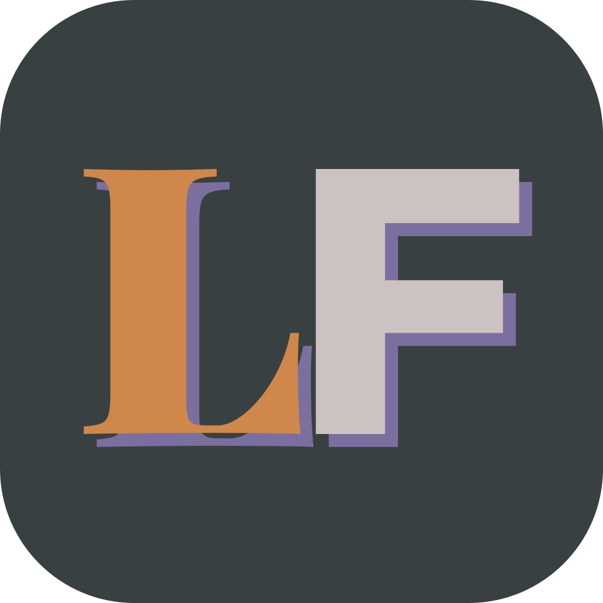
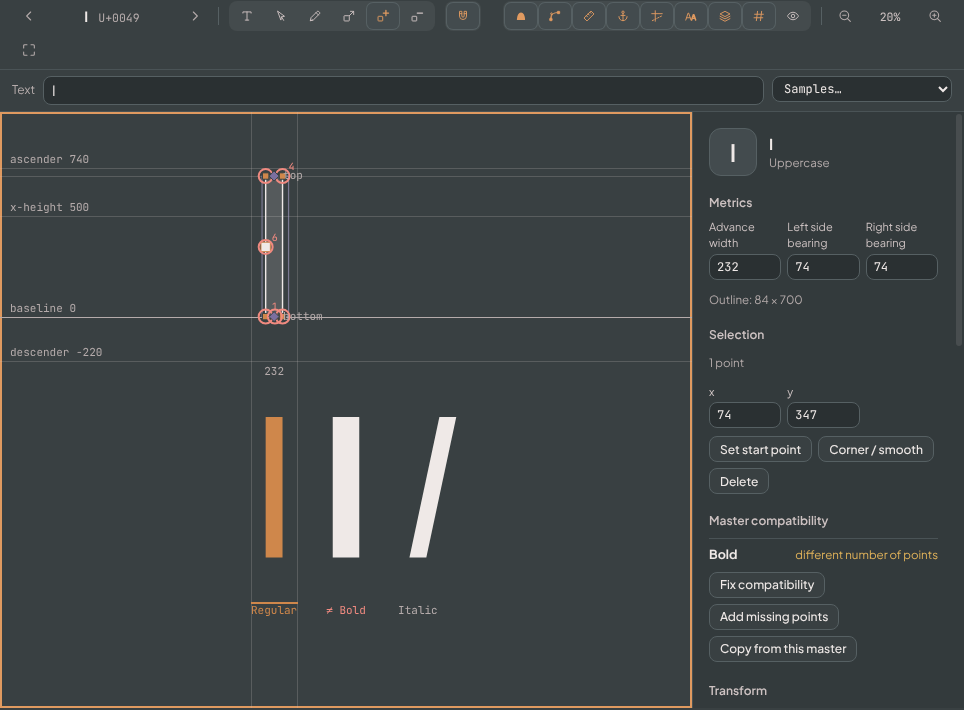
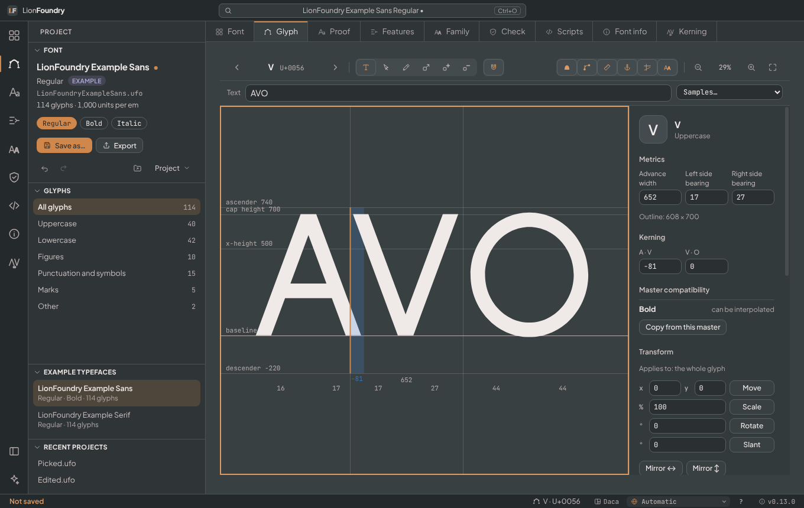
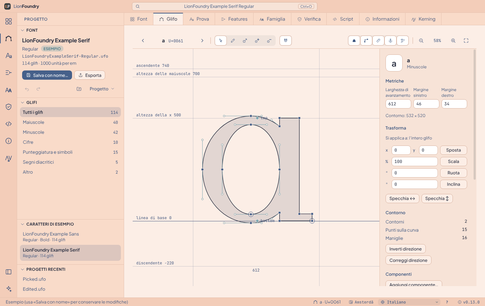

<div align="center">



# LionFoundry

### Disegna un’intera famiglia di caratteri. Esporta tutti i font con un clic.

Un editor di font libero e open source, con un’interfaccia pulita, fatto per le persone — e pronto per gli agenti IA.

[English](README.md) · [Português (Brasil)](README.pt-BR.md) · [Português (Portugal)](README.pt-PT.md) · [Español](README.es.md) · [Français](README.fr.md) · [Deutsch](README.de.md) · **Italiano**

<sub>del <b>LionFoundry Team</b> · creato e ideato da <b>Daniel Michelon De Carli</b></sub>


</div>

> Questa traduzione non è ancora stata rivista da una persona madrelingua. Il testo di riferimento è quello [inglese](README.md); le correzioni sono benvenute.

<a id="download"></a>

## Download

Scarica il programma di installazione per il tuo sistema. I link portano sempre all’**ultima versione**; ogni programma di installazione contiene l’app completa, quindi durante l’installazione non viene scaricato nient’altro.

- **Windows 10/11** (x64): una procedura guidata che ti lascia scegliere la cartella. → [`LionFoundry-Setup.exe`](https://github.com/danielcarli/lionfoundry/releases/latest/download/LionFoundry-Setup.exe) · oppure la versione portatile, senza installazione: [`LionFoundry-win-x64.zip`](https://github.com/danielcarli/lionfoundry/releases/latest/download/LionFoundry-win-x64.zip)
- **macOS** (Apple Silicon, Intel): apri il `.dmg` e trascina LionFoundry in Applicazioni. → [`LionFoundry-mac-universal.dmg`](https://github.com/danielcarli/lionfoundry/releases/latest/download/LionFoundry-mac-universal.dmg)
- **Linux** (x64): `.deb` per Ubuntu, Debian, Mint…, `.rpm` per Fedora, RHEL, openSUSE…, oppure l’AppImage per qualsiasi distribuzione, senza installazione. → [`.deb`](https://github.com/danielcarli/lionfoundry/releases/latest/download/lionfoundry_amd64.deb) · [`.rpm`](https://github.com/danielcarli/lionfoundry/releases/latest/download/lionfoundry.x86_64.rpm) · [AppImage](https://github.com/danielcarli/lionfoundry/releases/latest/download/LionFoundry-x86_64.AppImage)

> I programmi di installazione non sono ancora firmati con un certificato a pagamento. Al primo avvio Windows può mostrare «PC protetto da Windows» (**Ulteriori informazioni › Esegui comunque**) e macOS chiede di consentire l’app in **Impostazioni di Sistema › Privacy e sicurezza › Apri comunque**. Le somme di controllo di tutti i file sono in [`SHA256SUMS.txt`](https://github.com/danielcarli/lionfoundry/releases/latest/download/SHA256SUMS.txt)

I programmi di installazione sono generati da GitHub Actions per ogni tag di versione (`.github/workflows/release.yml`), su macchine Windows, macOS e Linux, dal codice di questo repository. Sono nuovi: i pacchetti Linux sono stati provati prima della pubblicazione e quello per Windows è già stato installato e aperto su un computer reale; quello per macOS non è ancora stato provato — se uno non si apre, per favore [faccelo sapere](https://github.com/danielcarli/lionfoundry/issues). Puoi sempre [avviare l’app dal codice sorgente](#get-started).

## Dalla prima lettera ai font finiti

LionFoundry ti accompagna in tutto il lavoro dentro un’unica finestra: **disegna** le lettere, **spaziale e regola il kerning**, aggiungi le **feature OpenType**, costruisci la **famiglia** — Regular, Bold, Italic e tutto ciò che sta in mezzo — ed **esporta** font che funzionano in qualsiasi programma e sul web.

- **Libero e aperto.** Nessun account, nessun abbonamento, nessuna rete. I font che fai sono tuoi, con la licenza che scegli.
- **Facile da leggere.** Una finestra pulita, quattro temi, tutte le scorciatoie in una schermata.
- **Familiare.** Le parole e i tasti degli editor di font che già conosci: master, istanze, guide, `V`, `P`, `+`, `−`.

> **LionFoundry è un progetto sperimentale.** Copre ogni fase della creazione di un carattere in una prima forma, di base — vedi [A che punto è](#where-it-stands) per ciò che ancora manca. È stato usato soprattutto su Linux; su Windows ha avuto solo una prima prova e su macOS non è stato testato. Conserva delle copie dei tuoi font.

## Che cosa lo rende diverso

| | |
|---|---|
| **Un’intera famiglia in un solo progetto** | Regular, Bold, Italic e gli stili intermedi vivono nello stesso progetto. Disegna due pesi e LionFoundry calcola per te Medium e SemiBold. |
| **Un solo Esporta per tutto** | Una finestra di dialogo, un clic: tutti i font della famiglia, per desktop e per il web, in una nuova cartella — con il foglio di stile pronto da incollare in un sito. |
| **Ti dice che cosa non va e ti aiuta a sistemarlo** | Una guida mostra ciò che è fatto e ciò che manca. Un elenco di problemi ti porta a ogni glifo. Due master che non concordano si sistemano con un pulsante. |
| **I tuoi originali sono al sicuro** | Non viene scritto nulla finché non salvi. Il primo salvataggio conserva una copia del progetto com’era. «Salva con nome» ed Esporta non sovrascrivono mai nulla. Tutto può essere annullato. |
| **Formati aperti** | I progetti sono UFO: una cartella di piccoli file di testo che anche altri editor di font aprono. Nessun vincolo. |
| **Pensato fin dall’inizio per gli agenti IA** | Un agente può leggere, verificare, provare e compilare i tuoi font attraverso un server locale — sul tuo computer, con te al comando. LionFoundry non parla mai con un fornitore di IA. |

## Guardalo

<sub>Le immagini mostrano l’interfaccia in inglese; il programma è in sette lingue, tra cui l’italiano.</sub>

### Disegnare

Selezione, penna, scala, aggiungi punto, rimuovi punto, coltello, rettangolo ed ellisse. **Rimuovi sovrapposizione**, unisci, sottrai e interseca lavorano sulle curve stesse, quindi le curve restano curve; **Aggiungi estremi** e **Riordina contorni** mettono i punti dove li vogliono i type designer. Ruotare, un **righello** che mostra lo spessore di ogni tratto che attraversa, un lazo e uno **sfondo** per ogni glifo e master, per confrontare o ricalcare. Seleziona più punti e intorno a loro compare un riquadro: trascina un angolo per ingrandire o ridurre la forma, con Maiusc per mantenere le proporzioni e Alt per scalare dal centro — i gesti di Illustrator. Maniglie che restano orizzontali, verticali o a 45° quando lo vuoi. **Guide** per ogni glifo e **Aggancia** per tenere i punti sulla linea. Digita la larghezza e i margini laterali; sposta, scala, ruota, inclina e rifletti. Componenti e ancore costruiscono per te le lettere accentate.

<div align="center">

</div>

### Vedere tutti i glifi

Tutto il font in una schermata. Cerca, filtra per tipo, crea, duplica, rinomina. **Aggiungi i glifi di una lingua** dà al font tutte le lettere di cui hanno bisogno il portoghese, lo spagnolo o l’Europa occidentale: quelle accentate vengono costruite con la lettera e l’accento che hai già disegnato.

<div align="center">

</div>

### Costruire la famiglia

I **master** sono gli stili che disegni. Le **istanze** sono gli stili che LionFoundry calcola tra di loro. Aggiungi un corsivo a partire da qualsiasi master e ridisegnalo. Guarda tutta la famiglia composta nello stesso testo, fianco a fianco.

<div align="center">

</div>

Mentre disegni il Bold, il Regular è lì dietro. Il pannello dice se i due si possono interpolare — e **Correggi compatibilità** mette d’accordo contorni e punti iniziali senza cambiare la forma.

<div align="center">

</div>

Attiva **Tutti i master** per vedere la lettera in ogni master sotto la riga che stai disegnando; un doppio clic su uno ti porta lì. **Compatibilità** numera i punti e collega ciascuno allo stesso punto dell’altro master — un anello rosso segna ciò che non ha corrispondenza, e **Aggiungi i punti mancanti** lo aggiunge senza cambiare la forma. **Anteprima** mostra la riga a qualsiasi peso tra i master. Tieni premuto `Alt` con Aggiungi punto, Rimuovi punto, Inverti o Correggi direzione per modificare tutti i master insieme.

<div align="center">

</div>

### Spaziatura e kerning dove leggi

La vista Glifo è una riga di testo, come negli altri editor di font: digita una parola, modifica qualsiasi sua lettera in mezzo alle altre e cambia dalla tastiera i margini laterali e il kerning della lettera dopo il cursore (`Alt`, `Ctrl` e `Ctrl+Alt` con le frecce). Nella prova, fai clic su una lettera e regola la sua spaziatura e il suo kerning proprio lì, nel testo. La vista **Kerning** tiene in ordine gruppi e coppie: una coppia fatta per un gruppo vale per tutte le sue lettere.

<div align="center">

</div>

| | |
|---|---|
|  |  |

### Feature OpenType, a fondo quanto vuoi

**Automatico:** chiama un glifo `f_i` ed è una legatura; `a.sc` è un maiuscoletto; kerning e accenti funzionano da soli. **Regole:** «sostituisci questo con quello», una riga alla volta. **Codice:** scrivi tu stesso il file delle feature. La prova mostra ogni passaggio, così vedi perché una lettera è cambiata.

<div align="center">

</div>

### Sapere quando è pronto

Una guida di ciò che è fatto. Quanto di ogni lingua il font scrive già. Ogni problema, con un link al glifo.

<div align="center">

</div>

### Esportare una volta sola

Scegli il master in modifica o l’intera famiglia, spunta i formati, fatto. TrueType per il desktop, WOFF2 per il web e un foglio di stile con le regole `@font-face`. I nomi vengono scritti in modo che i pulsanti Grassetto e Corsivo di qualsiasi programma trovino il font giusto.

| | |
|---|---|
|  |  |

<sub>A destra: sette font esportati da LionFoundry a partire da due pesi disegnati e dai loro corsivi, resi fuori dall’app.</sub>

### Fallo tuo

Quattro temi, sette lingue — English, Português (Brasil e Portugal), Español, Français, Deutsch e Italiano — e tutte le scorciatoie in una schermata (premi `?`).

| | | |
|---|---|---|
|  |  |  |
|  |  |  |

## Lavorare con l’IA

LionFoundry è stato progettato perché un agente IA possa lavorare ai tuoi font **con te**, non al posto tuo. Dentro l’app non c’è IA e nulla viene inviato da nessuna parte: l’agente che scegli si collega a LionFoundry sul tuo computer.

**Che cosa può fare oggi un agente**

- **Rivedere** — verificare il font, leggere i glifi che hanno problemi e spiegare che cosa sistemare.
- **Provare** — comporre parole e vedere quali feature e quali valori di kerning si applicano, passo per passo.
- **Modificare in blocco** — scrivere uno script («aggiungi 10 unità ai margini laterali di tutte le minuscole») e salvare il risultato come nuovo progetto, che potrai guardare.
- **Compilare** — esportare l’intera famiglia dopo ogni revisione.

**Come collegarlo**

*1. Il server locale (Model Context Protocol).* Avvialo sulla cartella in cui si trovano i tuoi font. Nella maggior parte delle app per agenti la configurazione è così:

```json
{
  "mcpServers": {
    "lionfoundry": {
      "command": "node",
      "args": ["/path/to/lionfoundry/tools/mcp-server.js", "/path/to/your/fonts"]
    }
  }
}
```

L’agente riceve nove strumenti: `describe_font`, `list_glyphs`, `get_glyph`, `validate_font`, `list_features`, `shape_text`, `export_font`, `export_family` e `run_script`. Il server non ha porte di rete né account, e vede solo la cartella con cui è stato avviato.

*2. La riga di comando.* Lo stesso motore per gli agenti che lavorano in un terminale. Ogni comando risponde in JSON:

```sh
node tools/cli.js info      MyFont.ufo                      # names, metrics, masters, counts
node tools/cli.js glyphs    MyFont.ufo acute                # one line of data per glyph (filtered by name)
node tools/cli.js glyph     MyFont.ufo a                    # the full outline of one glyph
node tools/cli.js validate  MyFont.ufo                      # problems; exit code 1 when there are errors
node tools/cli.js features  MyFont.ufo                      # features of the font and their code
node tools/cli.js shape     MyFont.ufo "AVATAR" --off kern  # glyphs, positions and steps for a text
node tools/cli.js export    MyFont.ufo MyFont.woff2         # compile one font (.ttf or .woff2)
node tools/cli.js export-family MyFont.ufo fonts/           # every font of the family into a new folder
node tools/cli.js convert   Other.ttf  Other.ufo            # a TrueType font as a new project
node tools/cli.js run       MyFont.ufo fix.py --out Fixed.ufo   # run a script, save the result as a new project
```

Aggiungi `--weight Bold` a qualsiasi comando per lavorare su un master.

*3. Script.* Chiedi uno script a un agente ed eseguilo nella vista Script. Gli stessi nomi in Python e in JavaScript, seguendo [fontParts](https://fontparts.robotools.dev) dove possibile:

```python
for glyph in font:
    if glyph.leftMargin is not None:
        glyph.leftMargin += 10
font.kerning[("A", "V")] = -80
```

Dentro l’app, tutto ciò che fa uno script torna come **un unico passaggio che puoi annullare**.

*4. Il progetto stesso.* Un progetto UFO è una cartella di piccoli file di testo. Un agente può leggerlo e confrontare due versioni senza alcuno strumento.

**Resti tu al comando**

- Attraverso il server e la riga di comando, un progetto o un file esistente **non viene mai modificato né sostituito**: i risultati vanno sempre in un percorso che non esiste ancora.
- LionFoundry non usa la rete. L’unica eccezione è il controllo della versione, e solo quando ci fai clic.
- Gli script sono codice: non vengono eseguiti in una sandbox di sicurezza, quindi esegui solo script che hai letto o di cui ti fidi.

**Che cosa non fa ancora:** l’agente non può lavorare sul progetto aperto nell’app (ne scrive uno nuovo, e tu lo apri), non ci sono suggerimenti con anteprima dentro l’interfaccia, e un agente legge i numeri di un contorno — non vede il disegno.

<a id="where-it-stands"></a>

## A che punto è

LionFoundry è giovane. Questo è l’elenco onesto.

| Che cosa fa | Che cosa non fa ancora |
|---|---|
| Apre UFO 2 e 3, salva UFO 3, importa TrueType | OpenType CFF (`.otf`), FontForge SFD, file del software standard del settore |
| Esporta TrueType e WOFF2, compilati con codice proprio | **Hinting** (i font vanno bene in stampa, sul web e sugli schermi ad alta densità; morbidi nei corpi piccoli sui vecchi schermi Windows) |
| Master, corsivi e istanze sull’asse del peso | **Font variabili** (viene esportato un `.designspace` per altri strumenti), un asse di larghezza |
| Corregge la compatibilità (contorni, punti iniziali) e aggiunge i punti che mancano a un master | Rendere compatibili master con un numero diverso di contorni |
| Rimuove le sovrapposizioni, unisce, sottrae, interseca e taglia con il coltello, sulle curve stesse | Componenti d’angolo e smart, filtri (contorno sfalsato, angoli arrotondati) |
| Gruppi e coppie di kerning, spaziatura nella prova | Una finestra delle metriche con molti glifi, spaziatura e kerning automatici |
| Sostituzioni, legature, kerning e posizionamento degli accenti | Lookup contestuali; scritture da destra a sinistra e complesse |
| Glifi a colori piatti (COLR/CPAL) | Sfumature, colore SVG e bitmap |
| Annulla per tutto, una copia di sicurezza al primo salvataggio | Salvataggio automatico e ripristino dopo un arresto anomalo |
| Programmi di installazione per Windows, macOS e Linux, generati per ogni versione | Test su Windows e macOS; programmi di installazione firmati; font di grandi dimensioni (CJK) |

<a id="get-started"></a>

## Per iniziare

La via più rapida è un programma di installazione da [Download](#download). Per avviare l’app dal codice sorgente ti serve [Node.js](https://nodejs.org) (LTS). In entrambi i casi Python 3 serve solo per gli script scritti in Python.

```sh
git clone https://github.com/danielcarli/lionfoundry.git
cd lionfoundry
npm install
npm start
```

Su Windows puoi anche fare doppio clic su `start.bat`.

**Sei agli inizi con il type design?** Segui il tutorial: [Da zero al primo carattere](docs/tutorial.it.md) — due pesi e un corsivo, passo per passo, con ogni strumento spiegato.

Due caratteri di esempio si aprono dalla barra laterale, così c’è qualcosa di reale da esplorare:

- **LionFoundry Example Sans** — due master, Regular e Bold, e due istanze tra di loro, Medium e SemiBold;
- **LionFoundry Example Serif** — contrasto tra aste spesse e sottili, grazie filiformi.

Ciascuno ha 114 glifi con le lettere accentate del portoghese e dello spagnolo, gruppi e coppie di kerning. Sono originali, volutamente di base, generati da `tools/examples/build.py` e rilasciati con la SIL Open Font License 1.1 (`examples/OFL.txt`).

## Per gli sviluppatori

Codice, commenti e documentazione tecnica sono in inglese: l’architettura, i comandi (`npm test`, `npm run test:e2e`, `npm run dist`…) e le note sulla sicurezza si trovano nella sezione [For developers](README.md#for-developers) del README inglese. Le traduzioni dell’interfaccia sono in `src/nls/` — un file JSON per lingua — e `npm run test:i18n` verifica che non manchi nessun messaggio.

## Registro delle modifiche

Vedi [CHANGELOG.md](CHANGELOG.md) (in inglese) — versione attuale: **0.17.0**.

## Riconoscimenti

LionFoundry è stato **creato e ideato da Daniel Michelon De Carli**, studente di architettura e urbanistica, ed è mantenuto dal **LionFoundry Team** insieme ai suoi collaboratori e traduttori.

Il materiale di terze parti è elencato in [THIRD-PARTY-NOTICES.md](THIRD-PARTY-NOTICES.md).

## Licenza

Copyright © 2026 LionFoundry Team.

LionFoundry è software libero: puoi ridistribuirlo e/o modificarlo secondo i termini della **[GNU General Public License v3.0](LICENSE)** pubblicata dalla Free Software Foundation, nella versione 3 della Licenza o (a tua scelta) in qualsiasi versione successiva. È distribuito nella speranza che sia utile, ma **senza alcuna garanzia**; vedi la licenza per i dettagli.

In breve: puoi usare, studiare, condividere e modificare LionFoundry liberamente; se distribuisci una versione modificata, anch’essa deve essere rilasciata sotto GPL con il suo codice sorgente.

**La licenza del programma non si estende ai font che fai con esso.** I font creati o modificati in LionFoundry sono opera tua, e sei tu a sceglierne la licenza.
