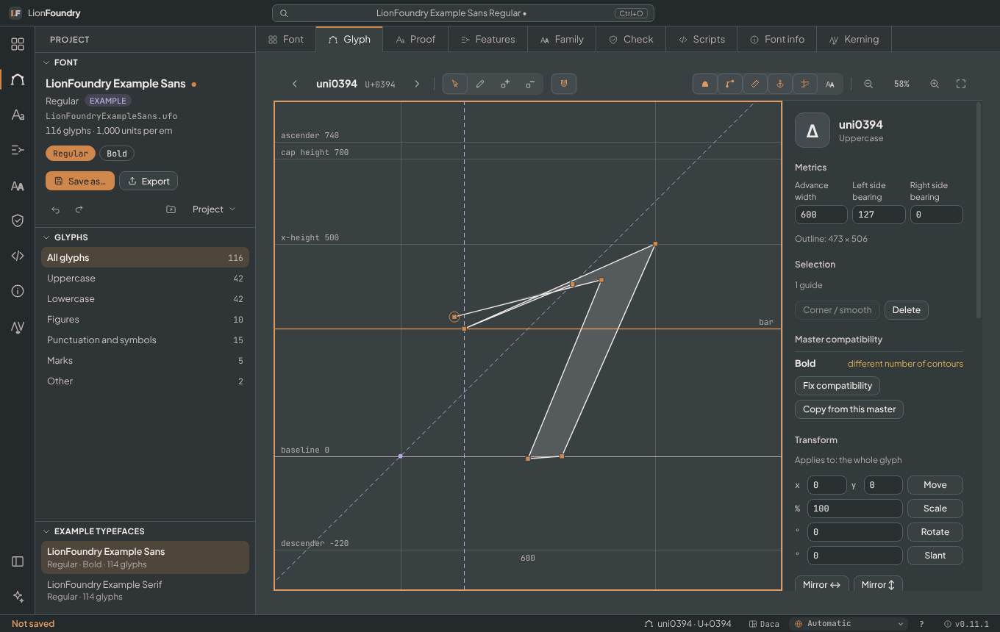
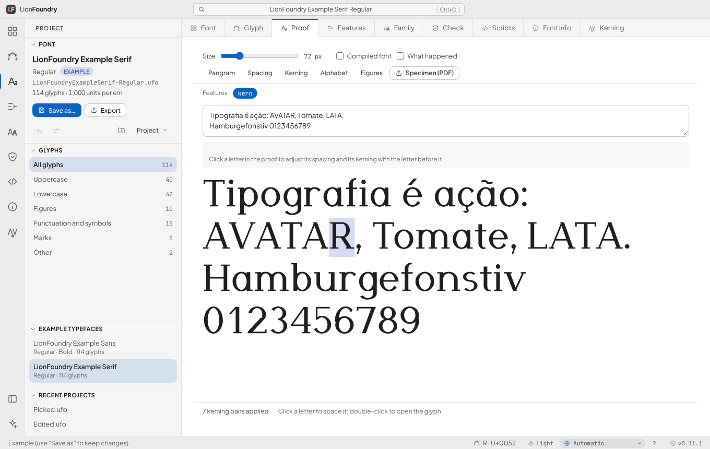
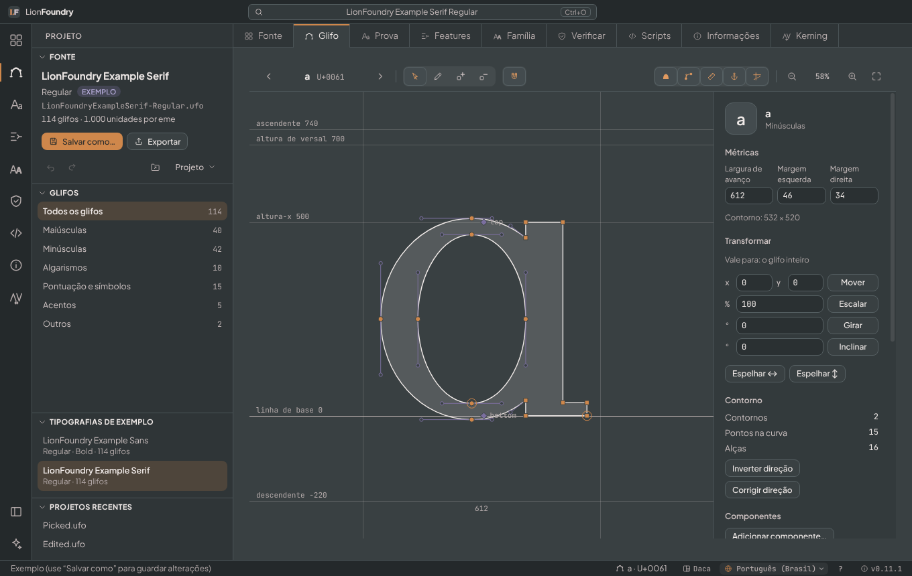

<div align="center">


# LionFoundry

### Draw a whole type family. Export every font in one click.

A free, open-source font editor with a clean interface, made for people — and ready for AI agents.

**English** · [Português (Brasil)](README.pt-BR.md)

<sub>by the <b>LionFoundry Team</b> · created and conceived by <b>Daniel Michelon De Carli</b></sub>


</div>

## Download

Download the installer for your system. The links always bring the **latest version**; every installer holds the whole app, so nothing else is downloaded while it installs.

- **Windows 10/11** (x64): a setup wizard that lets you choose the folder. → [`LionFoundry-Setup.exe`](https://github.com/danielcarli/lionfoundry/releases/latest/download/LionFoundry-Setup.exe) · or the portable version, with no installation: [`LionFoundry-win-x64.zip`](https://github.com/danielcarli/lionfoundry/releases/latest/download/LionFoundry-win-x64.zip)
- **macOS** (Apple Silicon and Intel): open the `.dmg` and drag LionFoundry to Applications. → [`LionFoundry-mac-universal.dmg`](https://github.com/danielcarli/lionfoundry/releases/latest/download/LionFoundry-mac-universal.dmg)
- **Linux** (x64): `.deb` for Ubuntu, Debian, Mint…, `.rpm` for Fedora, RHEL, openSUSE…, or the AppImage for any distribution, with no installation. → [`.deb`](https://github.com/danielcarli/lionfoundry/releases/latest/download/lionfoundry_amd64.deb) · [`.rpm`](https://github.com/danielcarli/lionfoundry/releases/latest/download/lionfoundry.x86_64.rpm) · [AppImage](https://github.com/danielcarli/lionfoundry/releases/latest/download/LionFoundry-x86_64.AppImage)

> The installers are not signed with a paid certificate yet. On first launch, Windows may show "Windows protected your PC" (**More info › Run anyway**) and macOS asks you to allow the app in **System Settings › Privacy & Security › Open Anyway**. The checksums of every file are in [`SHA256SUMS.txt`](https://github.com/danielcarli/lionfoundry/releases/latest/download/SHA256SUMS.txt).

The installers are built by GitHub Actions for each version tag (`.github/workflows/release.yml`), on Windows, macOS and Linux machines, from the code of this repository. They are new: the Linux packages were tried before this release; the Windows and macOS installers have not been tried on a real computer yet — if one does not open, please [tell us](https://github.com/danielcarli/lionfoundry/issues). You can always [run from the source](#get-started).

## From the first letter to the finished fonts

LionFoundry takes you through the whole job in one window: **draw** the letters, **space and kern** them, add **OpenType features**, build the **family** — Regular, Bold, Italic and everything in between — and **export** fonts that work in any program and on the web.

- **Free and open.** No account, no subscription, no network. The fonts you make are yours, under the license you choose.
- **Easy to read.** One clean window, four themes, every shortcut on one screen.
- **Familiar.** The words and the keys of the font editors you already know: masters, instances, guides, `V`, `P`, `+`, `−`.

> **LionFoundry is an experimental project.** It covers every step of making a typeface in a first, basic form — see [Where it stands](#where-it-stands) for what is still missing. It has only been used on Linux so far; on Windows and macOS it is untested. Keep copies of your fonts.

## What makes it different

| | |
|---|---|
| **A whole family in one project** | Regular, Bold, Italic and the styles in between live in the same project. Draw two weights and LionFoundry calculates Medium and SemiBold for you. |
| **One Export for everything** | One dialog, one click: every font of the family, for desktop and for the web, in a new folder — with the style sheet ready to paste into a site. |
| **It tells you what is wrong, and helps you fix it** | A guide shows what is done and what is missing. A list of problems takes you to each glyph. Two masters that do not agree are fixed with one button. |
| **Your originals are safe** | Nothing is written until you save. The first save keeps a copy of the project as it was. "Save as" and Export never write over anything. Everything can be undone. |
| **Open formats** | Projects are UFO: a folder of small text files that other font editors open too. No lock-in. |
| **Made for AI agents from the start** | An agent can read, check, test and build your fonts through a local server — on your computer, with you in charge. LionFoundry itself never talks to an AI provider. |

## See it

### Draw

Select, pen, scale, add point and remove point. Select several points and a box appears around them: drag a corner to make the shape larger or smaller, with Shift to keep the proportions and Alt to scale from the centre — the gestures of Illustrator. Handles that stay horizontal, vertical or at 45° when you want them to. **Guides** per glyph and **snap** to hold your points on the line. Type the width and the side bearings; move, scale, rotate, slant and mirror. Components and anchors build accented letters for you.

<div align="center">

</div>

### See every glyph

The whole font on one screen. Search, filter by kind, create, duplicate, rename. **Add glyphs for a language** gives the font every letter Portuguese, Spanish or Western Europe needs: the accented ones are built from the letter and the accent you already drew.

<div align="center">

</div>

### Build the family

**Masters** are the styles you draw. **Instances** are the styles LionFoundry calculates between them. Add an italic from any master and redraw it. See the whole family set in the same text, side by side.

<div align="center">

</div>

While you draw the Bold, the Regular is right there behind it. The panel says whether the two can be interpolated — and **Fix compatibility** puts the contours and start points in agreement without changing the shape.

<div align="center">

</div>

### Space and kern where you read

Click a letter in the proof and adjust its spacing and its kerning right there, in the text. The **Kerning** view keeps groups and pairs organised: one pair set for a group serves every letter in it.

| | |
|---|---|
|  |  |

### OpenType features, as deep as you want

**Automatic:** name a glyph `f_i` and it is a ligature; `a.sc` is a small cap; kerning and accents just work. **Rules:** "replace this by that", one line at a time. **Code:** write the feature file yourself. The proof shows every step, so you see why a letter changed.

<div align="center">

</div>

### Know when it is ready

A guide of what is done. How much of each language the font already writes. Every problem, with a link to the glyph.

<div align="center">

</div>

### Export once

Choose the master you are editing or the whole family, pick the formats, done. TrueType for desktop, WOFF2 for the web, and a style sheet with the `@font-face` rules. Names are written so that the Bold and Italic buttons of any program find the right font.

| | |
|---|---|
|  |  |

<sub>On the right: seven fonts exported by LionFoundry from two drawn weights and their italics, rendered outside the app.</sub>

### Make it yours

Four themes, English and Portuguese, and every shortcut on one screen (press `?`).

| | | |
|---|---|---|
|  |  |  |
|  |  |  |

## Work with AI

LionFoundry was designed so that an AI agent can work on your fonts **with you**, not instead of you. There is no AI inside the app and nothing is sent anywhere: the agent you choose connects to LionFoundry on your own computer.

**What an agent can do today**

- **Review** — check the font, read the glyphs that have problems and explain what to fix.
- **Test** — set words and see which features and kerning values apply, step by step.
- **Change in bulk** — write a script ("add 10 units to the side bearings of every lowercase letter") and save the result as a new project for you to look at.
- **Build** — export the whole family after every revision.

**How to connect it**

*1. The local server (Model Context Protocol).* Start it on the folder where your fonts are. In most agent apps the setup looks like this:

```json
{
  "mcpServers": {
    "lionfoundry": {
      "command": "node",
      "args": ["/path/to/lionfoundry/tools/mcp-server.js", "/path/to/your/fonts"]
    }
  }
}
```

The agent gets nine tools: `describe_font`, `list_glyphs`, `get_glyph`, `validate_font`, `list_features`, `shape_text`, `export_font`, `export_family` and `run_script`. The server has no network port and no account, and only sees the folder it was started with.

*2. The command line.* The same engine for agents that work in a terminal. Every command answers in JSON:

```sh
node tools/cli.js info      MyFont.ufo                      # names, metrics, masters, counts
node tools/cli.js glyphs    MyFont.ufo acute                # one line of data per glyph (filtered by name)
node tools/cli.js glyph     MyFont.ufo a                    # the full outline of one glyph
node tools/cli.js validate  MyFont.ufo                      # problems; exit code 1 when there are errors
node tools/cli.js features  MyFont.ufo                      # features of the font and their code
node tools/cli.js shape     MyFont.ufo "AVATAR" --off kern  # glyphs, positions and steps for a text
node tools/cli.js export    MyFont.ufo MyFont.woff2         # compile one font (.ttf or .woff2)
node tools/cli.js export-family MyFont.ufo fonts/           # every font of the family into a new folder
node tools/cli.js convert   Other.ttf  Other.ufo            # a TrueType font as a new project
node tools/cli.js run       MyFont.ufo fix.py --out Fixed.ufo   # run a script, save the result as a new project
```

Add `--weight Bold` to any command to work on one master.

*3. Scripts.* Ask an agent for a script and run it in the Scripts view. The same names in Python and JavaScript, following [fontParts](https://fontparts.robotools.dev) where possible:

```python
for glyph in font:
    if glyph.leftMargin is not None:
        glyph.leftMargin += 10
font.kerning[("A", "V")] = -80
```

Inside the app, whatever a script does comes back as **one step you can undo**.

*4. The project itself.* A UFO project is a folder of small text files. An agent can read it and compare two versions with no tool at all.

**You stay in charge**

- Through the server and the command line, an existing project or file is **never changed or replaced**: results always go to a path that does not exist yet.
- LionFoundry does not use the network. The only exception is the version check, and only when you click it.
- Scripts are code: they are not run in a security sandbox, so only run scripts you have read or trust.

**What it does not do yet:** the agent cannot work on the project that is open in the app (it writes a new one, and you open it), there are no suggestions with a preview inside the interface, and an agent reads the numbers of an outline — it does not see the drawing.

## Where it stands

LionFoundry is young. This is the honest list.

| It does | It does not yet |
|---|---|
| Opens UFO 2 and 3, saves UFO 3, imports TrueType | OpenType CFF (`.otf`), FontForge SFD, Glyphs files |
| Exports TrueType and WOFF2, compiled by its own code | **Hinting** (fonts are fine in print, on the web and on high-density screens; soft in small sizes on older Windows screens) |
| Masters, italics and instances on the weight axis | **Variable fonts** (a `.designspace` is exported for other tools), a width axis |
| Fixes compatibility by reordering contours and start points | Adding the points that are missing between two masters |
| Marks overlapping shapes so they fill correctly | Removing overlaps, a knife, boolean operations |
| Kerning groups and pairs, spacing in the proof | A metrics window with many glyphs, automatic spacing and kerning |
| Substitutions, ligatures, kerning and accent placement | Contextual lookups; right-to-left and complex scripts |
| Flat colour glyphs (COLR/CPAL) | Gradients, SVG and bitmap colour |
| Undo for everything, a backup on the first save | Automatic saving and recovery after a crash |
| Installers for Windows, macOS and Linux, built for each version | Tests on Windows and macOS; signed installers; large fonts (CJK) |

## Get started

The quickest way is an installer from [Download](#download). To run from the source you need [Node.js](https://nodejs.org) (LTS). In both cases, Python 3 is only needed for scripts written in Python.

```sh
git clone https://github.com/danielcarli/lionfoundry.git
cd lionfoundry
npm install
npm start
```

On Windows you can also double-click `start.bat`.

**New to type design?** Follow the tutorial: [From scratch to the first typeface](docs/tutorial.md) — two weights and an italic, step by step, with every tool explained.

Two example typefaces open from the side bar, so there is something real to explore:

- **LionFoundry Example Sans** — two masters, Regular and Bold, and two instances between them, Medium and SemiBold;
- **LionFoundry Example Serif** — contrast between thick and thin strokes, hairline serifs.

Each has 114 glyphs with the accented letters of Portuguese and Spanish, kerning groups and pairs. They are original, deliberately basic, generated by `tools/examples/build.py`, and released under the SIL Open Font License 1.1 (`examples/OFL.txt`).

## For developers

Same layering as [LionOrganizer](https://github.com/danielcarli/lionorganizer), [LionPhotos](https://github.com/danielcarli/lionphotos) and [Visual Studio Code](https://github.com/microsoft/vscode): `base` knows nothing above it, `platform` provides main-process services, `workbench` builds the interface. The interface runs in a sandboxed renderer and only talks to the main process through the `preload` bridge.

```
src/
  base/common/     no DOM, no Node: the font model, outline editing, guides and snap, masters and instances,
                   features and shaping, validation, interpolation, the TrueType compiler, the script API
  platform/        main-process services: UFO reader and writer, TrueType importer, WOFF2, scripts, versions
  code/            Electron entry point and the preload bridge
  nls/             message catalogs: en.json, pt-BR.json
  workbench/       layout parts, services (the open font, undo, export, themes) and the views:
                   font, glyph, proof, features, family, check, scripts, info, kerning
examples/          the example typefaces (UFO 3)
tools/             tests, the command line (cli.js), the server for agents (mcp-server.js), the example builder
```

The font is plain data (JSON) everywhere, and every change goes through one place, which is what makes it undoable. Fonts are compiled by code written for LionFoundry from the OpenType specification: there are no font libraries among the dependencies. The only dependency is Electron.

| Command | What it does |
|---|---|
| `npm start` | Run the app |
| `npm test` | Unit tests and the i18n check |
| `npm run test:e2e` | Starts the app and uses it — draws with the mouse, edits, saves, exports, imports, runs scripts — checking the screen and the files on disk |
| `npm run shots` | The same, saving screenshots to `shots/` |
| `npm run cli -- <command> …` | The command line |
| `npm run mcp -- <folder>` | The server for AI agents |
| `npm run examples` | Rebuild the example typefaces (needs Python with `fonttools` and `skia-pathops`) |
| `npm run dist` | Build the installers of the system you are on with electron-builder, into `dist/` (the release workflow does it for the three systems) |

Exported fonts were also checked outside the test suite with the OpenType Sanitizer, fontTools, FreeType and HarfBuzz. Code, comments and documentation are in English; the interface is in English and Portuguese.

Security: `contextIsolation` and `sandbox` on, no `nodeIntegration`, a strict Content Security Policy. The main process only reads the examples and what you picked in a native dialog, and only writes where you chose.

## Changelog

See [CHANGELOG.md](CHANGELOG.md) — current version: **0.12.2**.

## Credits

LionFoundry was **created and conceived by Daniel Michelon De Carli**, an architecture and urbanism student, and is maintained by the **LionFoundry Team** together with its contributors and translators.

Third-party material is listed in [THIRD-PARTY-NOTICES.md](THIRD-PARTY-NOTICES.md).

## License

Copyright © 2026 LionFoundry Team.

LionFoundry is free software: you can redistribute it and/or modify it under the terms of the **[GNU General Public License v3.0](LICENSE)** as published by the Free Software Foundation, either version 3 of the License, or (at your option) any later version. It is distributed in the hope that it will be useful, but **without any warranty**; see the license for details.

In short: you may use, study, share and change LionFoundry freely; if you distribute a modified version, it must also be released under the GPL with its source code.

**The program's license does not extend to the fonts you make with it.** Fonts created or edited in LionFoundry are your own work, and you choose their license.
