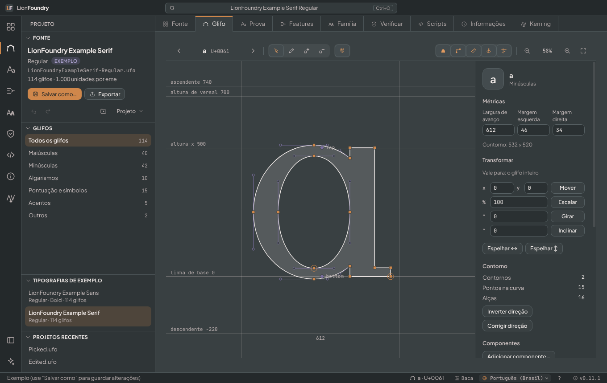
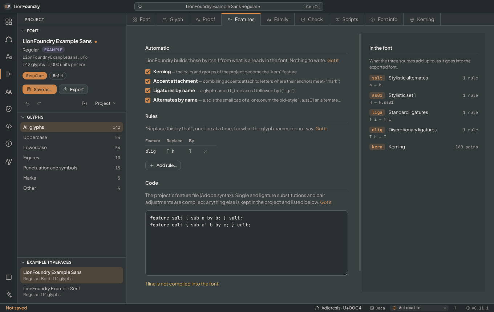

<div align="center">


# LionFoundry

### Desenhe uma família tipográfica inteira. Exporte todas as fontes em um clique.

Um editor de fontes livre e de código aberto, com uma interface limpa, feito para pessoas — e pronto para agentes de IA.

[English](README.md) · **Português (Brasil)**

<sub>pelo <b>LionFoundry Team</b> · criado e idealizado por <b>Daniel Michelon De Carli</b></sub>




</div>

## Baixar

Baixe o instalador do seu sistema. Os links trazem sempre a **versão mais recente**; cada instalador já traz o programa inteiro, então nada mais é baixado durante a instalação.

- **Windows 10/11** (x64): um assistente de instalação que deixa escolher a pasta. → [`LionFoundry-Setup.exe`](https://github.com/danielcarli/lionfoundry/releases/latest/download/LionFoundry-Setup.exe) · ou a versão portátil, sem instalação: [`LionFoundry-win-x64.zip`](https://github.com/danielcarli/lionfoundry/releases/latest/download/LionFoundry-win-x64.zip)
- **macOS** (Apple Silicon e Intel): abra o `.dmg` e arraste o LionFoundry para Aplicativos. → [`LionFoundry-mac-universal.dmg`](https://github.com/danielcarli/lionfoundry/releases/latest/download/LionFoundry-mac-universal.dmg)
- **Linux** (x64): `.deb` para Ubuntu, Debian, Mint…, `.rpm` para Fedora, RHEL, openSUSE…, ou o AppImage para qualquer distribuição, sem instalação. → [`.deb`](https://github.com/danielcarli/lionfoundry/releases/latest/download/lionfoundry_amd64.deb) · [`.rpm`](https://github.com/danielcarli/lionfoundry/releases/latest/download/lionfoundry.x86_64.rpm) · [AppImage](https://github.com/danielcarli/lionfoundry/releases/latest/download/LionFoundry-x86_64.AppImage)

> Os instaladores ainda não são assinados com um certificado pago. Na primeira vez, o Windows pode mostrar "O Windows protegeu o computador" (**Mais informações › Executar assim mesmo**) e o macOS pede para liberar o programa em **Ajustes do Sistema › Privacidade e Segurança › Abrir Mesmo Assim**. As somas de verificação de todos os arquivos estão em [`SHA256SUMS.txt`](https://github.com/danielcarli/lionfoundry/releases/latest/download/SHA256SUMS.txt).

Os instaladores são gerados pelo GitHub Actions a cada tag de versão (`.github/workflows/release.yml`), em máquinas Windows, macOS e Linux, a partir do código deste repositório. Eles são novos: os pacotes de Linux foram experimentados antes desta versão; os instaladores de Windows e de macOS ainda não foram experimentados num computador de verdade — se algum não abrir, por favor [avise](https://github.com/danielcarli/lionfoundry/issues). Sempre dá para [rodar a partir do código](#começar).

## Da primeira letra às fontes prontas

O LionFoundry leva você pelo trabalho inteiro em uma janela só: **desenhar** as letras, **espaçar e fazer o kerning**, adicionar **features OpenType**, montar a **família** — Regular, Bold, Italic e tudo o que fica entre eles — e **exportar** fontes que funcionam em qualquer programa e na web.

- **Livre e aberto.** Sem conta, sem assinatura, sem rede. As fontes que você faz são suas, com a licença que você escolher.
- **Fácil de ler.** Uma janela limpa, quatro temas, todos os atalhos em uma tela.
- **Familiar.** As palavras e as teclas dos editores de fontes que você já conhece: masters, instâncias, guias, `V`, `P`, `+`, `−`.

> **O LionFoundry é um projeto experimental.** Ele cobre todas as etapas de fazer uma tipografia em uma primeira forma, básica — veja em [Onde o programa está](#onde-o-programa-está) o que ainda falta. Até agora só foi usado em Linux; em Windows e macOS não foi testado. Guarde cópias das suas fontes.

## O que ele tem de diferente

| | |
|---|---|
| **A família inteira em um projeto** | Regular, Bold, Italic e os estilos intermediários ficam no mesmo projeto. Desenhe dois pesos e o LionFoundry calcula o Medium e o SemiBold para você. |
| **Um Exportar para tudo** | Um diálogo, um clique: todas as fontes da família, para desktop e para a web, em uma pasta nova — com a folha de estilos pronta para colar num site. |
| **Ele diz o que está errado e ajuda a consertar** | Um guia mostra o que está feito e o que falta. Uma lista de problemas leva a cada glifo. Dois masters que não concordam são acertados com um botão. |
| **Seus originais ficam protegidos** | Nada é gravado até você salvar. O primeiro salvamento guarda uma cópia do projeto como estava. "Salvar como" e Exportar nunca gravam por cima de nada. Tudo pode ser desfeito. |
| **Formatos abertos** | Os projetos são UFO: uma pasta de pequenos arquivos de texto que outros editores de fontes também abrem. Você não fica preso. |
| **Feito para agentes de IA desde o início** | Um agente pode ler, verificar, testar e gerar as suas fontes por um servidor local — no seu computador, com você no comando. O LionFoundry em si nunca fala com um provedor de IA. |

## Veja

<sub>As imagens abaixo mostram a interface em inglês; o programa também está em português.</sub>

### Desenhar

Selecionar, caneta, adicionar ponto e remover ponto. Alças que ficam na horizontal, na vertical ou a 45° quando você quer. **Guias** por glifo e **aderir**, para segurar os pontos na linha. Digite a largura e as margens; mova, escale, gire, incline e espelhe. Componentes e âncoras montam as letras acentuadas para você.

<div align="center">

</div>

### Ver todos os glifos

A fonte inteira em uma tela. Busque, filtre por tipo, crie, duplique, renomeie. **Adicionar glifos de uma língua** dá à fonte todas as letras que o português, o espanhol ou a Europa Ocidental pedem: as acentuadas são montadas com a letra e o acento que você já desenhou.

<div align="center">

</div>

### Montar a família

**Masters** são os estilos que você desenha. **Instâncias** são os estilos que o LionFoundry calcula entre eles. Crie um itálico a partir de qualquer master e redesenhe. Veja a família inteira composta no mesmo texto, lado a lado.

<div align="center">

</div>

Enquanto você desenha o Bold, o Regular está ali, ao fundo. O painel diz se os dois podem ser interpolados — e **Corrigir compatibilidade** põe contornos e pontos iniciais de acordo, sem mudar a forma.

<div align="center">

</div>

### Espaçar e fazer o kerning onde se lê

Clique numa letra na prova e ajuste o espaçamento e o kerning ali mesmo, no texto. A vista **Kerning** mantém grupos e pares organizados: um par feito para um grupo serve para todas as letras dele.

| | |
|---|---|
|  |  |

### Features OpenType, na profundidade que você quiser

**Automático:** chame um glifo de `f_i` e ele é uma ligadura; `a.sc` é um versalete; kerning e acentos simplesmente funcionam. **Regras:** "trocar isto por aquilo", uma linha por vez. **Código:** escreva você mesmo o arquivo de features. A prova mostra cada passo, então você vê por que uma letra mudou.

<div align="center">

</div>

### Saber quando está pronto

Um guia do que está feito. Quanto de cada língua a fonte já escreve. Cada problema, com um link para o glifo.

<div align="center">

</div>

### Exportar uma vez

Escolha o master em edição ou a família inteira, marque os formatos, pronto. TrueType para desktop, WOFF2 para a web e uma folha de estilos com as regras `@font-face`. Os nomes são gravados de modo que os botões de negrito e itálico de qualquer programa achem a fonte certa.

| | |
|---|---|
|  |  |

<sub>À direita: sete fontes exportadas pelo LionFoundry a partir de dois pesos desenhados e seus itálicos, renderizadas fora do programa.</sub>

### Deixar do seu jeito

Quatro temas, português e inglês, e todos os atalhos em uma tela (aperte `?`).

| | | |
|---|---|---|
|  |  |  |
|  |  |  |

## Trabalhar com IA

O LionFoundry foi pensado para que um agente de IA trabalhe nas suas fontes **com você**, não no seu lugar. Não há IA dentro do programa e nada é enviado para lugar nenhum: o agente que você escolher se conecta ao LionFoundry no seu próprio computador.

**O que um agente consegue fazer hoje**

- **Revisar** — verificar a fonte, ler os glifos com problema e explicar o que consertar.
- **Testar** — compor palavras e ver quais features e valores de kerning se aplicam, passo a passo.
- **Mudar em lote** — escrever um script ("aumente 10 unidades nas margens de todas as minúsculas") e gravar o resultado como um projeto novo para você conferir.
- **Gerar** — exportar a família inteira a cada revisão.

**Como conectar**

*1. O servidor local (Model Context Protocol).* Inicie o servidor na pasta onde estão as suas fontes. Na maioria dos programas de agente, a configuração é parecida com esta:

```json
{
  "mcpServers": {
    "lionfoundry": {
      "command": "node",
      "args": ["/caminho/para/lionfoundry/tools/mcp-server.js", "/caminho/para/as/suas/fontes"]
    }
  }
}
```

O agente ganha nove ferramentas: `describe_font`, `list_glyphs`, `get_glyph`, `validate_font`, `list_features`, `shape_text`, `export_font`, `export_family` e `run_script`. O servidor não abre porta de rede, não pede conta e só enxerga a pasta com que foi iniciado.

*2. A linha de comando.* O mesmo motor, para agentes que trabalham no terminal. Todo comando responde em JSON:

```sh
node tools/cli.js info      MinhaFonte.ufo                      # nomes, métricas, masters, contagens
node tools/cli.js glyphs    MinhaFonte.ufo acute                # uma linha de dados por glifo (filtrado pelo nome)
node tools/cli.js glyph     MinhaFonte.ufo a                    # o contorno completo de um glifo
node tools/cli.js validate  MinhaFonte.ufo                      # problemas; código de saída 1 quando há erros
node tools/cli.js features  MinhaFonte.ufo                      # as features da fonte e o código delas
node tools/cli.js shape     MinhaFonte.ufo "AVATAR" --off kern  # glifos, posições e passos de um texto
node tools/cli.js export    MinhaFonte.ufo MinhaFonte.woff2     # compilar uma fonte (.ttf ou .woff2)
node tools/cli.js export-family MinhaFonte.ufo fontes/          # todas as fontes da família em uma pasta nova
node tools/cli.js convert   Outra.ttf  Outra.ufo                # uma fonte TrueType como projeto novo
node tools/cli.js run       MinhaFonte.ufo ajuste.py --out Ajustada.ufo   # rodar um script e gravar o resultado como projeto novo
```

Acrescente `--weight Bold` a qualquer comando para trabalhar em um master.

*3. Scripts.* Peça um script a um agente e rode na vista Scripts. Os mesmos nomes em Python e em JavaScript, seguindo o [fontParts](https://fontparts.robotools.dev) onde é possível:

```python
for glyph in font:
    if glyph.leftMargin is not None:
        glyph.leftMargin += 10
font.kerning[("A", "V")] = -80
```

Dentro do programa, tudo o que um script faz volta como **um passo só, que você pode desfazer**.

*4. O próprio projeto.* Um projeto UFO é uma pasta de pequenos arquivos de texto. Um agente consegue ler o projeto e comparar duas versões sem ferramenta nenhuma.

**Você continua no comando**

- Pelo servidor e pela linha de comando, um projeto ou arquivo existente **nunca é alterado nem substituído**: os resultados vão sempre para um caminho que ainda não existe.
- O LionFoundry não usa a rede. A única exceção é a verificação de versão, e só quando você clica nela.
- Scripts são código: eles não rodam isolados numa caixa de segurança, então só rode scripts que você leu ou em que confia.

**O que ainda não faz:** o agente não trabalha no projeto que está aberto no programa (ele grava um projeto novo, e você abre), não há sugestões com pré-visualização dentro da interface, e um agente lê os números de um contorno — ele não enxerga o desenho.

## Onde o programa está

O LionFoundry é novo. Esta é a lista honesta.

| Faz | Ainda não faz |
|---|---|
| Abre UFO 2 e 3, grava UFO 3, importa TrueType | OpenType CFF (`.otf`), SFD do FontForge, arquivos do Glyphs |
| Exporta TrueType e WOFF2, compilados por código próprio | **Hinting** (as fontes ficam bem em impressão, na web e em telas de alta densidade; ficam moles em tamanhos pequenos nas telas antigas do Windows) |
| Masters, itálicos e instâncias no eixo de peso | **Fontes variáveis** (um `.designspace` é exportado para outras ferramentas), eixo de largura |
| Corrige a compatibilidade reordenando contornos e pontos iniciais | Acrescentar os pontos que faltam entre dois masters |
| Marca formas sobrepostas para que sejam preenchidas corretamente | Remover sobreposições, faca, operações booleanas |
| Grupos e pares de kerning, espaçamento na prova | Janela de métricas com vários glifos, espaçamento e kerning automáticos |
| Substituições, ligaduras, kerning e posicionamento de acentos | Lookups contextuais; escritas da direita para a esquerda e complexas |
| Glifos coloridos em cor chapada (COLR/CPAL) | Gradientes, cor em SVG e em bitmap |
| Desfazer para tudo, cópia de segurança no primeiro salvamento | Salvamento automático e recuperação depois de uma queda |
| Instaladores para Windows, macOS e Linux, gerados a cada versão | Testes em Windows e macOS; instaladores assinados; fontes grandes (CJK) |

## Começar

O caminho mais rápido é um instalador de [Baixar](#baixar). Para rodar a partir do código você precisa do [Node.js](https://nodejs.org) (LTS). Nos dois casos, o Python 3 só é necessário para scripts escritos em Python.

```sh
git clone https://github.com/danielcarli/lionfoundry.git
cd lionfoundry
npm install
npm start
```

No Windows também dá para clicar duas vezes em `start.bat`.

Duas tipografias de exemplo abrem pela barra lateral, para haver algo de verdade para explorar:

- **LionFoundry Example Sans** — dois masters, Regular e Bold, e duas instâncias entre eles, Medium e SemiBold;
- **LionFoundry Example Serif** — contraste entre traços grossos e finos, serifas finas.

Cada uma tem 114 glifos, com as letras acentuadas do português e do espanhol, grupos e pares de kerning. São originais, básicas de propósito, geradas por `tools/examples/build.py` e publicadas sob a SIL Open Font License 1.1 (`examples/OFL.txt`).

## Para quem desenvolve

A mesma organização em camadas do [LionOrganizer](https://github.com/danielcarli/lionorganizer), do [LionPhotos](https://github.com/danielcarli/lionphotos) e do [Visual Studio Code](https://github.com/microsoft/vscode): `base` não conhece nada acima dela, `platform` oferece os serviços do processo principal, `workbench` monta a interface. A interface roda num renderer isolado e só fala com o processo principal pela ponte `preload`.

```
src/
  base/common/     sem DOM, sem Node: o modelo da fonte, edição de contornos, guias e aderir, masters e instâncias,
                   features e composição de texto, validação, interpolação, o compilador TrueType, a API de scripts
  platform/        serviços do processo principal: leitor e gravador de UFO, importador de TrueType, WOFF2, scripts, versões
  code/            ponto de entrada do Electron e a ponte preload
  nls/             catálogos de mensagens: en.json, pt-BR.json
  workbench/       partes do layout, serviços (a fonte aberta, desfazer, exportar, temas) e as vistas:
                   fonte, glifo, prova, features, família, verificar, scripts, informações, kerning
examples/          as tipografias de exemplo (UFO 3)
tools/             testes, a linha de comando (cli.js), o servidor para agentes (mcp-server.js), o gerador dos exemplos
```

A fonte é dado puro (JSON) em todo lugar, e toda alteração passa por um ponto só — é isso que permite desfazer. As fontes são compiladas por código escrito para o LionFoundry a partir da especificação OpenType: não há bibliotecas de fontes entre as dependências. A única dependência é o Electron.

| Comando | O que faz |
|---|---|
| `npm start` | Roda o programa |
| `npm test` | Testes unitários e a verificação das traduções |
| `npm run test:e2e` | Abre o programa e usa — desenha com o mouse, edita, salva, exporta, importa, roda scripts — conferindo a tela e os arquivos no disco |
| `npm run shots` | O mesmo, salvando capturas de tela em `shots/` |
| `npm run cli -- <comando> …` | A linha de comando |
| `npm run mcp -- <pasta>` | O servidor para agentes de IA |
| `npm run examples` | Regenera as tipografias de exemplo (precisa de Python com `fonttools` e `skia-pathops`) |
| `npm run dist` | Gera os instaladores do sistema em que você está, com o electron-builder, em `dist/` (o fluxo de release faz isso para os três sistemas) |

As fontes exportadas também foram conferidas fora da suíte de testes com o OpenType Sanitizer, o fontTools, o FreeType e o HarfBuzz. Código, comentários e documentação técnica estão em inglês; a interface está em inglês e em português.

Segurança: `contextIsolation` e `sandbox` ligados, sem `nodeIntegration`, uma Content Security Policy estrita. O processo principal só lê os exemplos e o que você escolheu num diálogo do sistema, e só grava onde você escolheu.

## Histórico de versões

Veja o [CHANGELOG.md](CHANGELOG.md) (em inglês) — versão atual: **0.11.2**.

## Créditos

O LionFoundry foi **criado e idealizado por Daniel Michelon De Carli**, estudante de arquitetura e urbanismo, e é mantido pelo **LionFoundry Team** com quem contribui e traduz.

O material de terceiros está listado em [THIRD-PARTY-NOTICES.md](THIRD-PARTY-NOTICES.md).

## Licença

Copyright © 2026 LionFoundry Team.

O LionFoundry é software livre: você pode redistribuí-lo e/ou modificá-lo sob os termos da **[GNU General Public License v3.0](LICENSE)**, publicada pela Free Software Foundation, na versão 3 da licença ou (à sua escolha) em qualquer versão posterior. Ele é distribuído na esperança de ser útil, mas **sem nenhuma garantia**; veja a licença para os detalhes.

Em resumo: você pode usar, estudar, compartilhar e modificar o LionFoundry livremente; se distribuir uma versão modificada, ela também precisa ser publicada sob a GPL, com o código-fonte.

**A licença do programa não se estende às fontes feitas com ele.** As fontes criadas ou editadas no LionFoundry são trabalho seu, e a licença delas é você quem escolhe.
