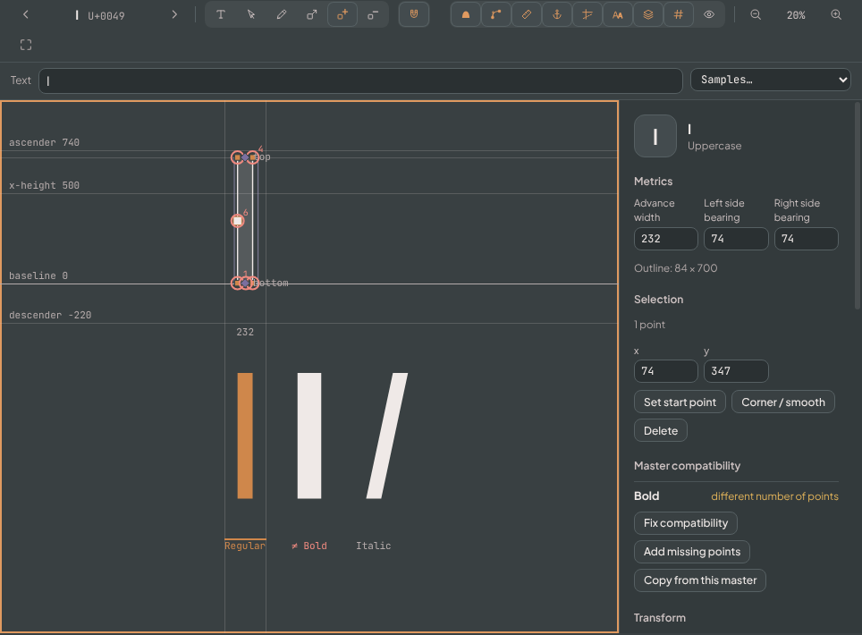
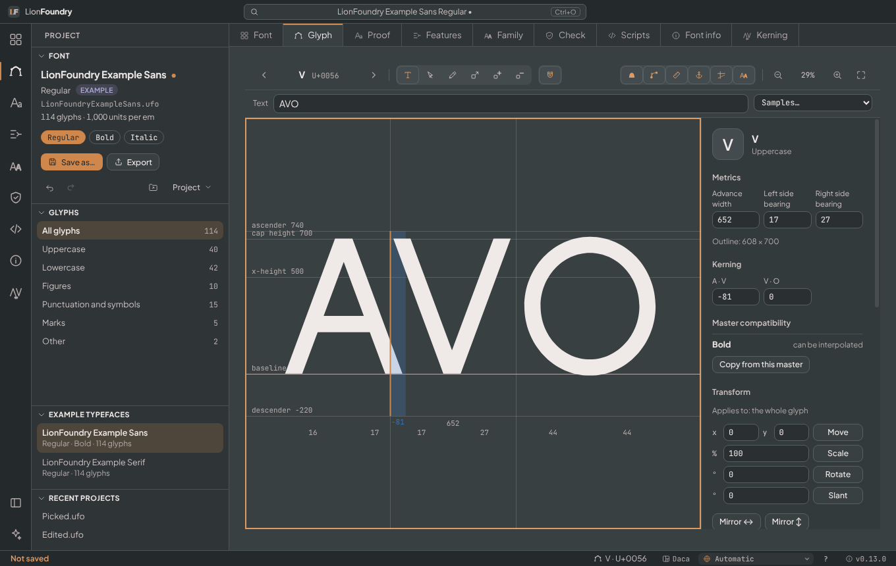
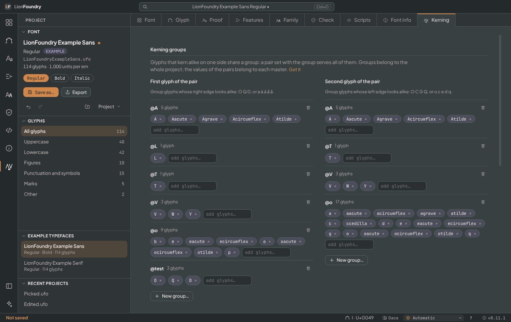
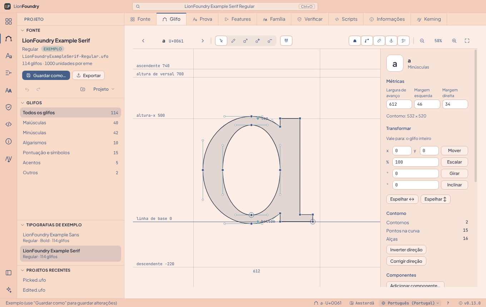

<div align="center">


# LionFoundry

### Desenhe uma família tipográfica inteira. Exporte todas as fontes com um clique.

Um editor de fontes livre e de código aberto, com uma interface limpa, feito para pessoas — e preparado para agentes de IA.

[English](README.md) · [Português (Brasil)](README.pt-BR.md) · **Português (Portugal)** · [Español](README.es.md) · [Français](README.fr.md) · [Deutsch](README.de.md) · [Italiano](README.it.md)

<sub>pela <b>LionFoundry Team</b> · criado e idealizado por <b>Daniel Michelon De Carli</b></sub>


</div>

> Esta versão em português europeu foi adaptada do texto em português do Brasil e ainda não foi revista por um falante nativo. O texto de referência é o [inglês](README.md); as correções são bem-vindas.

<a id="download"></a>

## Transferir

Transfira o instalador para o seu sistema. As ligações levam sempre à **versão mais recente**; cada instalador contém o programa completo, pelo que nada mais é transferido durante a instalação.

- **Windows 10/11** (x64): um assistente de instalação que permite escolher a pasta. → [`LionFoundry-Setup.exe`](https://github.com/danielcarli/lionfoundry/releases/latest/download/LionFoundry-Setup.exe) · ou a versão portátil, sem instalação: [`LionFoundry-win-x64.zip`](https://github.com/danielcarli/lionfoundry/releases/latest/download/LionFoundry-win-x64.zip)
- **macOS** (Apple Silicon, Intel): abra o `.dmg` e arraste o LionFoundry para Aplicações. → [`LionFoundry-mac-universal.dmg`](https://github.com/danielcarli/lionfoundry/releases/latest/download/LionFoundry-mac-universal.dmg)
- **Linux** (x64): `.deb` para Ubuntu, Debian, Mint…, `.rpm` para Fedora, RHEL, openSUSE…, ou a AppImage para qualquer distribuição, sem instalação. → [`.deb`](https://github.com/danielcarli/lionfoundry/releases/latest/download/lionfoundry_amd64.deb) · [`.rpm`](https://github.com/danielcarli/lionfoundry/releases/latest/download/lionfoundry.x86_64.rpm) · [AppImage](https://github.com/danielcarli/lionfoundry/releases/latest/download/LionFoundry-x86_64.AppImage)

> Os instaladores ainda não estão assinados com um certificado pago. No primeiro arranque, o Windows pode mostrar «O Windows protegeu o seu PC» (**Mais informações › Executar mesmo assim**) e o macOS pede para autorizar a aplicação em **Definições do Sistema › Privacidade e segurança › Abrir mesmo assim**. As somas de verificação de todos os ficheiros estão em [`SHA256SUMS.txt`](https://github.com/danielcarli/lionfoundry/releases/latest/download/SHA256SUMS.txt)

Os instaladores são gerados pelo GitHub Actions para cada etiqueta de versão (`.github/workflows/release.yml`), em máquinas Windows, macOS e Linux, a partir do código deste repositório. São recentes: os pacotes de Linux foram experimentados antes da publicação e o instalador de Windows já foi instalado e aberto num computador real; o de macOS ainda não foi experimentado — se algum não abrir, por favor [avise-nos](https://github.com/danielcarli/lionfoundry/issues). Pode sempre [executar a partir do código](#get-started).

## Da primeira letra às fontes prontas

O LionFoundry acompanha-o em todo o trabalho numa única janela: **desenhar** as letras, **espacejá-las e ajustar o kerning**, acrescentar **features OpenType**, montar a **família** — Regular, Bold, Italic e tudo o que fica entre eles — e **exportar** fontes que funcionam em qualquer programa e na web.

- **Livre e aberto.** Sem conta, sem subscrição, sem rede. As fontes que fizer são suas, com a licença que escolher.
- **Fácil de ler.** Uma janela limpa, quatro temas, todos os atalhos num só ecrã.
- **Familiar.** As palavras e as teclas dos editores de fontes que já conhece: masters, instâncias, guias, `V`, `P`, `+`, `−`.

> **O LionFoundry é um projeto experimental.** Cobre todas as etapas da criação de um tipo de letra numa primeira forma, básica — veja em [Em que ponto está](#where-it-stands) o que ainda falta. Foi usado sobretudo em Linux; em Windows teve apenas um primeiro teste e em macOS não foi testado. Guarde cópias das suas fontes.

## O que o torna diferente

| | |
|---|---|
| **Uma família inteira num só projeto** | Regular, Bold, Italic e os estilos intermédios ficam no mesmo projeto. Desenhe dois pesos e o LionFoundry calcula por si o Medium e o SemiBold. |
| **Um único Exportar para tudo** | Uma caixa de diálogo, um clique: todas as fontes da família, para o computador e para a web, numa pasta nova — com a folha de estilos pronta a colar num site. |
| **Diz o que está errado e ajuda a corrigir** | Um guia mostra o que está feito e o que falta. Uma lista de problemas leva a cada glifo. Dois masters que não coincidem corrigem-se com um botão. |
| **Os seus originais ficam protegidos** | Nada é gravado até guardar. A primeira gravação conserva uma cópia do projeto tal como estava. «Guardar como» e Exportar nunca escrevem por cima de nada. Tudo pode ser anulado. |
| **Formatos abertos** | Os projetos são UFO: uma pasta de pequenos ficheiros de texto que outros editores de fontes também abrem. Sem dependência. |
| **Feito para agentes de IA desde o início** | Um agente pode ler, verificar, testar e gerar as suas fontes através de um servidor local — no seu computador, consigo no comando. O LionFoundry nunca fala com um fornecedor de IA. |

## Veja

<sub>As imagens mostram a interface em inglês; o programa está em sete línguas, entre elas o português.</sub>

### Desenhar

Selecionar, caneta, escala, adicionar ponto, remover ponto, faca, retângulo e elipse. **Remover sobreposição**, unir, subtrair e interseção trabalham nas próprias curvas, por isso as curvas continuam curvas; **Acrescentar extremos** e **Limpar contornos** deixam os pontos onde os tipógrafos os querem. Rodar, uma **régua** que mostra a espessura de cada traço que atravessa, um laço, e um **fundo** para cada glifo e master, para comparar ou decalcar. Selecione vários pontos e aparece uma caixa à volta deles: arraste um canto para aumentar ou diminuir a forma, com Shift para manter as proporções e Alt para escalar a partir do centro — os gestos do Illustrator. Alças que ficam na horizontal, na vertical ou a 45° quando quiser. **Guias** por glifo e **Aderir**, para manter os pontos na linha. Escreva a largura e as margens laterais; mova, escale, rode, incline e espelhe. Os componentes e as âncoras montam as letras acentuadas por si.

<div align="center">

</div>

### Ver todos os glifos

A fonte inteira num só ecrã. Procure, filtre por tipo, crie, duplique, mude o nome. **Adicionar glifos de uma língua** dá à fonte todas as letras de que o português, o espanhol ou a Europa ocidental precisam: as acentuadas são montadas com a letra e o acento que já desenhou.

<div align="center">

</div>

### Montar a família

Os **masters** são os estilos que desenha. As **instâncias** são os estilos que o LionFoundry calcula entre eles. Crie um itálico a partir de qualquer master e redesenhe-o. Veja toda a família composta no mesmo texto, lado a lado.

<div align="center">

</div>

Enquanto desenha o Bold, o Regular está ali mesmo, por trás. O painel diz se os dois podem ser interpolados — e **Corrigir compatibilidade** põe de acordo os contornos e os pontos iniciais sem alterar a forma.

<div align="center">

</div>

Ative **Todos os masters** para ver a letra em cada master, por baixo da linha que está a desenhar; um duplo clique num deles leva-o até ele. **Compatibilidade** numera os pontos e liga cada um ao mesmo ponto do outro master — um anel vermelho marca o que não tem par, e **Acrescentar pontos em falta** acrescenta-o sem alterar a forma. **Pré-visualização** mostra a linha em qualquer peso entre os masters. Mantenha `Alt` premido com Adicionar ponto, Remover ponto, Inverter ou Corrigir direção para alterar todos os masters de uma vez.

<div align="center">

</div>

### Espacejar e ajustar o kerning onde se lê

A vista Glifo é uma linha de texto, como nos outros editores de fontes: escreva uma palavra, edite qualquer letra dela no meio das outras e altere pelo teclado as margens laterais e o kerning da letra depois do cursor (`Alt`, `Ctrl` e `Ctrl+Alt` com as setas). Na prova, clique numa letra e ajuste o seu espaçamento e o seu kerning ali mesmo, no texto. A vista **Kerning** mantém os grupos e os pares organizados: um par feito para um grupo serve para todas as suas letras.

<div align="center">

</div>

| | |
|---|---|
|  |  |

### Features OpenType, com a profundidade que quiser

**Automático:** dê a um glifo o nome `f_i` e é uma ligadura; `a.sc` é um versalete; o kerning e os acentos simplesmente funcionam. **Regras:** «trocar isto por aquilo», uma linha de cada vez. **Código:** escreva o ficheiro de features. A prova mostra cada passo, para que veja por que razão uma letra mudou.

<div align="center">

</div>

### Saber quando está pronta

Um guia do que está feito. Quanto de cada língua a fonte já escreve. Cada problema, com uma ligação para o glifo.

<div align="center">

</div>

### Exportar uma só vez

Escolha o master em edição ou a família inteira, marque os formatos, e está feito. TrueType para o computador, WOFF2 para a web e uma folha de estilos com as regras `@font-face`. Os nomes são escritos de modo que os botões de negrito e itálico de qualquer programa encontrem a fonte certa.

| | |
|---|---|
|  |  |

<sub>À direita: sete fontes exportadas pelo LionFoundry a partir de dois pesos desenhados e dos seus itálicos, apresentadas fora do programa.</sub>

### À sua maneira

Quatro temas, sete línguas — English, Português (Brasil e Portugal), Español, Français, Deutsch e Italiano — e todos os atalhos num só ecrã (prima `?`).

| | | |
|---|---|---|
|  |  |  |
|  |  |  |

## Trabalhar com IA

O LionFoundry foi pensado para que um agente de IA trabalhe nas suas fontes **consigo**, não em seu lugar. Não há IA dentro do programa e nada é enviado para lado nenhum: o agente que escolher liga-se ao LionFoundry no seu próprio computador.

**O que um agente pode fazer hoje**

- **Rever** — verificar a fonte, ler os glifos com problemas e explicar o que corrigir.
- **Testar** — compor palavras e ver que features e que valores de kerning se aplicam, passo a passo.
- **Alterar em massa** — escrever um script («acrescenta 10 unidades às margens laterais de todas as minúsculas») e guardar o resultado como um projeto novo, para que o possa ver.
- **Gerar** — exportar a família inteira depois de cada revisão.

**Como ligá-lo**

*1. O servidor local (Model Context Protocol).* Inicie-o na pasta onde estão as suas fontes. Na maior parte das aplicações de agentes, a configuração é assim:

```json
{
  "mcpServers": {
    "lionfoundry": {
      "command": "node",
      "args": ["/path/to/lionfoundry/tools/mcp-server.js", "/path/to/your/fonts"]
    }
  }
}
```

O agente recebe nove ferramentas: `describe_font`, `list_glyphs`, `get_glyph`, `validate_font`, `list_features`, `shape_text`, `export_font`, `export_family` e `run_script`. O servidor não tem porta de rede nem conta, e só vê a pasta com que foi iniciado.

*2. A linha de comandos.* O mesmo motor para agentes que trabalham num terminal. Todos os comandos respondem em JSON:

```sh
node tools/cli.js info      MyFont.ufo                      # names, metrics, masters, counts
node tools/cli.js glyphs    MyFont.ufo acute                # one line of data per glyph (filtered by name)
node tools/cli.js glyph     MyFont.ufo a                    # the full outline of one glyph
node tools/cli.js validate  MyFont.ufo                      # problems; exit code 1 when there are errors
node tools/cli.js features  MyFont.ufo                      # features of the font and their code
node tools/cli.js shape     MyFont.ufo "AVATAR" --off kern  # glyphs, positions and steps for a text
node tools/cli.js export    MyFont.ufo MyFont.woff2         # compile one font (.ttf or .woff2)
node tools/cli.js export-family MyFont.ufo fonts/           # every font of the family into a new folder
node tools/cli.js convert   Other.ttf  Other.ufo            # a TrueType font as a new project
node tools/cli.js run       MyFont.ufo fix.py --out Fixed.ufo   # run a script, save the result as a new project
```

Acrescente `--weight Bold` a qualquer comando para trabalhar num master.

*3. Scripts.* Peça um script a um agente e execute-o na vista Scripts. Os mesmos nomes em Python e em JavaScript, seguindo o [fontParts](https://fontparts.robotools.dev) sempre que possível:

```python
for glyph in font:
    if glyph.leftMargin is not None:
        glyph.leftMargin += 10
font.kerning[("A", "V")] = -80
```

Dentro do programa, tudo o que um script faz volta como **um único passo que pode anular**.

*4. O próprio projeto.* Um projeto UFO é uma pasta de pequenos ficheiros de texto. Um agente pode lê-lo e comparar duas versões sem ferramenta nenhuma.

**Continua no comando**

- Através do servidor e da linha de comandos, um projeto ou ficheiro existente **nunca é alterado nem substituído**: os resultados vão sempre para um caminho que ainda não existe.
- O LionFoundry não usa a rede. A única exceção é a verificação de versão, e só quando clica nela.
- Os scripts são código: não são executados numa caixa de segurança isolada, por isso execute apenas scripts que leu ou em que confia.

**O que ainda não faz:** o agente não trabalha no projeto que está aberto no programa (grava um projeto novo, e o utilizador abre-o), não há sugestões com pré-visualização dentro da interface, e um agente lê os números de um contorno — não vê o desenho.

<a id="where-it-stands"></a>

## Em que ponto está

O LionFoundry é jovem. Esta é a lista honesta.

| O que faz | O que ainda não faz |
|---|---|
| Abre UFO 2 e 3, guarda UFO 3, importa TrueType | OpenType CFF (`.otf`), FontForge SFD, ficheiros do software padrão da indústria |
| Exporta TrueType e WOFF2, compilados por código próprio | **Hinting** (as fontes ficam bem em impressão, na web e em ecrãs de alta densidade; ficam pouco nítidas em tamanhos pequenos nos ecrãs antigos do Windows) |
| Masters, itálicos e instâncias no eixo de peso | **Fontes variáveis** (é exportado um `.designspace` para outras ferramentas), um eixo de largura |
| Corrige a compatibilidade (contornos, pontos iniciais) e acrescenta os pontos que faltam num master | Compatibilizar masters com um número diferente de contornos |
| Remove sobreposições, une, subtrai, faz interseção e corta com a faca, nas próprias curvas | Componentes de canto e inteligentes, filtros (contorno deslocado, cantos arredondados) |
| Grupos e pares de kerning, espaçamento na prova | Uma janela de métricas com muitos glifos, espaçamento e kerning automáticos |
| Substituições, ligaduras, kerning e posicionamento de acentos | Lookups contextuais; escritas da direita para a esquerda e complexas |
| Glifos coloridos de cor lisa (COLR/CPAL) | Gradientes, cor SVG e bitmap |
| Anular para tudo, uma cópia de segurança na primeira gravação | Gravação automática e recuperação após uma falha |
| Instaladores para Windows, macOS e Linux, gerados para cada versão | Testes em Windows e macOS; instaladores assinados; fontes grandes (CJK) |

<a id="get-started"></a>

## Começar

O caminho mais rápido é um instalador de [Transferir](#download). Para executar a partir do código precisa do [Node.js](https://nodejs.org) (LTS). Nos dois casos, o Python 3 só é necessário para scripts escritos em Python.

```sh
git clone https://github.com/danielcarli/lionfoundry.git
cd lionfoundry
npm install
npm start
```

No Windows também pode fazer duplo clique em `start.bat`.

**Está a começar?** Siga o tutorial: [Do zero ao primeiro tipo de letra](docs/tutorial.pt-PT.md) — dois pesos e um itálico, passo a passo, com cada ferramenta explicada.

Dois tipos de letra de exemplo abrem-se a partir da barra lateral, para haver algo real para explorar:

- **LionFoundry Example Sans** — dois masters, Regular e Bold, e duas instâncias entre eles, Medium e SemiBold;
- **LionFoundry Example Serif** — contraste entre traços grossos e finos, serifas filiformes.

Cada um tem 114 glifos com as letras acentuadas do português e do espanhol, grupos e pares de kerning. São originais, deliberadamente básicos, gerados por `tools/examples/build.py` e publicados sob a SIL Open Font License 1.1 (`examples/OFL.txt`).

## Para programadores

O código, os comentários e a documentação técnica estão em inglês: a arquitetura, os comandos (`npm test`, `npm run test:e2e`, `npm run dist`…) e as notas de segurança estão na secção [For developers](README.md#for-developers) do README em inglês (ou em [Para quem desenvolve](README.pt-BR.md) no README em português do Brasil). As traduções da interface estão em `src/nls/` — um ficheiro JSON por língua — e `npm run test:i18n` verifica que não falta nenhuma mensagem.

## Registo de alterações

Veja o [CHANGELOG.md](CHANGELOG.md) (em inglês) — versão atual: **0.17.0**.

## Créditos

O LionFoundry foi **criado e idealizado por Daniel Michelon De Carli**, estudante de arquitetura e urbanismo, e é mantido pela **LionFoundry Team** em conjunto com os seus colaboradores e tradutores.

O material de terceiros está listado em [THIRD-PARTY-NOTICES.md](THIRD-PARTY-NOTICES.md).

## Licença

Copyright © 2026 LionFoundry Team.

O LionFoundry é software livre: pode redistribuí-lo e/ou modificá-lo nos termos da **[GNU General Public License v3.0](LICENSE)** publicada pela Free Software Foundation, seja a versão 3 da Licença ou (à sua escolha) qualquer versão posterior. É distribuído na esperança de que seja útil, mas **sem qualquer garantia**; consulte a licença para mais pormenores.

Em resumo: pode usar, estudar, partilhar e modificar o LionFoundry livremente; se distribuir uma versão modificada, esta também tem de ser publicada sob a GPL, com o código-fonte.

**A licença do programa não se estende às fontes feitas com ele.** As fontes criadas ou editadas no LionFoundry são obra sua, e é o utilizador quem escolhe a licença delas.
