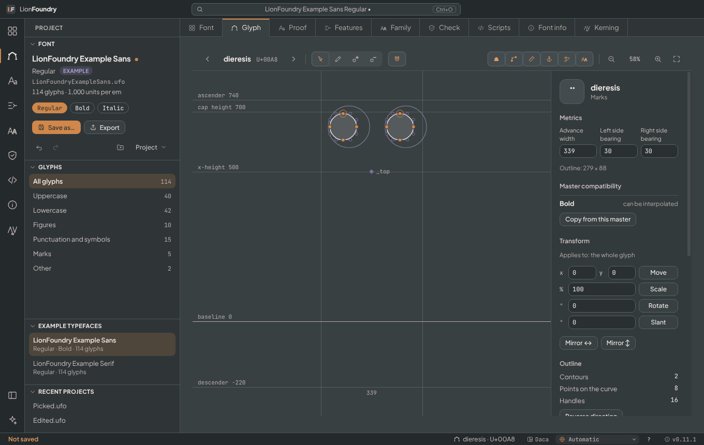

# Von null zur ersten Schrift

[English](tutorial.md) · [Português (Brasil)](tutorial.pt-BR.md) · [Português (Portugal)](tutorial.pt-PT.md) · [Español](tutorial.es.md) · [Français](tutorial.fr.md) · **Deutsch** · [Italiano](tutorial.it.md)

In diesem Tutorial beginnst du mit einem leeren Projekt und endest mit einer kleinen Familie, die sich installieren lässt: **Regular**, **Bold** und **Italic**, dazu zwei Schnitte, die LionFoundry selbst zwischen Regular und Bold berechnet.

Es ist kein Kurs im Buchstabenzeichnen. Es ist der Weg durch die App: was zu tun ist, in welcher Reihenfolge und wo du klickst. Die Zeichnung ist deine.

> LionFoundry ist experimentell: **Speichere oft** (`Strg+S`) und bewahre Kopien deines Projekts auf.

**Bevor du anfängst:** Drücke jederzeit `?`, um alle Tastaturkürzel zu sehen. Die Ansichten liegen auf `Strg+1` bis `Strg+9`: Schrift, Glyphe, Probe, Features, Familie, Prüfen, Skripte, Schriftinfo, Kerning.

Die Bilder zeigen die englische Oberfläche; die Namen in diesem Text sind die der deutschen Oberfläche. Diese Übersetzung wurde noch nicht von Muttersprachlern geprüft.

## Der Weg

| Teil | Was du tust |
|---|---|
| [Die Werkzeuge](#tools) | Zeichenstift, Auswahl, Skalieren und das Bedienfeld kennenlernen |
| [1. Das Projekt](#step-1) | Anlegen, speichern, die Höhen festlegen |
| [2. Die ersten Buchstaben](#step-2) | `n`, `o`, `H`, `O` zeichnen |
| [3. Der Rest des Alphabets](#step-3) | Die übrigen Buchstaben aus den ersten ableiten |
| [4. Zurichtung](#step-4) | Vor- und Nachbreite beim Lesen des Textes einstellen |
| [5. Akzente](#step-5) | Die Akzentbuchstaben bauen |
| [6. Kerning](#step-6) | Die Paare korrigieren, die übrig bleiben |
| [7. Die Bold](#step-7) | Die zweite Strichstärke und die Stärken dazwischen hinzufügen |
| [8. Die Italic](#step-8) | Die Kursive aus der Regular hinzufügen |
| [9. Prüfen](#step-9) | Die Problemliste lesen |
| [10. Exportieren](#step-10) | Alle Schriften auf einmal erzeugen |

## Begriffe, die dir begegnen

| Begriff | Was es ist |
|---|---|
| **Glyphe** | Die Zeichnung eines Zeichens. Der Buchstabe `a` ist eine Glyphe; `á` ist eine andere. |
| **Kontur** | Die geschlossene Linie, die die Zeichnung bildet. Das `o` hat zwei: die äußere und die innere. |
| **Punkt und Anfasser** | Der Punkt liegt auf der Linie. Die Anfasser gehen von ihm aus und bestimmen, wie sich die Kurve biegt. |
| **Vor- und Nachbreite** | Der Weißraum links und rechts von jedem Buchstaben. |
| **Kerning** | Eine Abstandsänderung nur für ein Buchstabenpaar, etwa `AV`. |
| **Master** | Ein Schnitt, den du zeichnest: Regular, Bold, Italic. |
| **Instanz** | Ein Schnitt, den die App zwischen zwei Mastern berechnet: Medium, SemiBold. |
| **Anker** | Ein benannter Punkt, der festlegt, wo ein Akzent auf einem Buchstaben sitzt. |

## Die Werkzeuge

Fast das gesamte Zeichnen geschieht in der Ansicht **Glyphe** (`Strg+2`). Das ist ihre Werkzeugleiste:

**Zum Zeichnen**

| Nr. | Werkzeug | Taste | Wofür |
|---|---|---|---|
| 2 | **Text** | `T` | Tippen, um Buchstaben in die Zeile zu setzen. Der Buchstabe nach dem Cursor ist der, den die Tasten ändern (Schritt 4). `Esc` kehrt zu seiner Zeichnung zurück. |
| 3 | **Auswahl** | `V` | Klicke auf einen Punkt, ziehe einen Rahmen auf, um mehrere zu nehmen, ziehe zum Verschieben. Die Pfeiltasten bewegen um 1 Einheit; mit `Umschalt` um 10. `Entf` entfernt. |
| 4 | **Zeichenstift** | `P` | Zeichnen. Klick: ein Eckpunkt. Klicken und ziehen: ein Kurvenpunkt. Klick auf den ersten Punkt: Die Form schließt sich. |
| 5 | **Skalieren** | `S` | Macht die Auswahl größer oder kleiner. Ziehen; `Umschalt` hält die Proportionen. |
| 6 | **Punkt hinzufügen** | `+` | Klicke auf die Linie, und dort entsteht ein Punkt. Die Form ändert sich nicht. |
| 7 | **Punkt entfernen** | `−` | Klicke auf einen Punkt, und er ist weg. Die Kurve bleibt so ähnlich wie möglich. |
| 8 | **Messer** | `E` | Eine Linie quer durch Formen ziehen: Sie werden in geschlossene Teile geschnitten. |
| 9 | **Rechteck** / **Ellipse** | `F` | Von Ecke zu Ecke ziehen, um ein Rechteck zu zeichnen; erneut `F` wechselt zur Ellipse. `Umschalt`: Quadrat oder Kreis. |
| 10 | **Drehen** | `R` | Dreht die Auswahl um ihre Mitte (klicken, um einen anderen Punkt zu wählen). `Umschalt`: in 15°-Schritten. |
| 11 | **Lineal** | `L` | Eine Linie ziehen: Sie zeigt Länge, Winkel und die Stärke jedes durchquerten Strichs. |
| 12 | **Einrasten** | `M` | (der Magnet) Zieht, was du bewegst, auf die Höhenlinien und Hilfslinien. `Alt` löst es für eine Bewegung. |

**Zum Ansehen**

| Nr. | Schaltfläche | Was sie ein- oder ausblendet |
|---|---|---|
| 1 | Pfeile | Vorherige und nächste Glyphe (auch `[` und `]`) |
| 13 | Füllung | Der gefüllte Buchstabe, wie er im Text aussehen wird |
| 14 | Punkte | Die Punkte und die Anfasser |
| 15 | Metrik | Die Höhenlinien und die Dickte des Buchstabens |
| 16 | Anker | Die Punkte, an denen Akzente sitzen |
| 17 | Hilfslinien | Deine eigenen Hilfslinien |
| 18 | Hintergrund | Die Kopie der Zeichnung dahinter, zum Vergleichen oder Nachzeichnen |
| 19 | Zoom | Vergrößern und verkleinern (auch mit dem Mausrad oder `Strg` `+` und `Strg` `−`) |
| 20 | Einpassen | Zeigt die ganze Glyphe (`Strg+0`). `Leertaste` + Ziehen verschiebt die Ansicht. |

Hat das Projekt mehr als einen Master, erscheint eine weitere Schaltfläche, **Andere Master**: Sie zeigt die andere Strichstärke hinter der, die du gerade zeichnest.

**Das Bedienfeld rechts** enthält den Rest: Dickte, Vor- und Nachbreite (**Metrik**), was ausgewählt ist, **Transformieren** (verschieben, skalieren, drehen, neigen und spiegeln nach Zahlen), Komponenten, Anker und **Hilfslinien**.

**Der Skalierrahmen.** Sind zwei oder mehr Punkte ausgewählt, erscheint ein Rahmen um sie. Ziehe an einer Ecke, um die Form zu vergrößern oder zu verkleinern. `Umschalt` hält die Proportionen; `Alt` skaliert von der Mitte aus.

**Ein Fehler?** `Strg+Z` macht alles rückgängig.

## 1. Das Projekt

1. **`Strg+N`** (Neues Projekt…). Gib den Namen der Familie ein und lass **1000** Einheiten pro Geviert stehen. Das Projekt beginnt mit leeren Glyphen für A–Z, a–z und die Ziffern.
2. **`Strg+Umschalt+S`** (Speichern unter…) und wähle den Speicherort. Das Projekt ist ein `.ufo`-Ordner.
3. Prüfe unter **Schriftinfo** (`Strg+8`) die Höhen. Ein guter Anfang für eine Textschrift:

| Linie | Wert |
|---|---|
| Oberlänge | 740 |
| Versalhöhe | 700 |
| x-Höhe | 500 |
| Unterlänge | −220 |

Diese Linien erscheinen in jeder Glyphe, und sie halten deine Punkte fest, wenn **Einrasten** eingeschaltet ist (Taste `M`).

## 2. Die ersten Buchstaben

Beginne mit vier Buchstaben. Sie entscheiden fast alles: `n` und `o` bestimmen die Kleinbuchstaben, `H` und `O` die Großbuchstaben.

Doppelklicke in der Ansicht **Schrift** (`Strg+1`) auf `n`, um es in der Ansicht **Glyphe** zu öffnen.

Nimm das Werkzeug **Zeichenstift** (`P`) und zeichne die Form, Punkt für Punkt. Wechsle dann zu **Auswahl** (`V`) und korrigiere.

**Vier Gewohnheiten, die später Arbeit sparen**

- **Punkte an den Extremen.** Setze die Punkte einer Kurve oben, unten und an den Seiten — nicht mitten in die Diagonale.
- **Gerade Anfasser.** Halte `Umschalt`, während du einen Anfasser ziehst, oder nutze `Umschalt+H` und `Umschalt+V`, um ihn horizontal oder vertikal zu stellen.
- **Runde Buchstaben gehen über die Linie hinaus.** `o` und `O` reichen etwa 10 Einheiten unter die Grundlinie und über die Höhe, sonst wirken sie kleiner als `n` und `H`.
- **Notiere die Strichstärke.** Miss den Stamm des `n` (zum Beispiel 80 Einheiten) und verwende denselben Wert in den anderen Buchstaben.

Gib im Bedienfeld unter **Metrik** die **Vorbreite** und die **Nachbreite** ein. Grobe Werte genügen fürs Erste: 60 für gerade Seiten, 30 für runde.

Brauchst du noch eine Linie? Füge im Bedienfeld unter **Hilfslinien** eine horizontale, vertikale oder diagonale Hilfslinie hinzu und ziehe sie an ihren Platz.

**Aus Formen bauen.** Manche Buchstaben entstehen schneller aus Teilen: ein Stamm mit dem **Rechteck** (`F`), eine Rundung mit der **Ellipse** (erneut `F`). Lass sie sich überlappen und drücke **Überlappung entfernen** (`Strg+Umschalt+O`): Sie werden zu einer Kontur, und Kurven bleiben Kurven. Das **Messer** (`E`) schneidet eine Form in zwei; mit ausgewählten Konturen kombinieren **Vereinigen**, **Subtrahieren** und **Schnittmenge** sie. **Extrempunkte hinzufügen** setzt die Punkte an die Extrempunkte, und **Konturen bereinigen** (`Strg+Umschalt+T`) entfernt überflüssige Punkte.

**Messen und vergleichen.** Das **Lineal** (`L`) zeigt die Stärke jedes Strichs, den es durchquert — so bleiben die Stämme leicht gleich. Vor einer großen Änderung legt **In den Hintergrund kopieren** (Bedienfeld) die alte Zeichnung hinter die neue; **Mit Hintergrund tauschen** holt sie wieder nach vorn. `Tab` geht von Punkt zu Punkt, `Strg+Umschalt+A` bringt die ausgewählten Punkte auf eine Linie, und `Alt` + Ziehen zieht ein Lasso um Punkte.

## 3. Der Rest des Alphabets

Zeichne nicht jeden Buchstaben von Grund auf. Kopiere und passe an.

1. In der Ausgangsglyphe, ohne Auswahl, kopiert **`Strg+C`** die ganze Zeichnung.
2. Öffne die Zielglyphe (`[` und `]` gehen zur vorherigen und zur nächsten) und drücke **`Strg+V`**.
3. Ändere, was geändert werden muss.

| Aus | wird |
|---|---|
| `n` | `h`, `m`, `r` und das `u` (das gedrehte `n`: im Bedienfeld unter Transformieren 180 eingeben und auf Drehen klicken) |
| `o` | `c`, `e`; mit einem Stamm: `b`, `d`, `p`, `q` |
| `H` | `E`, `F`, `L`, `T`, `I` |
| `O` | `C`, `G`, `Q`, `D` |

Um einen Teil größer oder kleiner zu machen, wähle seine Punkte aus und nutze den **Skalierrahmen**.

Klicke nach dem Einfügen oder Drehen im Bedienfeld auf **Richtung korrigieren**: Das bringt alle Konturen auf einmal in die richtige Richtung.

## 4. Zurichtung

Zugerichtet wird beim Lesen, nicht beim Messen. Öffne die Ansicht **Probe** (`Strg+3`).

1. Tippe `nnnonnnoonoo`, dann `HHHOHHHOOHOO`. Die Schaltfläche **Zurichtung** hält fertige Texte bereit.
2. **Klicke auf einen Buchstaben** im Text: Seine Vor- und Nachbreite und seine Dickte erscheinen. Ändere sie und sieh zu, wie der Text folgt.
3. Bringe zuerst `n` und `o` in Ordnung, bis der Rhythmus gleichmäßig ist. Gib dann jedem Buchstaben die Werte der Form, der er ähnelt: gerade Seiten wie `n`, runde Seiten wie `o`.

**Zurichten, wo du zeichnest.** Dasselbe geht in der Ansicht **Glyphe**: Tippe das Wort in ihr Feld **Text**, drücke `T` und setze den Cursor vor einen Buchstaben. `Alt + ← →` ändern seine Vorbreite, `Strg + ← →` seine Nachbreite, `Strg+Alt + ← →` sein Kerning mit dem Buchstaben davor; mit `Umschalt` in Schritten von 10. `Esc` kehrt zum Zeichnen dieses Buchstabens zurück.

## 5. Akzente

Akzentbuchstaben werden gebaut, nicht gezeichnet.

1. **Mache die Akzente.** In der Ansicht Schrift: **Neue Glyphe**. Lass das Zeichen leer und gib den Namen ein: `acute`, `grave`, `circumflex`, `tilde` und `cedilla`. Zeichne jeden.
2. **Markiere, wo sie sitzen.** In jedem Buchstaben, der einen Akzent trägt, im Bedienfeld **Anker hinzufügen…** mit dem Namen `top`, knapp über dem Buchstaben. In jedem Akzent ein Anker namens `_top` darunter. Die App verbindet das `_top` des Akzents mit dem `top` des Buchstabens. Für die Cedille verwende `bottom` im `c` und `_bottom` in der Cedille.
3. **Baue.** Im Aktionsmenü der Ansicht Schrift: **Glyphen einer Sprache hinzufügen…**, dann **Portugiesisch** wählen — die oben gezeichneten Akzente sind die des Portugiesischen. **Westeuropa** deckt auch Deutsch ab und braucht ein paar Akzente mehr, etwa das Trema (`dieresis`). Die Akzentbuchstaben entstehen von selbst. Was sich nicht bauen lässt, wird leer angelegt, damit du es zeichnest.

Das `a` geändert? `á`, `ã` und `â` ändern sich mit, weil sie das `a` als Komponente verwenden.

## 6. Kerning

Kerning ist für die Paare, die die Zurichtung nicht lösen kann: `AV`, `To`, `LT`, `r.`. Mache es **nach** der Zurichtung.

1. Lege in der Ansicht **Kerning** (`Strg+9`) mit **Neue Gruppe…** **Gruppen** an: Buchstaben, die sich auf einer Seite gleich verhalten, teilen sich eine Gruppe. Zum Beispiel `O Q D` als erste Glyphe des Paars; `O C G Q` als zweite. Ein Paar mit der Gruppe gilt für alle.
2. In der Ansicht **Probe**, Schaltfläche **Kerning**: Klicke auf den zweiten Buchstaben eines Paars und ändere sein **Kerning** mit dem Buchstaben davor.

Wenige gut gewählte Paare sind mehr wert als Hunderte. Wenn viele Paare korrigiert werden müssen, liegt das Problem in der Zurichtung.

## 7. Die Bold

Ein **Master** ist ein Schnitt, den du zeichnest. Bisher hast du einen: die Regular.

1. Ansicht **Familie** (`Strg+5`) › **Neuer Master…**. Position **700**, Name **Bold**.
2. Die Bold beginnt als **Kopie der Regular** und wird zum Master in Bearbeitung. In der Seitenleiste erscheinen zwei Schaltflächen, Regular und Bold: Dort wechselst du zwischen beiden.
3. Öffne einen Buchstaben und schalte in der Werkzeugleiste **Andere Master** ein: Die Regular erscheint dahinter.
4. Mache ihn fetter. **Verschiebe die Punkte; füge keine hinzu und entferne keine.** Wähle die Punkte auf einer Seite eines Stamms aus und schiebe sie mit den Pfeiltasten; bei Kurven verschiebst du den Punkt, und seine Anfasser folgen.

**Warum dieselben Punkte?** Um eine Stärke dazwischen zu berechnen, verbindet die App jeden Punkt der Regular mit demselben Punkt der Bold. Hat eine Seite einen Punkt mehr, geht das nicht. Das Bedienfeld zeigt unter **Master-Kompatibilität**, ob die Glyphe in Ordnung ist. Ist nur die Reihenfolge falsch, bringt **Kompatibilität herstellen** sie in Ordnung, ohne die Form zu ändern.

Fehlen Punkte, gibt **Fehlende Punkte hinzufügen** jedem Master die Punkte, die der andere hat, an derselben Stelle, ohne die Form zu ändern. Um zu sehen, wo sie sich unterscheiden, schalte **Kompatibilität** ein: Die Punkte bekommen Nummern, eine gestrichelte Linie führt zum selben Punkt im anderen Master, und ein roter Ring markiert, was kein Gegenstück hat. **Alle Master** zeigt den Buchstaben in jedem Master unter der Zeile, **Vorschau** das Wort in jeder Stärke dazwischen. Halte `Alt` beim Hinzufügen oder Entfernen eines Punktes, um es in allen Mastern zu tun.

In der Bold: Stämme von 80 werden etwa 140; die Innenräume werden kleiner; Vor- und Nachbreite werden etwas kleiner. Prüfe Zurichtung und Kerning erneut in der Probe — jeder Master hat seine eigenen.

**Die Instanzen.** Ziehe in der Ansicht Familie unter **Zwischen den Mastern** den Regler auf **500** und klicke auf **Diese Position als Instanz hinzufügen…** (Medium). Dasselbe bei **600** (SemiBold). Sie werden nicht gezeichnet: Sie werden bei jedem Export neu berechnet und folgen jeder Änderung an Regular und Bold.

## 8. Die Italic

1. Wechsle in der Seitenleiste zurück zur **Regular**.
2. Ansicht Familie › **Neue Kursive aus diesem Master…**. Neigung **10** Grad, Name **Italic**.
3. Die Kursive beginnt als **geneigte** Regular — eine Schräge mit denselben Punkten. Die eigentliche Arbeit beginnt jetzt.

**Was umzuzeichnen ist**

- **Die Kurven.** Das Neigen verbiegt die runden Buchstaben: Das `o` bekommt eine schwere Seite. Bringe Punkte und Anfasser wieder ins Gleichgewicht.
- **Die Formen einer Kursiven.** Das einstöckige `a`, ein runderes `e`, ein `f`, das unter die Grundlinie reicht, gebogene Ausläufe an `n`, `m`, `u`.
- **Die Breite.** Kursive sind meist etwas schmaler. Wähle alles aus (`Strg+A`) und nutze den seitlichen Griff des Skalierrahmens.
- **Zurichtung und Kerning**, wieder in der Probe.

Aufrechte und Kursive sind zwei Gruppen: Instanzen werden nur innerhalb jeder Gruppe berechnet. Mit einer einzigen Kursiven gibt es keine kursiven Instanzen. Für eine Bold Italic wiederhole Schritt 2 von der Bold aus.

## 9. Prüfen

Ansicht **Prüfen** (`Strg+6`).

- **Projektleitfaden**: was erledigt ist und was fehlt.
- **Die Sprachen**, direkt unter dem Leitfaden: wie viel von jeder die Schrift schon schreibt. **Glyphen hinzufügen…** neben einer Sprache legt an, was fehlt.
- **Probleme**: Jeder Eintrag führt dich zur Glyphe. Behebe die Fehler; lies die Warnungen. Glyphen, die sich nicht interpolieren lassen, stehen hier.

Prüfe jeden Master: Wechsle in der Seitenleiste und sieh dir die Liste erneut an.

## 10. Exportieren

1. **`Strg+E`** (oder die Schaltfläche **Exportieren** in der Seitenleiste).
2. Wähle unter **Was** **Die ganze Familie**. Kreuze **TrueType-Schrift (.ttf)** und **Webfont (.woff2)** an.
3. Wähle, wo der Ordner angelegt werden soll.

Du erhältst einen neuen Ordner mit:

| Ordner oder Datei | Wofür |
|---|---|
| `ttf/` | Zum Installieren auf einem Rechner: Regular, Italic, Medium, SemiBold, Bold |
| `woff2/` | Für Websites |
| `.css` | Die fertigen `@font-face`-Regeln |

Installiere die Schriften aus `ttf/` und schreibe einen echten Text in einem anderen Programm. Die Schaltflächen für Fett und Kursiv sollten die Bold und die Italic finden. Einen Fehler entdeckt? Geh zurück ins Projekt, behebe ihn und exportiere erneut: Jeder Export legt einen weiteren Ordner an und überschreibt nie etwas.

## Und danach?

- **Ziffern und Satzzeichen**: derselbe Weg wie bei den Buchstaben.
- **Ligaturen**: Lege eine Glyphe namens `f_i` an, und die Ligatur funktioniert von selbst (Ansicht **Features**).
- **Kapitälchen und Alternativen**: Glyphen namens `a.sc` oder `a.ss01` werden durch ihren Namen zu Features.
- **Bold Italic**: eine Kursive, die aus der Bold gemacht wird.

**Was LionFoundry dir noch nicht abnimmt:** Es hintet keine Schriften (sie sind im Druck, im Web und auf hochauflösenden Bildschirmen in Ordnung; in kleinen Größen auf älteren Windows-Bildschirmen weich), exportiert keine Variable Fonts, ergänzt nicht die Punkte, die zwischen zwei Mastern fehlen, und speichert nicht von selbst. Die vollständige Liste steht im [README](../README.de.md#where-it-stands).
