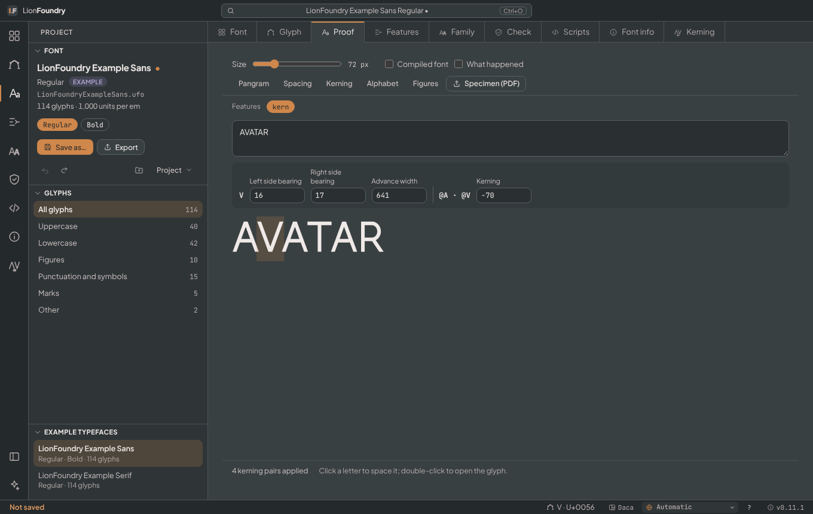
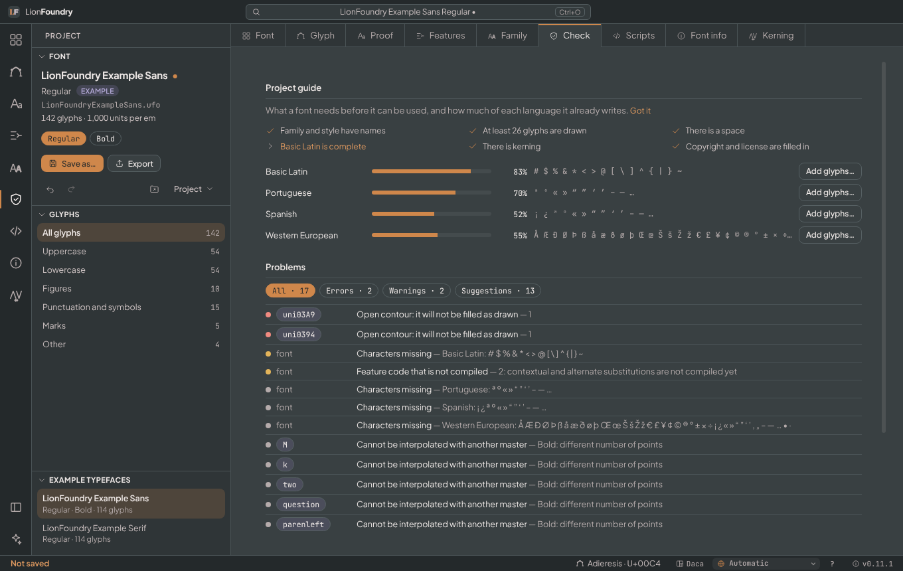

# De cero a la primera tipografía

[English](tutorial.md) · [Português (Brasil)](tutorial.pt-BR.md) · [Português (Portugal)](tutorial.pt-PT.md) · **Español** · [Français](tutorial.fr.md) · [Deutsch](tutorial.de.md) · [Italiano](tutorial.it.md)

En este tutorial empiezas con un proyecto vacío y terminas con una pequeña familia lista para instalar: **Regular**, **Bold** e **Italic**, más dos estilos que LionFoundry calcula por sí solo entre Regular y Bold.

No es un curso para dibujar letras. Es el camino dentro de la aplicación: qué hacer, en qué orden y dónde hacer clic. El dibujo es tuyo.

> LionFoundry es experimental: **guarda a menudo** (`Ctrl+S`) y conserva copias de tu proyecto.

**Antes de empezar:** pulsa `?` en cualquier momento para ver todos los atajos. Las vistas están en `Ctrl+1` a `Ctrl+9`: Fuente, Glifo, Prueba, Features, Familia, Comprobar, Scripts, Información, Kerning.

Las imágenes muestran la interfaz en inglés; los nombres de este texto son los de la interfaz en español. Esta traducción aún no ha sido revisada por una persona nativa.

## El camino

| Parte | Qué haces |
|---|---|
| [Las herramientas](#tools) | Conoce la pluma, la selección, la escala y el panel |
| [1. El proyecto](#step-1) | Créalo, guárdalo, fija las alturas |
| [2. Las primeras letras](#step-2) | Dibuja `n`, `o`, `H`, `O` |
| [3. El resto del alfabeto](#step-3) | Haz las demás letras a partir de las primeras |
| [4. El espaciado](#step-4) | Ajusta los márgenes laterales leyendo el texto |
| [5. Los acentos](#step-5) | Construye las letras acentuadas |
| [6. El kerning](#step-6) | Corrige los pares que quedan |
| [7. La Bold](#step-7) | Añade el segundo peso y los pesos intermedios |
| [8. La Italic](#step-8) | Añade la cursiva a partir de la Regular |
| [9. Comprobar](#step-9) | Lee la lista de problemas |
| [10. Exportar](#step-10) | Genera todas las fuentes de una vez |

## Palabras que verás

| Palabra | Qué es |
|---|---|
| **Glifo** | El dibujo de un carácter. La letra `a` es un glifo; `á` es otro. |
| **Contorno** | La línea cerrada que forma el dibujo. La `o` tiene dos: el exterior y el interior. |
| **Punto y manejador** | El punto está sobre la línea. Los manejadores salen de él y dicen cómo se curva. |
| **Márgenes laterales** | El espacio en blanco a la izquierda y a la derecha de cada letra. |
| **Kerning** | Un cambio de espacio solo para un par de letras, como `AV`. |
| **Master** | Un estilo que dibujas: Regular, Bold, Italic. |
| **Instancia** | Un estilo que la aplicación calcula entre dos masters: Medium, SemiBold. |
| **Ancla** | Un punto con nombre que dice dónde se coloca un acento sobre una letra. |

## Las herramientas

Casi todo el dibujo ocurre en la vista **Glifo** (`Ctrl+2`). Esta es su barra de herramientas:

**Para dibujar**

| N.º | Herramienta | Tecla | Para qué sirve |
|---|---|---|---|
| 2 | **Texto** | `T` | Escribir para poner letras en la línea. La letra después del cursor es la que cambian las teclas (paso 4). `Esc` vuelve a dibujarla. |
| 3 | **Seleccionar** | `V` | Haz clic en un punto, arrastra un recuadro para coger varios, arrastra para mover. Las flechas mueven 1 unidad; con `Mayús`, 10. `Supr` elimina. |
| 4 | **Pluma** | `P` | Dibuja. Clic: un punto recto. Clic y arrastrar: un punto de curva. Clic en el primer punto: la forma se cierra. |
| 5 | **Escala** | `S` | Agranda o reduce lo seleccionado. Arrastra; `Mayús` mantiene las proporciones. |
| 6 | **Añadir punto** | `+` | Haz clic en la línea y aparece un punto ahí. La forma no cambia. |
| 7 | **Quitar punto** | `−` | Haz clic en un punto y desaparece. La curva queda lo más parecida posible. |
| 8 | **Cuchillo** | `E` | Arrastra una línea que atraviese las formas: quedan cortadas en partes cerradas. |
| 9 | **Rectángulo** / **Elipse** | `F` | Arrastra de una esquina a la otra para dibujar un rectángulo; `F` otra vez cambia a la elipse. `Mayús`: cuadrado o círculo. |
| 10 | **Girar** | `R` | Gira lo seleccionado alrededor de su centro (haz clic para elegir otro punto). `Mayús`: en pasos de 15°. |
| 11 | **Regla** | `L` | Arrastra una línea: muestra su longitud, su ángulo y el grosor de cada trazo que atraviesa. |
| 12 | **Ajustar** | `M` | (el imán) Atrae lo que arrastras hacia las líneas de altura y las guías. `Alt` lo suelta durante un movimiento. |

**Para ver**

| N.º | Botón | Qué muestra u oculta |
|---|---|---|
| 1 | Flechas | Glifo anterior y siguiente (también `[` y `]`) |
| 13 | Relleno | La letra rellena, como se verá en un texto |
| 14 | Puntos | Los puntos y los manejadores |
| 15 | Métricas | Las líneas de altura y el ancho de la letra |
| 16 | Anclas | Los puntos donde se colocan los acentos |
| 17 | Guías | Tus propias líneas de ayuda |
| 18 | Fondo | La copia del dibujo guardada detrás, para comparar o calcar |
| 19 | Zoom | Acercar y alejar (también la rueda del ratón, o `Ctrl` `+` y `Ctrl` `−`) |
| 20 | Encajar | Muestra el glifo entero (`Ctrl+0`). `Espacio` + arrastrar mueve la vista. |

Cuando el proyecto tiene más de un master aparece un botón más, **Otros masters**: muestra el otro peso detrás del que estás dibujando.

**El panel de la derecha** tiene el resto: el ancho y los márgenes laterales (**Métricas**), lo que está seleccionado, **Transformar** (mover, escalar, girar, inclinar y reflejar con números), los componentes, las anclas y **Guías**.

**El recuadro de escala.** Con dos o más puntos seleccionados aparece un recuadro a su alrededor. Arrastra una esquina para agrandar o reducir la forma. `Mayús` mantiene las proporciones; `Alt` crece desde el centro.

**¿Un error?** `Ctrl+Z` lo deshace todo.

## 1. El proyecto

1. **`Ctrl+N`** (Nuevo proyecto…). Escribe el nombre de la familia y deja **1000** unidades por eme. El proyecto empieza con glifos vacíos para A–Z, a–z y las cifras.
2. **`Ctrl+Mayús+S`** (Guardar como…) y elige dónde guardar. El proyecto es una carpeta `.ufo`.
3. En **Información** (`Ctrl+8`), revisa las alturas. Un buen comienzo para una tipografía de texto:

| Línea | Valor |
|---|---|
| Ascendente | 740 |
| Altura de mayúsculas | 700 |
| Altura de x | 500 |
| Descendente | −220 |

Estas líneas aparecen en todos los glifos y sujetan tus puntos cuando **Ajustar** está activado (tecla `M`).

## 2. Las primeras letras

Empieza por cuatro letras. Lo deciden casi todo: `n` y `o` fijan las minúsculas, `H` y `O` las mayúsculas.

En la vista **Fuente** (`Ctrl+1`), haz doble clic en `n` para abrirla en la vista **Glifo**.

Coge la herramienta **Pluma** (`P`) y dibuja la forma, punto a punto. Luego cambia a **Seleccionar** (`V`) y ajusta.

**Cuatro costumbres que ahorran trabajo después**

- **Puntos en los extremos.** En una curva, pon los puntos arriba, abajo y a los lados — no en mitad de la diagonal.
- **Manejadores rectos.** Mantén `Mayús` mientras arrastras un manejador, o usa `Mayús+H` y `Mayús+V`, para dejarlo horizontal o vertical.
- **Las letras redondas sobrepasan la línea.** La `o` y la `O` bajan unas 10 unidades por debajo de la línea de base y suben otro tanto por encima de la altura; si no, parecen más pequeñas que `n` y `H`.
- **Apunta el grosor.** Mide el asta de la `n` (por ejemplo, 80 unidades) y usa el mismo valor en las demás letras.

En el panel, en **Métricas**, escribe **Margen izquierdo** y **Margen derecho**. Por ahora bastan valores aproximados: 60 para los lados rectos, 30 para los redondos.

¿Necesitas una línea más? En **Guías**, en el panel, añade una guía horizontal, vertical o diagonal y arrástrala a su sitio.

**Construir con formas.** Algunas letras salen más rápido por piezas: un asta con el **Rectángulo** (`F`), una panza con la **Elipse** (`F` otra vez). Deja que se superpongan y pulsa **Quitar superposición** (`Ctrl+Shift+O`): se vuelven un solo contorno, y las curvas siguen siendo curvas. El **Cuchillo** (`E`) corta una forma en dos; con contornos seleccionados, **Unir**, **Restar** e **Intersección** las combinan. **Añadir extremos** pone los puntos en los extremos por ti, y **Ordenar contornos** (`Ctrl+Shift+T`) quita los puntos que sobran.

**Medir y comparar.** La **Regla** (`L`) muestra el grosor de cada trazo que atraviesa: una forma rápida de mantener iguales las astas. Antes de un cambio grande, **Copiar al fondo** (panel) guarda el dibujo anterior detrás del nuevo; **Intercambiar con el fondo** lo devuelve al frente. `Tab` pasa de punto en punto, `Ctrl+Mayús+A` pone los puntos seleccionados en una línea, y `Alt` + arrastrar dibuja un lazo alrededor de los puntos.

## 3. El resto del alfabeto

No dibujes cada letra desde cero. Copia y adapta.

1. En el glifo de origen, sin nada seleccionado, **`Ctrl+C`** copia el dibujo entero.
2. Abre el glifo de destino (`[` y `]` van al anterior y al siguiente) y pulsa **`Ctrl+V`**.
3. Cambia lo que haga falta.

| De | Obtienes |
|---|---|
| `n` | `h`, `m`, `r` y la `u` (la `n` girada: en el panel, en Transformar, escribe 180 y haz clic en Girar) |
| `o` | `c`, `e`; con un asta: `b`, `d`, `p`, `q` |
| `H` | `E`, `F`, `L`, `T`, `I` |
| `O` | `C`, `G`, `Q`, `D` |

Para agrandar o reducir una parte, selecciona sus puntos y usa el **recuadro de escala**.

Después de pegar o girar, haz clic en **Corregir dirección** en el panel: pone todos los contornos en el sentido correcto de una vez.

## 4. El espaciado

El espaciado se ajusta leyendo, no midiendo. Abre la vista **Prueba** (`Ctrl+3`).

1. Escribe `nnnonnnoonoo` y después `HHHOHHHOOHOO`. El botón **Espaciado** tiene textos ya preparados.
2. **Haz clic en una letra** del texto: aparecen sus márgenes laterales y su ancho. Cámbialos y mira cómo el texto los sigue.
3. Deja bien primero `n` y `o`, hasta que el ritmo sea regular. Luego da a cada letra los márgenes de la forma a la que se parece: lados rectos como `n`, lados redondos como `o`.

**Espaciar donde dibujas.** Lo mismo funciona en la vista **Glifo**: escribe la palabra en su campo **Texto**, pulsa `T` y pon el cursor antes de una letra. `Alt + ← →` cambian su margen izquierdo, `Ctrl + ← →` el derecho, `Ctrl+Alt + ← →` su kerning con la letra anterior; con `Mayús`, de 10 en 10. `Esc` vuelve a dibujar esa letra.

## 5. Los acentos

Las letras acentuadas se construyen, no se dibujan.

1. **Haz los acentos.** En la vista Fuente, **Nuevo glifo**. Deja el carácter vacío y escribe el nombre: `acute`, `grave`, `circumflex`, `tilde` y `cedilla`. Dibuja cada uno.
2. **Marca dónde se colocan.** En cada letra que lleva acento, en el panel, **Añadir ancla…** con el nombre `top`, justo encima de la letra. En cada acento, un ancla llamada `_top` debajo de él. La aplicación une el `_top` del acento con el `top` de la letra. Para la cedilla, usa `bottom` en la `c` y `_bottom` en la cedilla.
3. **Construye.** En el menú de acciones de la vista Fuente, **Añadir glifos de un idioma…** y elige **Portugués** — los acentos dibujados arriba son los del portugués; **Español** necesita además la diéresis (`dieresis`) para la `ü`. Las letras acentuadas se construyen solas. Lo que no se puede construir se crea vacío, para que lo dibujes.

¿Has cambiado la `a`? `á`, `ã` y `â` cambian con ella, porque usan la `a` como componente.

## 6. El kerning

El kerning es para los pares que el espaciado no resuelve: `AV`, `To`, `LT`, `r.`. Hazlo **después** del espaciado.

1. En la vista **Kerning** (`Ctrl+9`), crea **grupos** con **Nuevo grupo…**: las letras que se comportan igual por un lado comparten grupo. Por ejemplo, `O Q D` como primer glifo del par; `O C G Q` como segundo. Un par hecho con el grupo sirve para todas.
2. En la vista **Prueba**, botón **Kerning**: haz clic en la segunda letra de un par y cambia su **kerning** con la letra anterior.

Unos pocos pares bien elegidos valen más que cientos. Si hay que corregir muchos pares, el problema está en el espaciado.

## 7. La Bold

Un **master** es un estilo que dibujas. Hasta ahora tienes uno: la Regular.

1. Vista **Familia** (`Ctrl+5`) › **Nuevo master…**. Posición **700**, nombre **Bold**.
2. La Bold empieza como una **copia de la Regular** y pasa a ser el master en edición. En la barra lateral aparecen dos botones, Regular y Bold: ahí cambias de uno a otro.
3. Abre una letra y activa **Otros masters** en la barra de herramientas: la Regular se ve detrás.
4. Hazla más pesada. **Mueve los puntos; no añadas ni quites ninguno.** Selecciona los puntos de un lado del asta y empújalos con las flechas; en las curvas, mueve el punto y sus manejadores lo siguen.

**¿Por qué los mismos puntos?** Para calcular un peso intermedio, la aplicación une cada punto de la Regular con el mismo punto de la Bold. Si un lado tiene un punto de más, no puede. El panel indica, en **Compatibilidad entre masters**, si el glifo está bien. Si solo falló el orden, **Corregir compatibilidad** lo arregla sin cambiar la forma.

Si faltan puntos, **Añadir los puntos que faltan** da a cada master los puntos que tiene el otro, en el mismo lugar, sin cambiar la forma. Para ver dónde difieren, activa **Compatibilidad**: los puntos llevan números, una línea discontinua va al mismo punto del otro master y un anillo rojo marca lo que no tiene pareja. **Todos los masters** muestra la letra en cada master bajo la línea, y **Vista previa** la palabra en cualquier peso intermedio. Mantén `Alt` al añadir o quitar un punto para hacerlo en todos los masters.

En la Bold: las astas de 80 pasan a unas 140; los espacios interiores se reducen; los márgenes laterales se reducen un poco. Revisa otra vez el espaciado y el kerning en la prueba — cada master tiene los suyos.

**Las instancias.** En la vista Familia, en **Entre los masters**, arrastra el control hasta **500** y haz clic en **Añadir esta posición como instancia…** (Medium). Haz lo mismo en **600** (SemiBold). No se dibujan: se calculan de nuevo en cada exportación y siguen cada cambio de la Regular y de la Bold.

## 8. La Italic

1. En la barra lateral, vuelve a la **Regular**.
2. Vista Familia › **Nueva cursiva a partir de este master…**. Inclinación **10** grados, nombre **Italic**.
3. La cursiva empieza como la Regular **inclinada** — una oblicua, con los mismos puntos. El trabajo de verdad empieza ahora.

**Qué redibujar**

- **Las curvas.** Inclinar deforma las letras redondas: la `o` queda con un lado pesado. Equilibra de nuevo puntos y manejadores.
- **Las formas propias de la cursiva.** La `a` de un solo piso, una `e` más redonda, una `f` que baja de la línea de base, salidas curvas en `n`, `m`, `u`.
- **El ancho.** Las cursivas suelen ser algo más estrechas. Selecciónalo todo (`Ctrl+A`) y usa el tirador lateral del recuadro de escala.
- **El espaciado y el kerning**, otra vez en la prueba.

Redondas y cursivas son dos grupos: las instancias se calculan solo dentro de cada uno. Con una sola cursiva no hay instancias cursivas. Para una Bold Italic, repite el paso 2 a partir de la Bold.

## 9. Comprobar

Vista **Comprobar** (`Ctrl+6`).

- **Guía del proyecto**: lo que está hecho y lo que falta.
- **Los idiomas**, justo debajo de la guía: cuánto de cada uno escribe ya la fuente. **Añadir glifos…** junto a un idioma crea lo que falta.
- **Problemas**: cada elemento te lleva al glifo. Corrige los errores; lee los avisos. Los glifos que no se pueden interpolar aparecen aquí.

Comprueba cada master: cambia en la barra lateral y mira la lista otra vez.

## 10. Exportar

1. **`Ctrl+E`** (o el botón **Exportar** de la barra lateral).
2. En **Qué**, elige **Toda la familia**. Marca **Fuente TrueType (.ttf)** y **Fuente web (.woff2)**.
3. Elige dónde crear la carpeta.

Obtienes una carpeta nueva con:

| Carpeta o archivo | Para qué |
|---|---|
| `ttf/` | Para instalar en un ordenador: Regular, Italic, Medium, SemiBold, Bold |
| `woff2/` | Para usar en sitios web |
| `.css` | Las reglas `@font-face`, listas |

Instala las fuentes de `ttf/` y escribe un texto real en otro programa. Los botones de negrita y cursiva deberían encontrar la Bold y la Italic. ¿Has visto un fallo? Vuelve al proyecto, corrígelo y exporta de nuevo: cada exportación crea otra carpeta y nunca sobrescribe nada.

## ¿Y después?

- **Cifras y puntuación**: el mismo camino que las letras.
- **Ligaduras**: crea un glifo llamado `f_i` y la ligadura funciona sola (vista **Features**).
- **Versalitas y alternativas**: los glifos llamados `a.sc` o `a.ss01` se convierten en features por su nombre.
- **Bold Italic**: una cursiva hecha a partir de la Bold.

**Lo que LionFoundry todavía no hace por ti:** no aplica hinting a las fuentes (se ven bien impresas, en la web y en pantallas de alta densidad; algo blandas en tamaños pequeños en pantallas antiguas de Windows), no exporta fuentes variables, no añade los puntos que faltan entre dos masters y no guarda por sí solo. La lista completa está en el [README](../README.es.md#where-it-stands).
