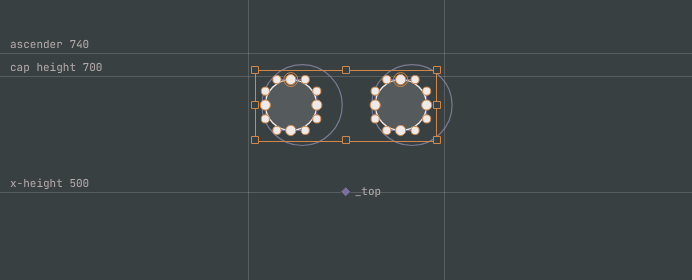
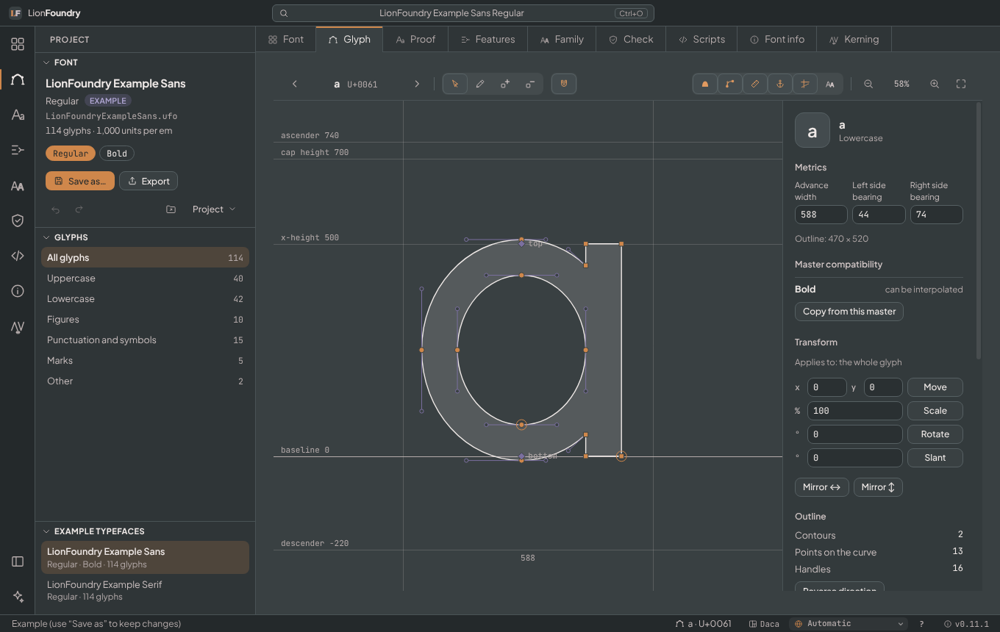

# De zéro au premier caractère

[English](tutorial.md) · [Português (Brasil)](tutorial.pt-BR.md) · [Português (Portugal)](tutorial.pt-PT.md) · [Español](tutorial.es.md) · **Français** · [Deutsch](tutorial.de.md) · [Italiano](tutorial.it.md)

Dans ce tutoriel, vous partez d’un projet vide et vous arrivez à une petite famille prête à installer : **Regular**, **Bold** et **Italic**, plus deux styles que LionFoundry calcule tout seul entre le Regular et le Bold.

Ce n’est pas un cours de dessin de lettres. C’est le chemin dans l’application : quoi faire, dans quel ordre et où cliquer. Le dessin, c’est le vôtre.

> LionFoundry est expérimental : **enregistrez souvent** (`Ctrl+S`) et gardez des copies de votre projet.

**Avant de commencer :** appuyez sur `?` à tout moment pour voir tous les raccourcis. Les vues sont sur `Ctrl+1` à `Ctrl+9` : Police, Glyphe, Épreuve, Features, Famille, Vérifier, Scripts, Informations, Crénage.

Les images montrent l’interface en anglais ; les noms cités dans ce texte sont ceux de l’interface en français. Cette traduction n’a pas encore été relue par une personne de langue maternelle française.

## Le chemin

| Partie | Ce que vous faites |
|---|---|
| [Les outils](#tools) | Découvrir la plume, la sélection, l’échelle et le panneau |
| [1. Le projet](#step-1) | Le créer, l’enregistrer, régler les hauteurs |
| [2. Les premières lettres](#step-2) | Dessiner `n`, `o`, `H`, `O` |
| [3. Le reste de l’alphabet](#step-3) | Faire les autres lettres à partir des premières |
| [4. Les approches](#step-4) | Régler les approches en lisant le texte |
| [5. Les accents](#step-5) | Construire les lettres accentuées |
| [6. Le crénage](#step-6) | Corriger les paires qui restent |
| [7. Le Bold](#step-7) | Ajouter la seconde graisse et les graisses intermédiaires |
| [8. L’Italic](#step-8) | Ajouter l’italique à partir du Regular |
| [9. Vérifier](#step-9) | Lire la liste des problèmes |
| [10. Exporter](#step-10) | Produire toutes les polices d’un coup |

## Les mots que vous verrez

| Mot | Ce que c’est |
|---|---|
| **Glyphe** | Le dessin d’un caractère. La lettre `a` est un glyphe ; `á` en est un autre. |
| **Contour** | La ligne fermée qui forme le dessin. Le `o` en a deux : l’extérieur et l’intérieur. |
| **Point et poignée** | Le point est sur la ligne. Les poignées en sortent et disent comment la courbe se plie. |
| **Approches** | Le blanc à gauche et à droite de chaque lettre. |
| **Crénage** | Une modification de l’espace pour une seule paire de lettres, comme `AV`. |
| **Master** | Un style que vous dessinez : Regular, Bold, Italic. |
| **Instance** | Un style que l’application calcule entre deux masters : Medium, SemiBold. |
| **Ancre** | Un point nommé qui dit où un accent se pose sur une lettre. |

## Les outils

Presque tout le dessin se fait dans la vue **Glyphe** (`Ctrl+2`). Voici sa barre d’outils :

**Pour dessiner**

| N° | Outil | Touche | À quoi il sert |
|---|---|---|---|
| 2 | **Texte** | `T` | Taper pour mettre des lettres dans la ligne. La lettre après le curseur est celle que les touches modifient (étape 4). `Échap` revient à son dessin. |
| 3 | **Sélection** | `V` | Cliquez sur un point, tracez un cadre pour en prendre plusieurs, faites glisser pour déplacer. Les flèches déplacent de 1 unité ; avec `Maj`, de 10. `Suppr` supprime. |
| 4 | **Plume** | `P` | Dessiner. Clic : un point droit. Cliquer-glisser : un point de courbe. Clic sur le premier point : la forme se ferme. |
| 5 | **Échelle** | `S` | Agrandir ou réduire ce qui est sélectionné. Faites glisser ; `Maj` conserve les proportions. |
| 6 | **Ajouter un point** | `+` | Cliquez sur la ligne et un point s’y place. La forme ne change pas. |
| 7 | **Supprimer un point** | `−` | Cliquez sur un point et il disparaît. La courbe reste aussi proche que possible. |
| 8 | **Couteau** | `E` | Faites glisser une ligne à travers les formes : elles sont coupées en parties fermées. |
| 9 | **Rectangle** / **Ellipse** | `F` | Faites glisser d’un coin à l’autre pour dessiner un rectangle ; `F` à nouveau passe à l’ellipse. `Maj` : carré ou cercle. |
| 10 | **Rotation** | `R` | Tourne la sélection autour de son centre (cliquez pour choisir un autre point). `Maj` : par pas de 15°. |
| 11 | **Règle** | `L` | Faites glisser une ligne : elle montre sa longueur, son angle et l’épaisseur de chaque trait traversé. |
| 12 | **Aimanter** | `M` | (l’aimant) Attire ce que vous faites glisser vers les lignes de hauteur et les repères. `Alt` relâche le temps d’un déplacement. |

**Pour voir**

| N° | Bouton | Ce qu’il affiche ou masque |
|---|---|---|
| 1 | Flèches | Glyphe précédent et suivant (aussi `[` et `]`) |
| 13 | Remplissage | La lettre remplie, comme elle apparaîtra dans un texte |
| 14 | Points | Les points et les poignées |
| 15 | Métriques | Les lignes de hauteur et la chasse de la lettre |
| 16 | Ancres | Les points où se posent les accents |
| 17 | Repères | Vos propres lignes d’aide |
| 18 | Arrière-plan | La copie du dessin gardée derrière lui, pour comparer ou décalquer |
| 19 | Zoom | Avant et arrière (aussi la molette de la souris, ou `Ctrl` `+` et `Ctrl` `−`) |
| 20 | Ajuster | Affiche le glyphe entier (`Ctrl+0`). `Espace` + glisser déplace la vue. |

Quand le projet a plus d’un master, un bouton de plus apparaît, **Autres masters** : il affiche l’autre graisse derrière celle que vous dessinez.

**Le panneau de droite** contient le reste : la chasse et les approches (**Métriques**), ce qui est sélectionné, **Transformer** (déplacer, mettre à l’échelle, faire pivoter, incliner et retourner par des nombres), les composants, les ancres et **Repères**.

**Le cadre d’échelle.** Avec deux points ou plus sélectionnés, un cadre apparaît autour d’eux. Faites glisser un coin pour agrandir ou réduire la forme. `Maj` conserve les proportions ; `Alt` part du centre.

**Une erreur ?** `Ctrl+Z` annule tout.

## 1. Le projet

1. **`Ctrl+N`** (Nouveau projet…). Saisissez le nom de la famille et laissez **1000** unités par cadratin. Le projet commence avec des glyphes vides pour A–Z, a–z et les chiffres.
2. **`Ctrl+Maj+S`** (Enregistrer sous…) et choisissez où enregistrer. Le projet est un dossier `.ufo`.
3. Dans **Informations** (`Ctrl+8`), vérifiez les hauteurs. Un bon départ pour un caractère de texte :

| Ligne | Valeur |
|---|---|
| Ascendante | 740 |
| Hauteur de capitale | 700 |
| Hauteur d’x | 500 |
| Descendante | −220 |

Ces lignes apparaissent dans tous les glyphes, et elles retiennent vos points quand **Aimanter** est activé (touche `M`).

## 2. Les premières lettres

Commencez par quatre lettres. Elles décident de presque tout : `n` et `o` fixent les bas de casse, `H` et `O` les capitales.

Dans la vue **Police** (`Ctrl+1`), double-cliquez sur `n` pour l’ouvrir dans la vue **Glyphe**.

Prenez l’outil **Plume** (`P`) et dessinez la forme, point par point. Passez ensuite à **Sélection** (`V`) et ajustez.

**Quatre habitudes qui épargnent du travail plus tard**

- **Des points aux extrêmes.** Sur une courbe, placez les points en haut, en bas et sur les côtés — pas au milieu de la diagonale.
- **Des poignées droites.** Maintenez `Maj` en faisant glisser une poignée, ou utilisez `Maj+H` et `Maj+V`, pour la rendre horizontale ou verticale.
- **Les lettres rondes dépassent la ligne.** Le `o` et le `O` descendent d’environ 10 unités sous la ligne de base et montent d’autant au-dessus de la hauteur, sinon ils paraissent plus petits que `n` et `H`.
- **Notez l’épaisseur.** Mesurez le fût du `n` (disons 80 unités) et reprenez la même valeur dans les autres lettres.

Dans le panneau, sous **Métriques**, saisissez **Approche gauche** et **Approche droite**. Des valeurs approximatives suffisent pour l’instant : 60 pour les côtés droits, 30 pour les côtés ronds.

Besoin d’une ligne de plus ? Sous **Repères**, dans le panneau, ajoutez un repère horizontal, vertical ou diagonal et faites-le glisser en place.

**Construire avec des formes.** Certaines lettres vont plus vite par morceaux : un fût avec le **Rectangle** (`F`), une panse avec l’**Ellipse** (`F` à nouveau). Laissez-les se chevaucher et appuyez sur **Supprimer le chevauchement** (`Ctrl+Maj+O`) : elles deviennent un seul contour, et les courbes restent des courbes. Le **Couteau** (`E`) coupe une forme en deux ; avec des contours sélectionnés, **Unir**, **Soustraire** et **Intersection** les combinent. **Ajouter les extrema** place les points aux extrema pour vous, et **Nettoyer les contours** (`Ctrl+Maj+T`) retire les points inutiles.

**Mesurer et comparer.** La **Règle** (`L`) montre l’épaisseur de chaque trait qu’elle traverse — un moyen rapide de garder des fûts égaux. Avant un grand changement, **Copier à l’arrière-plan** (panneau) garde l’ancien dessin derrière le nouveau ; **Échanger avec l’arrière-plan** le ramène devant. `Tab` passe d’un point à l’autre, `Ctrl+Maj+A` aligne les points sélectionnés, et `Alt` + glisser trace un lasso autour des points.

## 3. Le reste de l’alphabet

Ne dessinez pas chaque lettre à partir de rien. Copiez et adaptez.

1. Dans le glyphe de départ, sans rien sélectionner, **`Ctrl+C`** copie tout le dessin.
2. Ouvrez le glyphe d’arrivée (`[` et `]` vont au précédent et au suivant) et appuyez sur **`Ctrl+V`**.
3. Modifiez ce qui doit l’être.

| À partir de | Vous obtenez |
|---|---|
| `n` | `h`, `m`, `r` et le `u` (le `n` retourné : dans le panneau, sous Transformer, saisissez 180 et cliquez sur Pivoter) |
| `o` | `c`, `e` ; avec un fût : `b`, `d`, `p`, `q` |
| `H` | `E`, `F`, `L`, `T`, `I` |
| `O` | `C`, `G`, `Q`, `D` |

Pour agrandir ou réduire une partie, sélectionnez ses points et utilisez le **cadre d’échelle**.

Après avoir collé ou fait pivoter, cliquez sur **Corriger le sens** dans le panneau : tous les contours sont remis dans le bon sens d’un coup.

## 4. Les approches

Les approches se règlent en lisant, pas en mesurant. Ouvrez la vue **Épreuve** (`Ctrl+3`).

1. Saisissez `nnnonnnoonoo`, puis `HHHOHHHOOHOO`. Le bouton **Espacement** propose des textes tout prêts.
2. **Cliquez sur une lettre** du texte : ses approches et sa chasse apparaissent. Modifiez-les et regardez le texte suivre.
3. Réglez d’abord `n` et `o`, jusqu’à ce que le rythme soit régulier. Donnez ensuite à chaque lettre les approches de la forme à laquelle elle ressemble : côtés droits comme `n`, côtés ronds comme `o`.

**Régler les approches là où l’on dessine.** La même chose fonctionne dans la vue **Glyphe** : tapez le mot dans son champ **Texte**, appuyez sur `T` et placez le curseur avant une lettre. `Alt + ← →` changent son approche gauche, `Ctrl + ← →` sa droite, `Ctrl+Alt + ← →` son crénage avec la lettre précédente ; avec `Maj`, de 10 en 10. `Échap` revient au dessin de cette lettre.

## 5. Les accents

Les lettres accentuées se construisent, elles ne se dessinent pas.

1. **Faites les accents.** Dans la vue Police, **Nouveau glyphe**. Laissez le caractère vide et saisissez le nom : `acute`, `grave`, `circumflex`, `tilde` et `cedilla`. Dessinez chacun.
2. **Indiquez où ils se posent.** Dans chaque lettre qui reçoit un accent, dans le panneau, **Ajouter une ancre…** nommée `top`, juste au-dessus de la lettre. Dans chaque accent, une ancre nommée `_top` en dessous. L’application réunit le `_top` de l’accent et le `top` de la lettre. Pour la cédille, utilisez `bottom` dans le `c` et `_bottom` dans la cédille.
3. **Construisez.** Dans le menu d’actions de la vue Police, **Ajouter les glyphes d’une langue…** et choisissez **Portugais** — les accents dessinés ci-dessus sont ceux du portugais. **Europe de l’Ouest** couvre aussi le français et demande quelques accents de plus, comme le tréma (`dieresis`). Les lettres accentuées se construisent toutes seules. Ce qui ne peut pas être construit est créé vide, à dessiner.

Vous avez modifié le `a` ? `á`, `ã` et `â` changent avec lui, parce qu’ils utilisent le `a` comme composant.

## 6. Le crénage

Le crénage sert aux paires que les approches ne peuvent pas résoudre : `AV`, `To`, `LT`, `r.`. Faites-le **après** les approches.

1. Dans la vue **Crénage** (`Ctrl+9`), créez des **groupes** avec **Nouveau groupe…** : les lettres qui se comportent de la même façon d’un côté partagent un groupe. Par exemple, `O Q D` comme premier glyphe de la paire ; `O C G Q` comme second. Une paire faite avec le groupe vaut pour toutes.
2. Dans la vue **Épreuve**, bouton **Crénage** : cliquez sur la seconde lettre d’une paire et modifiez son **crénage** avec la lettre qui la précède.

Quelques paires bien choisies valent mieux que des centaines. S’il faut corriger beaucoup de paires, le problème vient des approches.

## 7. Le Bold

Un **master** est un style que vous dessinez. Pour l’instant vous en avez un : le Regular.

1. Vue **Famille** (`Ctrl+5`) › **Nouveau master…**. Position **700**, nom **Bold**.
2. Le Bold commence comme une **copie du Regular** et devient le master en cours de modification. Deux boutons apparaissent dans la barre latérale, Regular et Bold : c’est là que vous passez de l’un à l’autre.
3. Ouvrez une lettre et activez **Autres masters** dans la barre d’outils : le Regular apparaît derrière.
4. Graissez-la. **Déplacez les points ; n’en ajoutez pas et n’en retirez pas.** Sélectionnez les points d’un côté d’un fût et poussez-les avec les flèches ; sur les courbes, déplacez le point et ses poignées suivent.

**Pourquoi les mêmes points ?** Pour calculer une graisse intermédiaire, l’application relie chaque point du Regular au même point du Bold. Si un côté a un point de plus, elle ne le peut pas. Le panneau indique, sous **Compatibilité entre masters**, si le glyphe est correct. Si seul l’ordre est faux, **Corriger la compatibilité** le rétablit sans changer la forme.

S’il manque des points, **Ajouter les points manquants** donne à chaque master les points que l’autre possède, au même endroit, sans changer la forme. Pour voir où ils diffèrent, activez **Compatibilité** : les points reçoivent un numéro, un trait pointillé rejoint le même point dans l’autre master, et un anneau rouge signale ce qui n’a pas de correspondant. **Tous les masters** montre la lettre dans chaque master sous la ligne, et **Aperçu** le mot à n’importe quelle graisse intermédiaire. Maintenez `Alt` en ajoutant ou en supprimant un point pour le faire dans tous les masters.

Dans le Bold : les fûts de 80 passent à environ 140 ; les contreformes rétrécissent ; les approches diminuent un peu. Vérifiez à nouveau les approches et le crénage dans l’épreuve — chaque master a les siens.

**Les instances.** Dans la vue Famille, sous **Entre les masters**, faites glisser le curseur jusqu’à **500** et cliquez sur **Ajouter cette position comme instance…** (Medium). Faites de même à **600** (SemiBold). Elles ne sont pas dessinées : elles sont recalculées à chaque export et suivent toutes les modifications du Regular et du Bold.

## 8. L’Italic

1. Dans la barre latérale, revenez au **Regular**.
2. Vue Famille › **Nouvel italique à partir de ce master…**. Inclinaison **10** degrés, nom **Italic**.
3. L’italique commence comme le Regular **incliné** — un oblique, avec les mêmes points. Le vrai travail commence maintenant.

**Ce qu’il faut redessiner**

- **Les courbes.** L’inclinaison déforme les lettres rondes : le `o` se retrouve avec un côté lourd. Rééquilibrez les points et les poignées.
- **Les formes propres à l’italique.** Le `a` à un seul étage, un `e` plus rond, un `f` qui descend sous la ligne de base, des sorties courbes sur `n`, `m`, `u`.
- **La largeur.** Les italiques sont en général un peu plus étroits. Sélectionnez tout (`Ctrl+A`) et utilisez la poignée latérale du cadre d’échelle.
- **Les approches et le crénage**, à nouveau dans l’épreuve.

Les romains et les italiques forment deux groupes : les instances ne sont calculées qu’à l’intérieur de chacun. Avec un seul italique, il n’y a pas d’instances italiques. Pour un Bold Italic, répétez l’étape 2 à partir du Bold.

## 9. Vérifier

Vue **Vérifier** (`Ctrl+6`).

- **Guide du projet** : ce qui est fait et ce qui manque.
- **Les langues**, juste sous le guide : quelle part de chacune la police écrit déjà. **Ajouter des glyphes…** à côté d’une langue crée ce qui manque.
- **Problèmes** : chaque élément vous mène au glyphe. Corrigez les erreurs ; lisez les avertissements. Les glyphes qui ne peuvent pas être interpolés sont listés ici.

Vérifiez chaque master : changez dans la barre latérale et regardez à nouveau la liste.

## 10. Exporter

1. **`Ctrl+E`** (ou le bouton **Exporter** de la barre latérale).
2. Sous **Quoi**, choisissez **Toute la famille**. Cochez **Police TrueType (.ttf)** et **Police web (.woff2)**.
3. Choisissez où créer le dossier.

Vous obtenez un nouveau dossier avec :

| Dossier ou fichier | Pour quoi faire |
|---|---|
| `ttf/` | À installer sur un ordinateur : Regular, Italic, Medium, SemiBold, Bold |
| `woff2/` | À utiliser sur des sites web |
| `.css` | Les règles `@font-face`, prêtes à l’emploi |

Installez les polices de `ttf/` et écrivez un vrai texte dans un autre logiciel. Les boutons Gras et Italique devraient trouver le Bold et l’Italic. Vous avez repéré un défaut ? Revenez au projet, corrigez-le et exportez à nouveau : chaque export crée un autre dossier et n’écrase jamais rien.

## Et ensuite ?

- **Chiffres et ponctuation** : le même chemin que pour les lettres.
- **Ligatures** : créez un glyphe nommé `f_i` et la ligature fonctionne toute seule (vue **Features**).
- **Petites capitales et variantes** : les glyphes nommés `a.sc` ou `a.ss01` deviennent des features par leur nom.
- **Bold Italic** : un italique fait à partir du Bold.

**Ce que LionFoundry ne fait pas encore pour vous :** il n’applique pas de hinting aux polices (elles sont bonnes à l’impression, sur le web et sur les écrans haute densité ; un peu molles en petits corps sur les anciens écrans Windows), n’exporte pas de polices variables, n’ajoute pas les points qui manquent entre deux masters et n’enregistre pas tout seul. La liste complète est dans le [README](../README.fr.md#where-it-stands).
