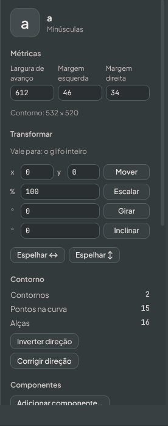
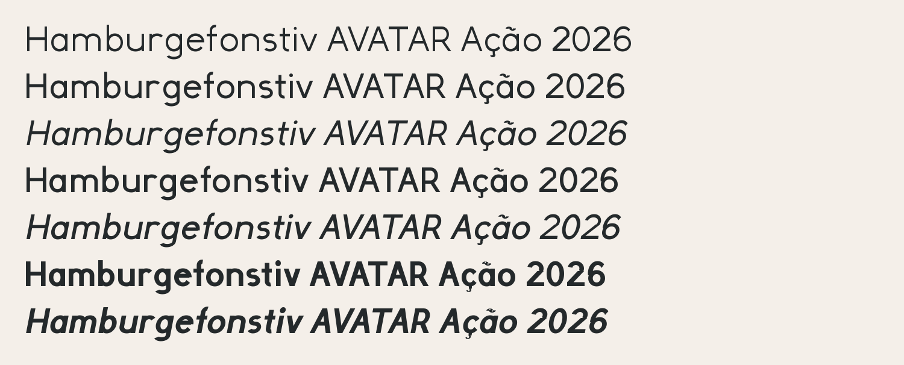

# Do zero à primeira tipografia

[English](tutorial.md) · **Português (Brasil)** · [Português (Portugal)](tutorial.pt-PT.md) · [Español](tutorial.es.md) · [Français](tutorial.fr.md) · [Deutsch](tutorial.de.md) · [Italiano](tutorial.it.md)

Neste tutorial você sai de um projeto vazio e chega a uma pequena família pronta para instalar: **Regular**, **Bold** e **Italic**, mais dois estilos que o LionFoundry calcula sozinho entre o Regular e o Bold.

Não é um curso de desenho de letras. É o caminho dentro do programa: o que fazer, em que ordem e onde clicar. O desenho é seu.

> As imagens mostram a interface em inglês; os nomes no texto são os da interface em português. O LionFoundry é experimental: **salve com frequência** (`Ctrl+S`) e guarde cópias do projeto.

**Antes de começar:** aperte `?` a qualquer momento para ver todos os atalhos. As vistas ficam em `Ctrl+1` a `Ctrl+9`: Fonte, Glifo, Prova, Features, Família, Verificar, Scripts, Informações, Kerning.

## O caminho

| Parte | O que você faz |
|---|---|
| [As ferramentas](#as-ferramentas) | Conhece a caneta, a seleção, a escala e o painel |
| [1. O projeto](#1-o-projeto) | Cria, salva e define as alturas |
| [2. As primeiras letras](#2-as-primeiras-letras) | Desenha `n`, `o`, `H`, `O` |
| [3. O resto do alfabeto](#3-o-resto-do-alfabeto) | Faz as outras letras a partir das primeiras |
| [4. Espaçamento](#4-espaçamento) | Acerta as margens lendo o texto |
| [5. Acentos](#5-acentos) | Monta as letras acentuadas |
| [6. Kerning](#6-kerning) | Corrige os pares que sobram |
| [7. O Bold](#7-o-bold) | Cria o segundo peso e os pesos do meio |
| [8. O Italic](#8-o-italic) | Cria o itálico a partir do Regular |
| [9. Verificar](#9-verificar) | Lê a lista de problemas |
| [10. Exportar](#10-exportar) | Gera todas as fontes de uma vez |

## Palavras que você vai ver

| Palavra | O que é |
|---|---|
| **Glifo** | O desenho de um caractere. A letra `a` é um glifo; o `á` é outro. |
| **Contorno** | A linha fechada que forma o desenho. O `o` tem dois: o de fora e o de dentro. |
| **Ponto e alça** | O ponto fica sobre a linha. As alças saem dele e dizem como a curva dobra. |
| **Margens** | O espaço em branco à esquerda e à direita de cada letra. |
| **Kerning** | Um ajuste de espaço só para um par de letras, como `AV`. |
| **Master** | Um estilo que você desenha: Regular, Bold, Italic. |
| **Instância** | Um estilo que o programa calcula entre dois masters: Medium, SemiBold. |
| **Âncora** | Um ponto com nome que diz onde o acento encaixa na letra. |

## As ferramentas

Quase todo o desenho acontece na vista **Glifo** (`Ctrl+2`). Esta é a barra dela:

**Para desenhar**

| Nº | Ferramenta | Tecla | Para que serve |
|---|---|---|---|
| 2 | **Texto** | `T` | Digitar para pôr letras na linha. A letra depois do cursor é a que as teclas mudam (passo 4). `Esc` volta a desenhá-la. |
| 3 | **Selecionar** | `V` | Clicar num ponto, arrastar uma caixa para pegar vários, arrastar para mover. As setas movem 1 unidade; com `Shift`, 10. `Delete` apaga. |
| 4 | **Caneta** | `P` | Desenhar. Clique: ponto reto. Clique e arraste: ponto de curva. Clique no primeiro ponto: fecha a forma. |
| 5 | **Escala** | `S` | Aumentar ou diminuir o que está selecionado. Arraste; `Shift` mantém as proporções. |
| 6 | **Adicionar ponto** | `+` | Clique na linha e um ponto entra ali. A forma não muda. |
| 7 | **Remover ponto** | `−` | Clique num ponto e ele sai. A curva continua o mais parecida possível. |
| 8 | **Faca** | `E` | Arraste uma linha atravessando as formas: elas são cortadas em partes fechadas. |
| 9 | **Retângulo** / **Elipse** | `F` | Arraste de um canto ao outro para desenhar um retângulo; `F` de novo muda para a elipse. `Shift`: quadrado ou círculo. |
| 10 | **Girar** | `R` | Gira o que está selecionado em volta do centro (clique para escolher outro ponto). `Shift`: de 15° em 15°. |
| 11 | **Régua** | `L` | Arraste uma linha: ela mostra o comprimento, o ângulo e a espessura de cada traço que atravessa. |
| 12 | **Aderir** (o ímã) | `M` | Puxa o que você arrasta para as linhas de altura e para as guias. `Alt` solta por um movimento. |

**Para ver**

| Nº | Botão | O que mostra ou esconde |
|---|---|---|
| 1 | Setas | Glifo anterior e próximo (também `[` e `]`) |
| 13 | Preenchimento | A letra pintada, como vai aparecer no texto |
| 14 | Pontos | Os pontos e as alças |
| 15 | Métricas | As linhas de altura e a largura da letra |
| 16 | Âncoras | Os pontos de encaixe dos acentos |
| 17 | Guias | As suas linhas de apoio |
| 18 | Fundo | A cópia do desenho guardada atrás dele, para comparar ou decalcar |
| 19 | Zoom | Aproximar e afastar (também a roda do mouse, ou `Ctrl` `+` e `Ctrl` `−`) |
| 20 | Enquadrar | Mostra o glifo inteiro (`Ctrl+0`). `Espaço` + arrastar move a vista. |

Quando o projeto tem mais de um master, aparece mais um botão, **Outros masters**: ele mostra o outro peso ao fundo.

**O painel à direita** tem o resto: a largura e as margens (**Métricas**), o que está selecionado, **Transformar** (mover, escalar, girar, inclinar, espelhar por número), componentes, âncoras e **Guias**.

**A caixa de escala.** Com dois ou mais pontos selecionados, aparece uma caixa em volta deles. Arraste um canto para aumentar ou diminuir. `Shift` mantém as proporções; `Alt` faz crescer a partir do centro.

**Errou?** `Ctrl+Z` desfaz qualquer coisa.

## 1. O projeto

1. **`Ctrl+N`** (Novo projeto…). Dê o nome da família e deixe **1000** unidades por eme. O projeto começa com glifos vazios para A–Z, a–z e os algarismos.
2. **`Ctrl+Shift+S`** (Salvar como…) e escolha onde gravar. O projeto é uma pasta `.ufo`.
3. Na vista **Informações** (`Ctrl+8`), confira as alturas. Um bom começo para uma fonte de texto:

| Linha | Valor |
|---|---|
| Ascendente | 740 |
| Altura de versal | 700 |
| Altura-x | 500 |
| Descendente | −220 |

Essas linhas aparecem em todo glifo e seguram os pontos quando **Aderir** está ligado (tecla `M`).

## 2. As primeiras letras

Comece por quatro letras. Elas decidem quase tudo: `n` e `o` definem as minúsculas, `H` e `O` as maiúsculas.

Na vista **Fonte** (`Ctrl+1`), dê dois cliques no `n` para abrir a vista **Glifo**.

Pegue a **Caneta** (`P`) e desenhe a forma, ponto por ponto. Depois troque para **Selecionar** (`V`) e ajuste. As ferramentas estão explicadas [mais acima](#as-ferramentas).

**Quatro hábitos que poupam trabalho depois**

- **Pontos nos extremos.** Numa curva, ponha os pontos no topo, na base e nos lados — não no meio da diagonal.
- **Alças retas.** Segure `Shift` ao arrastar uma alça, ou use `Shift+H` e `Shift+V`, para deixá-la na horizontal ou na vertical.
- **Redondas passam da linha.** O `o` e o `O` ultrapassam a linha de base e a altura em cerca de 10 unidades, senão parecem menores que o `n` e o `H`.
- **Anote a espessura.** Meça a haste do `n` (por exemplo, 80 unidades) e use o mesmo valor nas outras letras.

No painel à direita, em **Métricas**, digite a **Margem esquerda** e a **Margem direita**. Valores provisórios servem: 60 para lados retos, 30 para lados redondos.

Precisa de uma linha a mais? Em **Guias**, no painel, adicione uma guia horizontal, vertical ou diagonal e arraste até o lugar.

**Montar com formas.** Algumas letras saem mais rápido em pedaços: uma haste com o **Retângulo** (`F`), um bojo com a **Elipse** (`F` de novo). Deixe que se sobreponham e aperte **Remover sobreposição** (`Ctrl+Shift+O`): viram um contorno só, e as curvas continuam curvas. A **Faca** (`E`) corta uma forma em duas; com contornos selecionados, **Unir**, **Subtrair** e **Interseção** combinam as formas. **Adicionar extremos** põe os pontos nos extremos para você, e **Limpar contornos** (`Ctrl+Shift+T`) tira os pontos que sobram.

**Medir e comparar.** A **Régua** (`L`) mostra a espessura de cada traço que atravessa — um jeito rápido de manter as hastes iguais. Antes de uma mudança grande, **Copiar para o fundo** (painel) guarda o desenho antigo atrás do novo; **Trocar com o fundo** traz ele de volta para a frente. `Tab` passa de ponto em ponto, `Ctrl+Shift+A` põe os pontos selecionados numa linha, e `Alt` + arrastar faz um laço em volta dos pontos.

## 3. O resto do alfabeto

Não desenhe cada letra do zero. Copie e adapte.

1. No glifo de origem, sem nada selecionado, **`Ctrl+C`** copia o desenho inteiro.
2. Abra o glifo de destino (`[` e `]` passam para o anterior e o próximo) e **`Ctrl+V`**.
3. Mude o que precisa.

| De | Saem |
|---|---|
| `n` | `h`, `m`, `r` e o `u` (o `n` girado: no painel, em Transformar, digite 180 e clique em Girar) |
| `o` | `c`, `e`; com uma haste: `b`, `d`, `p`, `q` |
| `H` | `E`, `F`, `L`, `T`, `I` |
| `O` | `C`, `G`, `Q`, `D` |

Para aumentar ou diminuir uma parte, selecione os pontos: aparece uma **caixa com alças**. Arraste um canto; `Shift` mantém as proporções, `Alt` escala a partir do centro.

Depois de colar ou girar, use **Corrigir direção** no painel: ele acerta o sentido dos contornos de uma vez.

## 4. Espaçamento

Espaçamento se acerta lendo, não medindo. Abra a **Prova** (`Ctrl+3`).

1. Digite `nnnonnnoonoo` e depois `HHHOHHHOOHOO`. O botão **Espaçamento** traz textos prontos.
2. **Clique numa letra** do texto: aparecem as margens e a largura dela. Mude e veja o texto se ajustar na hora.
3. Acerte primeiro o `n` e o `o` até o ritmo ficar regular. Depois dê a cada letra as margens da forma parecida: lados retos como o `n`, lados redondos como o `o`.

**Espaçar onde se desenha.** O mesmo funciona na vista **Glifo**: digite a palavra no campo **Texto**, aperte `T` e ponha o cursor antes de uma letra. `Alt + ← →` mudam a margem esquerda dela, `Ctrl + ← →` a direita, `Ctrl+Alt + ← →` o kerning com a letra anterior; com `Shift`, de 10 em 10. `Esc` volta a desenhar essa letra.

## 5. Acentos

As letras acentuadas são montadas, não desenhadas.

1. **Crie os acentos.** Na vista Fonte, **Novo glifo**. Deixe o caractere vazio e escreva o nome: `acute` (agudo), `grave`, `circumflex` (circunflexo), `tilde` (til) e `cedilla` (cedilha). Desenhe cada um.
2. **Marque o encaixe.** Em cada letra que leva acento, no painel, **Adicionar âncora…** com o nome `top`, logo acima da letra. Em cada acento, uma âncora `_top` embaixo dele. O programa junta a `_top` do acento com a `top` da letra. Para a cedilha, use `bottom` no `c` e `_bottom` na cedilha.
3. **Monte.** No menu de ações da vista Fonte, **Adicionar glifos de uma língua…** e escolha Português. As letras acentuadas são montadas sozinhas. O que não dá para montar é criado vazio, para você desenhar.

Mudou o `a`? O `á`, o `ã` e o `â` mudam juntos, porque usam o `a` como componente.

## 6. Kerning

Kerning é para os pares que o espaçamento não resolve: `AV`, `To`, `LT`, `r.`. Faça **depois** de espaçar.

1. Na vista **Kerning** (`Ctrl+9`), crie **grupos** com **Novo grupo…**: letras que se comportam igual de um lado dividem um grupo. Por exemplo, `O Q D` no primeiro lado do par; `O C G Q` no segundo. Um par feito com o grupo vale para todas.
2. Na **Prova**, botão **Kerning**: clique na segunda letra de um par e ajuste o **kerning** com a letra anterior.

Poucos pares bem escolhidos valem mais que centenas. Se muitos pares pedem ajuste, o problema está no espaçamento.

## 7. O Bold

Um **master** é um estilo desenhado. Até aqui você tem um: o Regular.

1. Vista **Família** (`Ctrl+5`) › **Novo master…**. Posição **700**, nome **Bold**.
2. O Bold nasce como **cópia do Regular** e passa a ser o master em edição. Na barra lateral aparecem dois botões, Regular e Bold: é ali que você troca de um para o outro.
3. Abra uma letra e ligue **Outros masters** na barra do glifo: o Regular aparece ao fundo.
4. Engrosse. **Mova os pontos; não acrescente nem remova.** Selecione os pontos de um lado da haste e empurre com as setas; nas curvas, mova o ponto e as alças acompanham.

**Por que os mesmos pontos?** Para calcular um peso do meio, o programa liga cada ponto do Regular ao mesmo ponto do Bold. Se um lado tem um ponto a mais, a conta não fecha. O painel mostra, em **Compatibilidade entre masters**, se o glifo está certo. Se só a ordem saiu do lugar, **Corrigir compatibilidade** acerta sem mudar a forma.

Se faltam pontos, **Adicionar pontos que faltam** dá a cada master os pontos que o outro tem, no mesmo lugar, sem mudar a forma. Para ver onde diferem, ligue **Compatibilidade**: os pontos ganham números, uma linha tracejada vai até o mesmo ponto no outro master, e um anel vermelho marca o que não tem par. **Todos os masters** mostra a letra em cada master embaixo da linha, e **Pré-visualização** a palavra em qualquer peso intermediário. Segure `Alt` ao adicionar ou remover um ponto para fazer isso em todos os masters.

No Bold: hastes de 80 viram cerca de 140; os vazados internos encolhem; as margens ficam um pouco menores. Reveja o espaçamento e o kerning na Prova — cada master tem os seus.

**As instâncias.** Na vista Família, em **Entre os masters**, arraste o controle até **500** e clique em **Adicionar esta posição como instância…** (Medium). Faça o mesmo em **600** (SemiBold). Elas não são desenhadas: são recalculadas a cada exportação e acompanham toda mudança no Regular e no Bold.

## 8. O Italic

1. Na barra lateral, volte para o **Regular**.
2. Vista Família › **Novo itálico a partir deste master…**. Inclinação **10** graus, nome **Italic**.
3. O itálico nasce como o Regular **inclinado** — um oblíquo, com os mesmos pontos. O trabalho de verdade começa agora.

**O que redesenhar**

- **As curvas.** A inclinação deforma as redondas: o `o` fica com um lado pesado. Reequilibre os pontos e as alças.
- **As formas próprias do itálico.** O `a` de um andar só, o `e` mais redondo, o `f` que desce abaixo da linha de base, as saídas curvas no `n`, `m`, `u`.
- **A largura.** Itálicos costumam ser um pouco mais estreitos. Selecione tudo (`Ctrl+A`) e use a alça lateral da caixa.
- **O espaçamento e o kerning**, de novo na Prova.

Romanos e itálicos são dois grupos: as instâncias são calculadas só dentro de cada um. Com um itálico só, não há instâncias itálicas. Para ter um Bold Italic, repita o passo 2 a partir do Bold.

## 9. Verificar

Vista **Verificar** (`Ctrl+6`).

- **Guia do projeto**: o que está feito e o que falta.
- **As línguas**, logo abaixo do guia: quanto de cada uma a fonte já escreve. **Adicionar glifos…** ao lado de uma língua cria o que falta.
- **Problemas**: cada item leva ao glifo. Resolva os erros; leia os avisos. Glifos que não podem ser interpolados aparecem aqui.

Confira cada master: troque na barra lateral e olhe a lista de novo.

## 10. Exportar

1. **`Ctrl+E`** (ou o botão **Exportar** na barra lateral).
2. Em **O quê**, escolha **A família inteira**. Marque **Fonte TrueType (.ttf)** e **Fonte web (.woff2)**.
3. Escolha onde criar a pasta.

Você recebe uma pasta nova com:

| Pasta ou arquivo | Para quê |
|---|---|
| `ttf/` | Instalar no computador: Regular, Italic, Medium, SemiBold, Bold |
| `woff2/` | Usar em sites |
| `.css` | As regras `@font-face` prontas |

Instale as fontes de `ttf/` e escreva um texto de verdade em outro programa. Os botões de negrito e itálico devem achar o Bold e o Italic. Achou um defeito? Volte ao projeto, corrija e exporte de novo: cada exportação cria outra pasta e nunca grava por cima.

## E agora?

- **Algarismos e pontuação**: o mesmo caminho das letras.
- **Ligaduras**: crie um glifo chamado `f_i` e a ligadura passa a funcionar sozinha (vista **Features**).
- **Versaletes e alternativas**: glifos `a.sc` ou `a.ss01` viram features pelo nome.
- **Bold Italic**: um itálico a partir do Bold.

**O que o LionFoundry ainda não faz por você:** não aplica hinting (as fontes ficam bem em impressão, na web e em telas de alta densidade; ficam moles em tamanhos pequenos nas telas antigas do Windows), não exporta fonte variável, não acrescenta os pontos que faltam entre dois masters e não salva sozinho. A lista completa está no [README](../README.pt-BR.md#onde-o-programa-está).
