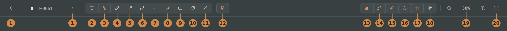

# Do zero ao primeiro tipo de letra

[English](tutorial.md) · [Português (Brasil)](tutorial.pt-BR.md) · **Português (Portugal)** · [Español](tutorial.es.md) · [Français](tutorial.fr.md) · [Deutsch](tutorial.de.md) · [Italiano](tutorial.it.md)

Neste tutorial parte de um projeto vazio e chega a uma pequena família pronta a instalar: **Regular**, **Bold** e **Italic**, mais dois estilos que o LionFoundry calcula sozinho entre o Regular e o Bold.

Não é um curso de desenho de letras. É o caminho dentro do programa: o que fazer, por que ordem e onde clicar. O desenho é seu.

> O LionFoundry é experimental: **guarde com frequência** (`Ctrl+S`) e mantenha cópias do seu projeto.

**Antes de começar:** prima `?` em qualquer altura para ver todos os atalhos. As vistas estão em `Ctrl+1` a `Ctrl+9`: Fonte, Glifo, Prova, Features, Família, Verificar, Scripts, Informações, Kerning.

As imagens mostram a interface em inglês; os nomes usados neste texto são os da interface em português (Portugal). Este texto foi adaptado do português do Brasil e ainda não foi revisto por um falante nativo.

## O caminho

| Parte | O que faz |
|---|---|
| [As ferramentas](#tools) | Conhecer a caneta, a seleção, a escala e o painel |
| [1. O projeto](#step-1) | Criar, guardar, definir as alturas |
| [2. As primeiras letras](#step-2) | Desenhar `n`, `o`, `H`, `O` |
| [3. O resto do alfabeto](#step-3) | Fazer as outras letras a partir das primeiras |
| [4. O espaçamento](#step-4) | Acertar as margens laterais lendo o texto |
| [5. Os acentos](#step-5) | Montar as letras acentuadas |
| [6. O kerning](#step-6) | Corrigir os pares que sobram |
| [7. O Bold](#step-7) | Acrescentar o segundo peso e os pesos intermédios |
| [8. O Italic](#step-8) | Acrescentar o itálico a partir do Regular |
| [9. Verificar](#step-9) | Ler a lista de problemas |
| [10. Exportar](#step-10) | Gerar todas as fontes de uma vez |

## Palavras que vai ver

| Palavra | O que é |
|---|---|
| **Glifo** | O desenho de um carácter. A letra `a` é um glifo; `á` é outro. |
| **Contorno** | A linha fechada que forma o desenho. O `o` tem dois: o de fora e o de dentro. |
| **Ponto e alça** | O ponto fica sobre a linha. As alças saem dele e dizem como a curva se dobra. |
| **Margens laterais** | O espaço em branco à esquerda e à direita de cada letra. |
| **Kerning** | Um ajuste de espaço só para um par de letras, como `AV`. |
| **Master** | Um estilo que desenha: Regular, Bold, Italic. |
| **Instância** | Um estilo que o programa calcula entre dois masters: Medium, SemiBold. |
| **Âncora** | Um ponto com nome que diz onde um acento assenta numa letra. |

## As ferramentas

Quase todo o desenho acontece na vista **Glifo** (`Ctrl+2`). Esta é a sua barra de ferramentas:

**Para desenhar**

| N.º | Ferramenta | Tecla | Para que serve |
|---|---|---|---|
| 2 | **Texto** | `T` | Escrever para pôr letras na linha. A letra depois do cursor é a que as teclas alteram (passo 4). `Esc` volta a desenhá-la. |
| 3 | **Selecionar** | `V` | Clique num ponto, arraste uma caixa para apanhar vários, arraste para mover. As setas movem 1 unidade; com `Shift`, 10. `Delete` remove. |
| 4 | **Caneta** | `P` | Desenhar. Clique: um ponto reto. Clicar e arrastar: um ponto de curva. Clique no primeiro ponto: a forma fecha-se. |
| 5 | **Escala** | `S` | Aumenta ou diminui o que está selecionado. Arraste; `Shift` mantém as proporções. |
| 6 | **Adicionar ponto** | `+` | Clique na linha e fica lá um ponto. A forma não muda. |
| 7 | **Remover ponto** | `−` | Clique num ponto e ele desaparece. A curva fica o mais parecida possível. |
| 8 | **Faca** | `E` | Arraste uma linha a atravessar as formas: ficam cortadas em partes fechadas. |
| 9 | **Retângulo** / **Elipse** | `F` | Arraste de um canto ao outro para desenhar um retângulo; `F` outra vez muda para a elipse. `Shift`: quadrado ou círculo. |
| 10 | **Rodar** | `R` | Rode o que está selecionado à volta do centro (clique para escolher outro ponto). `Shift`: de 15° em 15°. |
| 11 | **Régua** | `L` | Arraste uma linha: mostra o comprimento, o ângulo e a espessura de cada traço que atravessa. |
| 12 | **Aderir** | `M` | (o íman) Puxa o que arrasta para as linhas de altura e para as guias. `Alt` solta durante um movimento. |

**Para ver**

| N.º | Botão | O que mostra ou oculta |
|---|---|---|
| 1 | Setas | Glifo anterior e seguinte (também `[` e `]`) |
| 13 | Preenchimento | A letra preenchida, como vai aparecer num texto |
| 14 | Pontos | Os pontos e as alças |
| 15 | Métricas | As linhas de altura e a largura da letra |
| 16 | Âncoras | Os pontos onde assentam os acentos |
| 17 | Guias | As suas próprias linhas de apoio |
| 18 | Fundo | A cópia do desenho guardada atrás dele, para comparar ou decalcar |
| 19 | Zoom | Aproximar e afastar (também a roda do rato, ou `Ctrl` `+` e `Ctrl` `−`) |
| 20 | Ajustar | Mostra o glifo inteiro (`Ctrl+0`). `Espaço` + arrastar move a vista. |

Quando o projeto tem mais de um master aparece mais um botão, **Outros masters**: mostra o outro peso por trás daquele que está a desenhar.

**O painel à direita** tem o resto: a largura e as margens laterais (**Métricas**), o que está selecionado, **Transformar** (mover, escalar, rodar, inclinar e espelhar por números), os componentes, as âncoras e **Guias**.

**A caixa de escala.** Com dois ou mais pontos selecionados, aparece uma caixa à volta deles. Arraste um canto para aumentar ou diminuir a forma. `Shift` mantém as proporções; `Alt` escala a partir do centro.

**Enganou-se?** `Ctrl+Z` anula qualquer coisa.

## 1. O projeto

1. **`Ctrl+N`** (Novo projeto…). Escreva o nome da família e deixe **1000** unidades por eme. O projeto começa com glifos vazios para A–Z, a–z e os algarismos.
2. **`Ctrl+Shift+S`** (Guardar como…) e escolha onde guardar. O projeto é uma pasta `.ufo`.
3. Em **Informações** (`Ctrl+8`), verifique as alturas. Um bom começo para um tipo de texto:

| Linha | Valor |
|---|---|
| Ascendente | 740 |
| Altura de versal | 700 |
| Altura-x | 500 |
| Descendente | −220 |

Estas linhas aparecem em todos os glifos e seguram os seus pontos quando **Aderir** está ligado (tecla `M`).

## 2. As primeiras letras

Comece por quatro letras. Decidem quase tudo: `n` e `o` definem as minúsculas, `H` e `O` as maiúsculas.

Na vista **Fonte** (`Ctrl+1`), faça duplo clique em `n` para a abrir na vista **Glifo**.

Pegue na ferramenta **Caneta** (`P`) e desenhe a forma, ponto a ponto. Depois mude para **Selecionar** (`V`) e ajuste.

**Quatro hábitos que poupam trabalho mais tarde**

- **Pontos nos extremos.** Numa curva, ponha os pontos em cima, em baixo e nos lados — não a meio da diagonal.
- **Alças direitas.** Mantenha `Shift` premido enquanto arrasta uma alça, ou use `Shift+H` e `Shift+V`, para a deixar horizontal ou vertical.
- **As letras redondas passam a linha.** O `o` e o `O` descem cerca de 10 unidades abaixo da linha de base e sobem outro tanto acima da altura, senão parecem mais pequenos do que `n` e `H`.
- **Anote a espessura.** Meça a haste do `n` (por exemplo, 80 unidades) e use o mesmo valor nas outras letras.

No painel, em **Métricas**, escreva **Margem esquerda** e **Margem direita**. Por agora bastam valores aproximados: 60 para lados retos, 30 para lados redondos.

Precisa de mais uma linha? Em **Guias**, no painel, acrescente uma guia horizontal, vertical ou diagonal e arraste-a para o lugar.

**Construir com formas.** Algumas letras fazem-se mais depressa por peças: uma haste com o **Retângulo** (`F`), um bojo com a **Elipse** (`F` outra vez). Deixe-as sobreporem-se e prima **Remover sobreposição** (`Ctrl+Shift+O`): passam a ser um só contorno, e as curvas continuam curvas. A **Faca** (`E`) corta uma forma em duas; com contornos selecionados, **Unir**, **Subtrair** e **Interseção** combinam-nas. **Acrescentar extremos** põe os pontos nos extremos por si, e **Limpar contornos** (`Ctrl+Shift+T`) tira os pontos que sobram.

**Medir e comparar.** A **Régua** (`L`) mostra a espessura de cada traço que atravessa — uma forma rápida de manter as hastes iguais. Antes de uma mudança grande, **Copiar para o fundo** (painel) guarda o desenho antigo atrás do novo; **Trocar com o fundo** volta a trazê-lo para a frente. `Tab` passa de ponto em ponto, `Ctrl+Shift+A` põe os pontos selecionados numa linha, e `Alt` + arrastar faz um laço à volta dos pontos.

## 3. O resto do alfabeto

Não desenhe cada letra do nada. Copie e adapte.

1. No glifo de origem, sem nada selecionado, **`Ctrl+C`** copia o desenho inteiro.
2. Abra o glifo de destino (`[` e `]` vão para o anterior e para o seguinte) e prima **`Ctrl+V`**.
3. Altere o que for preciso.

| De | Obtém |
|---|---|
| `n` | `h`, `m`, `r` e o `u` (o `n` rodado: no painel, em Transformar, escreva 180 e clique em Girar) |
| `o` | `c`, `e`; com uma haste: `b`, `d`, `p`, `q` |
| `H` | `E`, `F`, `L`, `T`, `I` |
| `O` | `C`, `G`, `Q`, `D` |

Para aumentar ou diminuir uma parte, selecione os pontos dela e use a **caixa de escala**.

Depois de colar ou rodar, clique em **Corrigir direção** no painel: põe todos os contornos no sentido certo de uma só vez.

## 4. O espaçamento

O espaçamento acerta-se a ler, não a medir. Abra a vista **Prova** (`Ctrl+3`).

1. Escreva `nnnonnnoonoo` e depois `HHHOHHHOOHOO`. O botão **Espaçamento** tem textos já preparados.
2. **Clique numa letra** do texto: aparecem as suas margens laterais e a sua largura. Altere-as e veja o texto acompanhar.
3. Acerte primeiro o `n` e o `o`, até o ritmo ficar regular. Depois dê a cada letra as margens da forma com que se parece: lados retos como o `n`, lados redondos como o `o`.

**Espacejar onde se desenha.** O mesmo funciona na vista **Glifo**: escreva a palavra no campo **Texto**, prima `T` e ponha o cursor antes de uma letra. `Alt + ← →` alteram a margem esquerda dela, `Ctrl + ← →` a direita, `Ctrl+Alt + ← →` o kerning com a letra anterior; com `Shift`, de 10 em 10. `Esc` volta a desenhar essa letra.

## 5. Os acentos

As letras acentuadas montam-se, não se desenham.

1. **Faça os acentos.** Na vista Fonte, **Novo glifo**. Deixe o carácter vazio e escreva o nome: `acute`, `grave`, `circumflex`, `tilde` e `cedilla`. Desenhe cada um.
2. **Marque onde assentam.** Em cada letra que leva acento, no painel, **Adicionar âncora…** com o nome `top`, logo acima da letra. Em cada acento, uma âncora chamada `_top` por baixo dele. O programa junta o `_top` do acento ao `top` da letra. Para a cedilha, use `bottom` no `c` e `_bottom` na cedilha.
3. **Monte.** No menu de ações da vista Fonte, **Adicionar glifos de uma língua…** e escolha **Português** (ou outra língua). As letras acentuadas montam-se sozinhas. O que não puder ser montado é criado vazio, para desenhar.

Alterou o `a`? `á`, `ã` e `â` mudam com ele, porque usam o `a` como componente.

## 6. O kerning

O kerning é para os pares que o espaçamento não resolve: `AV`, `To`, `LT`, `r.`. Faça-o **depois** do espaçamento.

1. Na vista **Kerning** (`Ctrl+9`), crie **grupos** com **Novo grupo…**: as letras que se comportam da mesma forma de um lado partilham um grupo. Por exemplo, `O Q D` como primeiro glifo do par; `O C G Q` como segundo. Um par feito com o grupo serve para todas.
2. Na vista **Prova**, botão **Kerning**: clique na segunda letra de um par e altere o **kerning** dela com a letra anterior.

Poucos pares bem escolhidos valem mais do que centenas. Se houver muitos pares para corrigir, o problema está no espaçamento.

## 7. O Bold

Um **master** é um estilo que desenha. Até agora tem um: o Regular.

1. Vista **Família** (`Ctrl+5`) › **Novo master…**. Posição **700**, nome **Bold**.
2. O Bold começa como uma **cópia do Regular** e passa a ser o master em edição. Aparecem dois botões na barra lateral, Regular e Bold: é aí que muda de um para o outro.
3. Abra uma letra e ligue **Outros masters** na barra de ferramentas: o Regular aparece por trás.
4. Torne-a mais pesada. **Mova os pontos; não acrescente nem retire nenhum.** Selecione os pontos de um lado da haste e empurre-os com as setas; nas curvas, mova o ponto e as alças acompanham-no.

**Porquê os mesmos pontos?** Para calcular um peso intermédio, o programa liga cada ponto do Regular ao mesmo ponto do Bold. Se um dos lados tiver um ponto a mais, não consegue. O painel mostra, em **Compatibilidade entre masters**, se o glifo está certo. Se só a ordem estiver errada, **Corrigir compatibilidade** resolve sem alterar a forma.

Se faltarem pontos, **Acrescentar pontos em falta** dá a cada master os pontos que o outro tem, no mesmo lugar, sem alterar a forma. Para ver onde diferem, ative **Compatibilidade**: os pontos ganham números, uma linha tracejada vai até ao mesmo ponto no outro master, e um anel vermelho marca o que não tem par. **Todos os masters** mostra a letra em cada master por baixo da linha, e **Pré-visualização** a palavra em qualquer peso intermédio. Mantenha `Alt` premido ao adicionar ou remover um ponto para o fazer em todos os masters.

No Bold: as hastes de 80 passam a cerca de 140; os espaços interiores diminuem; as margens laterais diminuem um pouco. Verifique outra vez o espaçamento e o kerning na prova — cada master tem os seus.

**As instâncias.** Na vista Família, em **Entre os masters**, arraste o controlo até **500** e clique em **Adicionar esta posição como instância…** (Medium). Faça o mesmo em **600** (SemiBold). Não são desenhadas: são calculadas de novo em cada exportação e acompanham todas as alterações ao Regular e ao Bold.

## 8. O Italic

1. Na barra lateral, volte ao **Regular**.
2. Vista Família › **Novo itálico a partir deste master…**. Inclinação **10** graus, nome **Italic**.
3. O itálico começa como o Regular **inclinado** — um oblíquo, com os mesmos pontos. O trabalho a sério começa agora.

**O que redesenhar**

- **As curvas.** A inclinação deforma as letras redondas: o `o` fica com um lado pesado. Equilibre de novo os pontos e as alças.
- **As formas próprias do itálico.** O `a` de um só andar, um `e` mais redondo, um `f` que desce abaixo da linha de base, saídas curvas no `n`, `m`, `u`.
- **A largura.** Os itálicos costumam ser um pouco mais estreitos. Selecione tudo (`Ctrl+A`) e use a alça lateral da caixa de escala.
- **O espaçamento e o kerning**, outra vez na prova.

Redondos e itálicos são dois grupos: as instâncias são calculadas apenas dentro de cada um. Com um só itálico não há instâncias itálicas. Para um Bold Italic, repita o passo 2 a partir do Bold.

## 9. Verificar

Vista **Verificar** (`Ctrl+6`).

- **Guia do projeto**: o que está feito e o que falta.
- **As línguas**, logo abaixo do guia: quanto de cada uma a fonte já escreve. **Adicionar glifos…** ao lado de uma língua cria o que falta.
- **Problemas**: cada item leva ao glifo. Corrija os erros; leia os avisos. Os glifos que não podem ser interpolados aparecem aqui.

Verifique cada master: mude na barra lateral e veja a lista outra vez.

## 10. Exportar

1. **`Ctrl+E`** (ou o botão **Exportar** na barra lateral).
2. Em **O quê**, escolha **A família inteira**. Marque **Fonte TrueType (.ttf)** e **Fonte web (.woff2)**.
3. Escolha onde criar a pasta.

Fica com uma pasta nova com:

| Pasta ou ficheiro | Para quê |
|---|---|
| `ttf/` | Para instalar num computador: Regular, Italic, Medium, SemiBold, Bold |
| `woff2/` | Para usar em sites |
| `.css` | As regras `@font-face`, prontas |

Instale as fontes de `ttf/` e escreva um texto real noutro programa. Os botões de negrito e itálico devem encontrar o Bold e o Italic. Encontrou um defeito? Volte ao projeto, corrija e exporte de novo: cada exportação cria outra pasta e nunca escreve por cima de nada.

## E depois?

- **Algarismos e pontuação**: o mesmo caminho das letras.
- **Ligaduras**: crie um glifo chamado `f_i` e a ligadura funciona sozinha (vista **Features**).
- **Versaletes e alternativas**: os glifos chamados `a.sc` ou `a.ss01` tornam-se features pelo nome.
- **Bold Italic**: um itálico feito a partir do Bold.

**O que o LionFoundry ainda não faz por si:** não aplica hinting às fontes (ficam bem em impressão, na web e em ecrãs de alta densidade; pouco nítidas em tamanhos pequenos nos ecrãs antigos do Windows), não exporta fontes variáveis, não acrescenta os pontos que faltam entre dois masters e não guarda sozinho. A lista completa está no [README](../README.pt-PT.md#where-it-stands).
